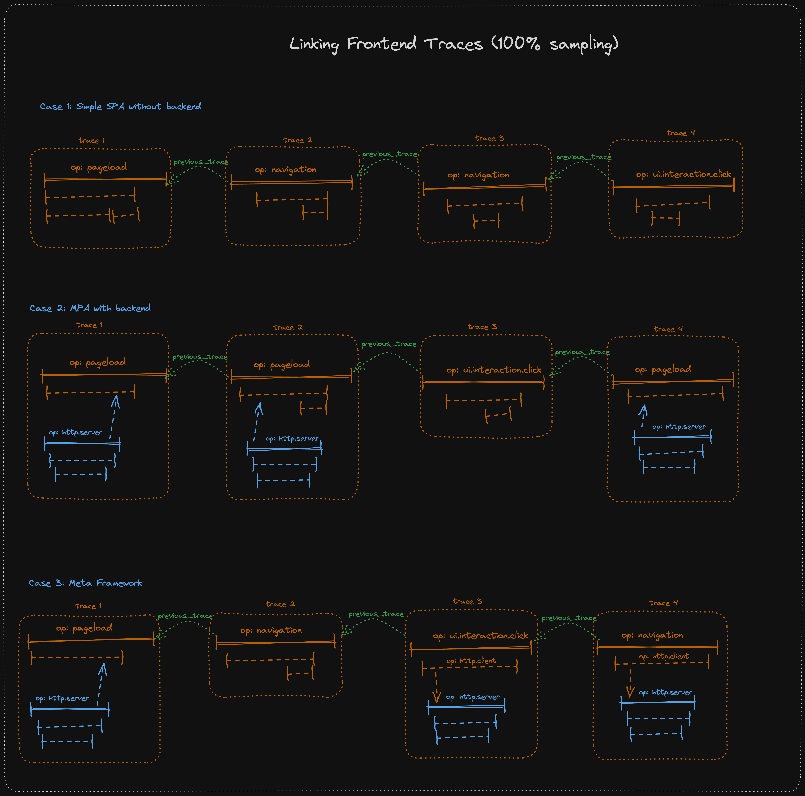
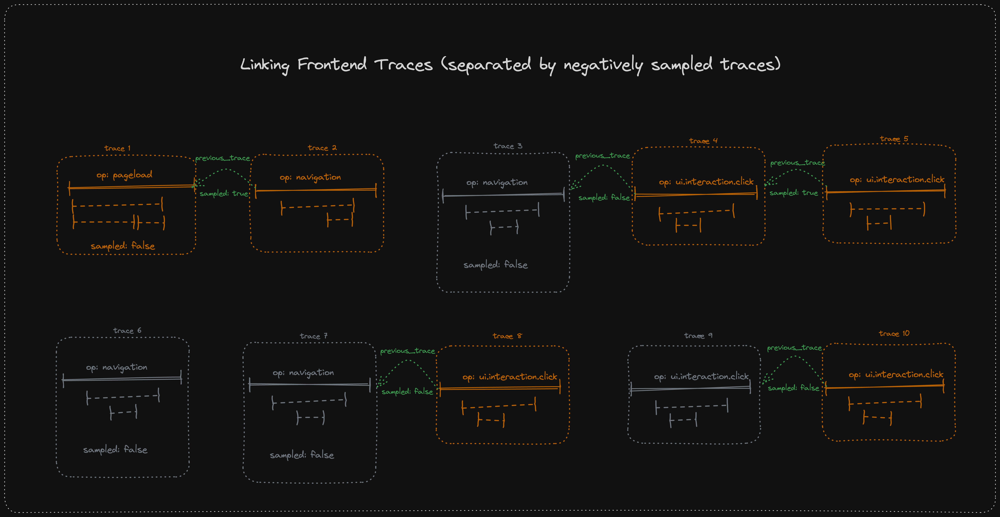

Span links associate one span with one or more other spans. The most important application of linking traces are frontend applications.
It can also be useful in settings with producer/consumer patterns or batch operations.
By using span links, we are able to display a user journey in our tracing views to make debugging of issues easier as developers get more context on what happened before a specific issue.

A span link can store the context of (a.k.a. link to) any other span. When necessary, a special link type can be added (see [Link Types](#link-types)).

Learn more about Span Links in [the RFC 141](https://github.com/getsentry/rfcs/blob/main/text/0141-linking-traces.md) or in the [OpenTelemetry docs](https://opentelemetry.io/docs/concepts/signals/traces/#span-links).

## SDK Implementation Guideline

- Links are added on a span level, as defined and specified by [OpenTelemetry](https://opentelemetry.io/docs/specs/otel/trace/api/#link).
- In addition to linking to span IDs, a span link also holds meta information about the link, collected via attributes.
- Span links MUST only link to other spans. We do not support linking a span to an error or other Sentry events.
- For SDKs still having public APIs around transactions, their respective Transaction interface and `startTransaction` function(s) should support the same APIs.

### Type Definitions

SDKs should follow the OpenTelemetry spec for the Link interface as defined by the platform.
Non-OTel SDKs should orient themselves on OTel, resulting in the interface below, or a related version that applies to the terminology and philosophy of the respective SDK:

```ts {tabTitle:Types}
// see https://github.com/open-telemetry/opentelemetry-js/blob/main/api/src/trace/link.ts
// or interface of respective platform
interface Link {
  // contains the SpanContext of the span to link to
  context: SpanContext;
  // key-value pair with primitive values
  attributes?: Attributes;
}


// see https://github.com/open-telemetry/opentelemetry-js/blob/main/api/src/trace/span_context.ts
// or interface of respective platform
interface SpanContext {
  traceId: string,
  spanId: string,
  traceFlags: number,
}

type Attributes = Record<string, AttributeValues>
type AttributeValues = string | boolean | number | Array<string> | Array<boolean> | Array<number>
```


### Required Span API

Ideally, the link is added when starting a span. An optional `links` attribute is added to the `startSpan` options.
SDKs that don't offer span-centric APIs but e.g. transaction APIs, should ensure that their respective `start...` APIs (e.g. `startTransaction`) also offer a possibility to add links.

```ts {tabTitle:Span Options}
function startSpan(options: StartSpanOptions);

interface StartSpanOptions: {
  //... other options (name, attributes, etc)
  links?: Link[];
}
```

Furthermore, the SDKs need to expose at least an `addLink` method on their respective Span interface. For completeness with OpenTelemetry, ideally they also expose `addLinks`:

```ts {tabTitle:Span API}
interface Span {
  // return value can differ depending on platform
  addLink(link: Link): this;
  addLinks(links: Link[]): this;
}
```

## Envelope Item Payload

Span trees are serialized to transaction event envelopes in all Sentry SDKs. Therefore, the envelope item needs to accommodate span links
in its payload. If the `links` entry is an empty array, it can be omitted from the envelope.

The serialized `links` objects should always contain:

- `span_id: string` - id of the span to link to
- `trace_id: string` - trace id of the span to link to
- `sampled: boolean` - required if sampling decision of the span to link to (corresponds to `traceFlags` in Otel span context converted to `boolean`) is available
- `attributes:` - required if attributes were added to the link

Optionally, the serialized link object can contain further fields from OTel like `traceState`, `isRemote` or `droppedAttributesCount` which will be just forwarded unless we find a use case for them.

The OTel fields `spanId`, `traceId`, and `traceFlags` should be excluded from the links objects in the envelope to avoid duplicate data (e.g. `trace_id` vs. `traceId`).

If the root span (previously known as transaction) has span links, the links are stored in the trace context.

```ts {tabTitle:Example Trace Context}
// event envelope item
{
  type: "transaction";
  transaction: string;
  contexts: {
    trace: {
      span_id: string;
      parent_span_id: string;
      trace_id: string;
      // new field for links:
      links?: Array<{
        "span_id": string,
        "trace_id": string,
        sampled?: boolean, // traceFlags from Otel converted to boolean
        attributes?: Record<string, AttributeValue>,
        // + potentially more fields 1:1 from Otel. e.g. (traceState, droppedAttributesCount, isRemote)
      }>
      // ...
    }
  }
  // ...
}
```

Links that are stored in child spans are serialized in `spans[i].links`.

```ts {tabTitle:Example Span Link Data}
// event envelope item
{
  type: "transaction";
  transaction: string;
  spans: Array<{
    span_id: string;
    parent_span_id: string;
    trace_id: string;
    // new field for links:
    links?: Array<{
      "span_id": string,
      "trace_id": string,
      sampled?: boolean,
      attributes?: Record<string, AttributeValue>,
    }>
    // ...
  }>
  // ...
}
```

## Link Types

Links don't require a special meaning or type but if necessary (e.g. for identifying special links in the product), set the `sentry.link.type` attribute on the link to define the link type.
Any string can be used, but these types have predefined meanings:

| `sentry.link.type` | Usage                                                                                                        | UI Implications                                                                                   |
|--------------------|--------------------------------------------------------------------------------------------------------------|---------------------------------------------------------------------------------------------------|
| "previous_trace"   | Linking e.g. a navigation span to the previous page load span.                                               | Used to query linked traces. Shows a button to go to linked previous trace in the trace explorer. |
| "cache_origin"     | Linking a span that uses a cached value (e.g. a cache read, or a page load of a reused page) to the span that produced that value. | Used to navigate from a cache-hit span to the origin trace. |
| "message_origin"   | Linking a span that processes a queue message to the span that published the message (e.g. a queue job).     | Used to navigate from a consumer span to the producer trace.                                      |
| "server_request"   | Linking a page load span to the server request that rendered its document, when the trace context arrived too late to continue it. | Used to navigate from a page load span to the trace of its server request. |

### `previous_trace`

Frontend traces can be linked by adding span links between root spans. For example, a navigation span includes a link to the previous page load span.

The span context inside the link object should be stored in a storage mechanism of choice (e.g. in-memory or `sessionStorage` in the browser).

Therefore, on root span start:
- Check if there is a previous span context stored. If yes, add the span link with the `'sentry.link.type': 'previous_trace'` attribute
- Store the root span context as the previous root span in a storage mechanism of choice (e.g. in-memory or `sessionStorage` in the browser)

SDKs are free to implement heuristics around how long a previous trace span context should be considered (max time) and store additional necessary data.



#### Negatively Sampled Traces

In many cases, with lower sample rates, we will not be able to provide a full trace link chain, due to some or many traces being negatively sampled.

- Sampled root spans should still include a link to the previous, negatively sampled root span (`traceFlags` on the spanContext() carry
  the information that the previous trace root span was negatively sampled).

This helps our product to hint that there would have been a previous trace, but it was negatively sampled.

We will not link to the previous positively sampled trace if a negatively sampled trace is in-between (see Traces 2-4 in the diagram below).
Furthermore, we will not show how many traces were negatively sampled in between two trace chains; only that there was at least one trace in between (see Trace 5-8).



### `cache_origin`

When a server responds with a cached value, the work that produced that value ran in an earlier trace, under a different request and a different sampling decision.
The serving trace cannot contain those spans as creates wrong parent/child trace relationships.
So without a link, the trace shows a cache read with no way to find the code that produced the value.

A `cache_origin` link connects the span that reads the cached value to the trace that produced it. "Origin" here means the producing trace (not "origin server" in CDN terms).

Add the link to the span that reads the cache (for example, a `cache.get` span):

```ts
span.addLink({
  context: originSpanContext, // stored at cache-fill time
  attributes: {
    'sentry.link.type': 'cache_origin'
  }
})
```

One trace can read multiple cache entries. Each cache-read span carries its own link.
In case the entire response is the cached unit (for example, a cached HTML page) the link belongs on the root span instead.

To attach the link on a cache hit, the SDK must record trace context at cache-fill time:

- On cache write, store the current span context (`trace_id`, `span_id`, sampling decision) keyed by the cache key. The storage mechanism is up to the SDK (e.g. an in-memory map, or metadata stored with the cache entry).
- On cache read, look up the stored context and add the link.
- Cache metadata (`cache.hit`, `cache.key`, item size) belongs in span attributes, not link attributes.
- If no context is found, emit the cache-read span **without** a link.

The origin trace may be negatively sampled. The link is still added, with `sampled: false` from the stored span context (same behavior as `previous_trace`).

A background revalidation (for example, stale-while-revalidate) starts its own trace rather than continuing the serving trace, and becomes the origin for future cache hits.

#### Page Loads of Reused Pages

A server can render a page, or a static part of it (a shell), once and reuse the HTML for later requests. Examples are an ISR page or the shell of a partially prerendered page.
The page load span of such a page uses HTML that an earlier render produced, so that render is the cache origin of the page load span.

- Send the origin with the reused HTML, in a different field than `sentry-trace`. For example, the Next.js SDK uses a `sentry-cache-origin` meta tag. The render belongs to the request that started it, so the page load span must never continue its trace.
- Add the link at span start, so that `tracesSampler` and `ignoreSpans` can see it.
- Set [`page.server_rendering.type`](https://conventions.sentry.dev/attributes/page/#page-server_rendering-type) on the page load span.
- If the server renders the other parts of the page for the current request (`partially_static`), the page load span continues the trace of that request as usual. The `cache_origin` link points only to the render of the reused part.

### `message_origin`

When a consumer processes a message, the work often runs long after the producer published it, in another process, and with a different sampling decision.
A parent/child relationship does not fit well: a delayed or retried job keeps the producer trace open for a long time, one publish span can fan out to many consumers, and a batch can contain messages from unrelated traces, so it has no single correct parent.
If the consumer starts its own trace, then without a link, the consumer trace has no way to find the code that published the message.

The [Queues module](/sdk/telemetry/traces/modules/queues/#distributed-tracing) continues the producer trace in the consumer where it can.
For the cases above, start a new trace in the consumer and add a `message_origin` link instead.
If the consumer continues the producer trace, do not add the link, because it would point into the same trace.

A `message_origin` link connects the span that processes a message (for example, a `queue.process` span) to the span that published it (for example, a `queue.publish` span). "Origin" here means the producer span, not the consumer.

Add the link to the span that processes the message:

```ts
span.addLink({
  context: producerSpanContext, // propagated with the message
  attributes: {
    'sentry.link.type': 'message_origin'
  }
})
```

- On publish, store the context of the publish span (for example, the `queue.publish` span: `trace_id`, `span_id`, sampling decision) with the message, for example in message metadata or headers.
- On process, read the stored context and add the link. A span that processes a batch adds one link for each distinct producer span in the batch.
- If the message has no stored context, emit the consumer span **without** a link.

The producer trace may be negatively sampled. The link is still added, with `sampled: false` from the stored span context (same behavior as `previous_trace`).

### `server_request`

A page load span continues the trace of the server request that rendered its document, if the SDK reads the trace context of that request (e.g. from a `sentry-trace` meta tag) before the span starts.
With streamed HTML, the context can arrive after that. For example, a prerendered shell is served first and the part of the document that the server renders for this request, which carries the context, streams in later.
A started span cannot move to another trace, so the page load span stays in its own trace.

A `server_request` link connects such a page load span to the server request that rendered its document:

```ts
pageloadSpan.addLink({
  context: serverRequestSpanContext, // parsed from the late `sentry-trace` value
  attributes: {
    'sentry.link.type': 'server_request'
  }
})
```

- Add the link only when the page load span could not continue the trace. A page load span that continues the trace of its server request needs no link.
- Add the link to the page load root span, and only while that span is still recording.
- Only use trace context that the server rendered for the current request. Trace context that a cached document carries belongs to the request that produced the cached document. Use `cache_origin` for that relationship.

The server request may be negatively sampled. The link is still added, with `sampled: false` from the trace context (same behavior as `previous_trace`).

#### `server_request` or `cache_origin`

Both types can link a page load span to a server span, but the linked spans have different roles:

- `server_request`: the linked span handled the request of this page load. It would be the parent of the page load span if its trace context had arrived in time.
- `cache_origin`: the linked span rendered HTML that the server reused from an earlier request. It is never the parent of the page load span.

A page load span can have both links. For example, the page reuses a prerendered shell (`cache_origin`), and the trace context of the part that the server renders for this request arrives late (`server_request`).

## Usage Example

Adding span links should be possible at span start time, as well as when holding a reference to the span.

In the example below, by adding span links, we can link from the last navigation trace all the way back to the initial pageload trace.
By passing the `'sentry.link.type': 'previous_trace'` attribute, we can identify the link as a previous trace link in Sentry and display the spans accordingly.

```ts {tabTitle:TypeScript}
// 1st trace starts
const pageloadSpan = startInactiveSpan(...)

// 2nd trace starts
const navigation1Span = startInactiveSpan({
  name: '/users',
  links: [{
    context: pageloadSpan.spanContext(),
    attributes: {
      'sentry.link.type': 'previous_trace'
    }
  }]
});

// 3rd trace starts
const navigation2Span = startSpan({name: '/users/:id'}, (span) => {
  span.addLink({
    context: navigation1Span.spanContext(),
    attributes: {
      'sentry.link.type': 'previous_trace'
    }
  })
})
```

## Ingest/Relay

Relay forwards the span links in the format that is required for further processing and storage.
Importantly, Relay doesn't require span links to be defined. They are completely optional.
Relay handles passing span links in the root span as well as in any child span (see [envelope item payload](#envelope-item-payload)).

The expected type and structure of the links array and its contents is [specified in Relay](https://github.com/getsentry/relay/blob/master/relay-event-schema/src/protocol/span.rs#L753).
