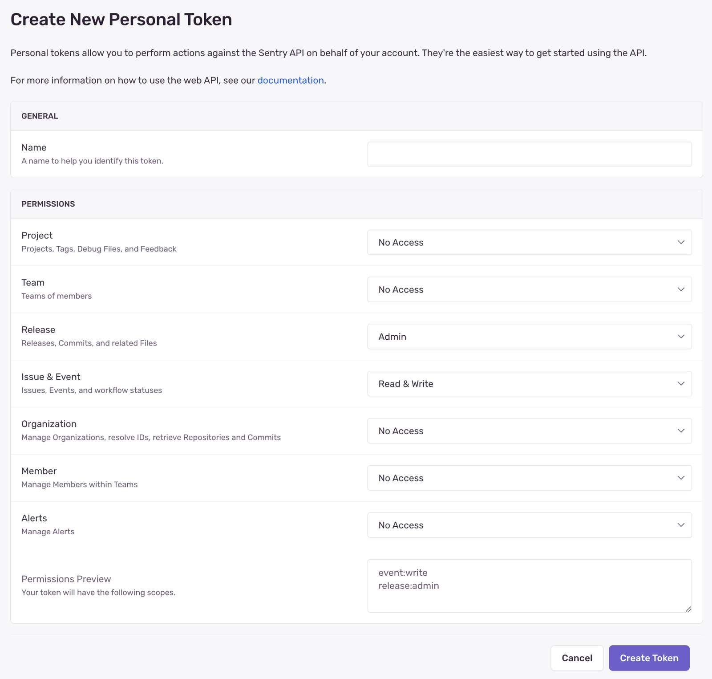

If you're building on top of Sentry's API (i.e using [Auth Tokens](/api/auth/)), you'll need certain scopes to access
different API endpoints.

To set the scopes for an [integration token](/integrations/integration-platform/#permissions), select the scopes from the dropdown. These can be edited later.

To set the scopes for an personal token, select the scopes from the dropdown when [creating a personal token](https://sentry.io/api/). These cannot be edited later.

If you're looking for information on membership roles please visit the
[membership](/organization/membership/) documentation.

### Organizations

|              |             |
| :----------: | :---------: |
|   **GET**    | `org:read`  |
| **PUT/POST** | `org:write` |
|  **DELETE**  | `org:admin` |

### Continuous Integration (CI)

|                  |          |
| :--------------: | :------: |
| **CI Workflows** | `org:ci` |

Use the `org:ci` scope for CI and deployment workflows, including uploading
source maps, creating releases, and managing code mappings.

### Projects

|              |                 |
| :----------: | :-------------: |
|   **GET**    | `project:read`  |
| **PUT/POST** | `project:write` |
|  **DELETE**  | `project:admin` |

<Alert level="warning" title="Note">

The `project:releases` scope will give you access to both **project**
and **organization** release endpoints. The available endpoints are listed in the
[Releases](/api/releases/) section of the API Documentation.

</Alert>

### Teams

|              |              |
| :----------: | :----------: |
|   **GET**    | `team:read`  |
| **PUT/POST** | `team:write` |
|  **DELETE**  | `team:admin` |

### Members

|              |                |
| :----------: | :------------: |
|   **GET**    | `member:read`  |
| **PUT/POST** | `member:write` |
|  **DELETE**  | `member:admin` |

### Issues & Events

|            |               |
| :--------: | :-----------: |
|  **GET**   | `event:read`  |
|  **PUT**   | `event:write` |
| **DELETE** | `event:admin` |

<Alert level="warning" title="Note">

**PUT/DELETE** methods only apply to updating/deleting issues.
Events in Sentry are immutable and can only be deleted by deleting the whole issue.

</Alert>

### Releases

|                         |                    |
| :---------------------: | :----------------: |
| **GET/PUT/POST/DELETE** | `project:releases` |

<Alert level="warning" title="Note">

Be aware that if you're using `sentry-cli` to [manage your releases](/cli/releases/), you'll need a token which also has `org:read` scope.

</Alert>

<Alert level="info" title="Project Access">

A [personal token](/account/auth-tokens/#personal-tokens) (user auth token) with the `project:releases` scope can create releases and upload artifact bundles for **any** project in the organization, even if [Open Membership](/organization/membership/#open-membership) is disabled and the user isn't a member of the project's team. This lets tools like `sentry-cli` upload to multiple projects with a single token.

Changes to existing releases (updates, deletes, legacy release file uploads, and deploys) still require that the user has access to **all** projects associated with the release. If your organization has Open Membership disabled, members can only modify existing releases for projects belonging to teams they're a member of.

</Alert>
