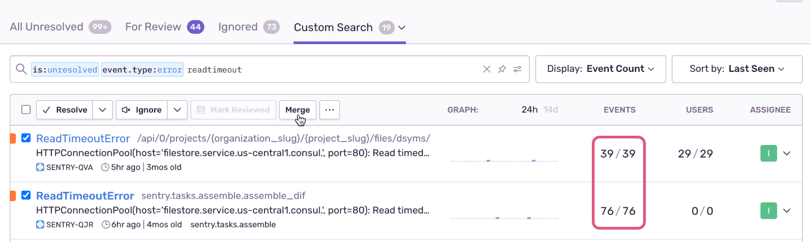
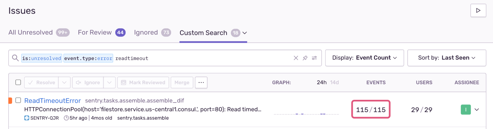
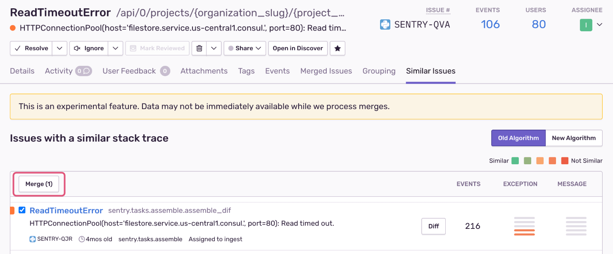

<Include name="only-error-issues-note.mdx" />
<Include name="merge-escalating-note.mdx" />

If you have similar-looking issues that have not been grouped together automatically and you want to reduce noise, you can do so by merging them.

In this example, before merge, there are two issues that are very similar, but have not been grouped together. One issue has 39 events in the past 24 hours, and the other has 76:

After the two issues are merged into one, the event count of 115 on that one issue reflects that they've been grouped together:

You can also do this from inside a single issue. On the **Issue Details** page, click **View** next to **Similar Issues** in the sidebar, select the issues you want to merge, and click **Merge**:

To unmerge issues, click **View** next to **Merged Issues** in the **Issue Details** sidebar. You'll see the fingerprints that have been merged into that issue. Select the ones to split out and click **Unmerge**.

It's important to note that we don't infer any new grouping rules from how you merge issues. Future events will be added to the merged set of issues by the same criteria as they would've been added to the individual issues that are now in the merged set.

If Sentry creates more issues than you can merge, or too few issues, you can try updating your [Fingerprinting Rules](/concepts/data-management/event-grouping/fingerprint-rules/) or [Stack Trace Rules](/concepts/data-management/event-grouping/stack-trace-rules/).
