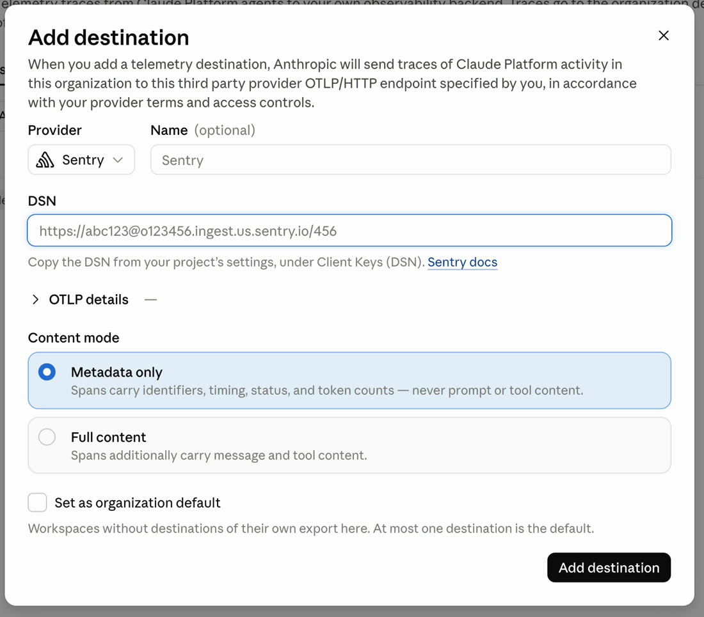
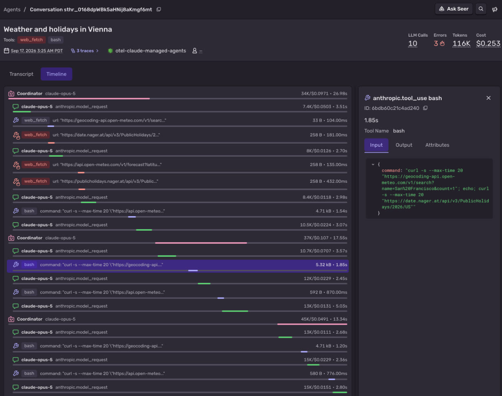

<Include name="feature-available-open-beta-tracing.mdx" />

The Claude Platform exports OpenTelemetry traces for Claude Managed Agents sessions and Messages API requests. Add Sentry as a destination in the Claude Console, and each agent turn, model request, and tool call shows up in [Agents](/product/agents/) in the same Sentry project as your errors and backend spans. You don't need to install a Sentry SDK or change any code.

OpenTelemetry export on the Claude Platform is in public beta, so span names and attributes can change. It covers the first-party Claude Platform only. Amazon Bedrock and Google Cloud Vertex AI aren't supported.

## Prerequisites

- A Sentry project for your agent
- The admin role in a [Claude Console](https://platform.claude.com/) organization

## Copy Your Sentry DSN

Go to [Project settings > Client Keys (DSN)](https://sentry.io/orgredirect/organizations/:orgslug/settings/projects/:projectId/keys/) for the project you want to send traces to, and copy the **DSN**. The Claude Console uses it to find your project's OTLP endpoint and authentication key.

## Add Sentry as a Destination

In the Claude Console, open the [OpenTelemetry settings page](https://platform.claude.com/settings/telemetry-destinations) for your organization and click **Add destination**. One destination covers both Claude Managed Agents sessions and Messages API requests.

- **Provider**: Select **Sentry**.
- **DSN**: Paste the DSN that you copied.
- **Content mode**: Select **Full content** to see prompts, responses, and tool input and output in Sentry. Select **Metadata only** to send only timing, status, and token counts.
- **Set as organization default**: Select this for your first destination.

To send a workspace's traces to a different Sentry project, add a destination to that workspace. A workspace destination replaces the organization default for that workspace.

See the [Claude Console docs](https://platform.claude.com/docs/en/manage-claude/opentelemetry#add-a-destination) for all destination options.

## Verify Your Setup

Send a Messages API request with an API key from a workspace that uses the destination, or run a Claude Managed Agents session. After the first traces are sent, the **Delivery** column on the Claude Console OpenTelemetry settings page changes to **Healthy**.

Then open [**Explore > Agents**](https://sentry.io/orgredirect/organizations/:orgslug/explore/agents/) in Sentry. Your session or request shows up on the **Conversations**, **Traces**, and **LLM Calls** tabs. Select a conversation and open the **Timeline** tab to see each turn, model request, and tool call with its duration and token usage.

The Claude Platform puts the conversation on agent spans, and tool input and output on tool spans. To read prompts and tool results, select a tool span or open the **Transcript** tab. Model request spans don't include prompts.

## Data and Privacy

Prompts and responses are only sent to Sentry if you select **Full content** for the destination. Sentry stores what it receives under your project's retention and [data scrubbing](/security-legal-pii/scrubbing/) settings. Spans are billed the same way as other Sentry tracing data.

## Trace Your Own Code

The Claude Platform export covers the requests that Claude handles. To also see your application code and the tools it runs for Claude in the same trace, instrument your app with the Claude SDK or a Sentry SDK:

- [Trace the Claude TypeScript SDK with OpenTelemetry](https://sentry.io/cookbook/trace-claude-typescript-sdk-with-opentelemetry/)
- [Trace the Claude Python SDK with OpenTelemetry](https://sentry.io/cookbook/trace-claude-python-sdk-with-opentelemetry/)
- [Sentry Anthropic integration for JavaScript](/platforms/javascript/guides/node/configuration/integrations/anthropic/)
- [Sentry Anthropic integration for Python](/platforms/python/agent-tracing/anthropic/)
