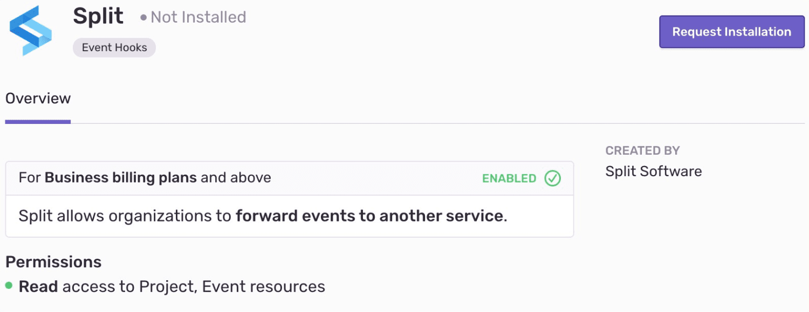

<Alert level="warning">

If you make changes to your organization slug, you'll need to update your configuration for this integration. Learn more in our [troubleshooting guide](/integrations/troubleshooting/).

</Alert>

The Split integration quickly processes and displays Sentry exception data in the Split platform as track events for analysis. You can control what environments and traffic types you're capturing exceptions for in the Split dashboard without having to touch any code.

<Alert title="Created by Split Software">

Built and supported by Split Software. For help installing or using this integration, contact Split Software directly.

- **Support:** [support@split.io](mailto:support@split.io)
- **Documentation:** [Split Sentry integration docs](https://help.split.io/hc/en-us/articles/360029879431)
- **In Sentry:** [Settings > Integrations > Split](https://sentry.io/orgredirect/organizations/:orgslug/settings/sentry-apps/split/)

</Alert>

## Install and Configure

<Alert>

Sentry owner, manager, or admin permissions are required to install this integration. The Split integration is available only for organizations on the Business and Enterprise plans.

Split **won't** work with self-hosted Sentry.

</Alert>

1. Navigate to [**Settings > Integrations**](https://sentry.io/orgredirect/organizations/:orgslug/settings/integrations/) > **Split**

2. Then, follow the full [Split installation instructions](https://help.split.io/hc/en-us/articles/360029879431).
