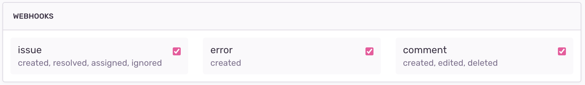

<Alert>

We've built an [example application](https://github.com/getsentry/integration-platform-example) to help you get started with building on Sentry's integration platform. Check it out for useful code snippets for adding these features in Python and TypeScript. See the [docs](/integrations/integration-platform/#example-app) for more information.

</Alert>

Webhooks are a way for two applications or services to communicate over the web, allowing one application to send automatic notifications or data updates to another in near real-time.

The concept is based on HTTP callbacks, where an HTTP POST request is sent to a specific URL (an HTTP endpoint in your tech stack) with a payload. Sentry uses JSON webhooks to get error notifications to your systems or services.



## Headers

Sentry webhooks support various functionalities and are made up of four integral HTTP headers described below:

```json
{
  "Content-Type": "application/json",
  "Request-ID": "<request_uuid>",
  "Sentry-Hook-Resource": "<resource>",
  "Sentry-Hook-Timestamp": "<timestamp>",
  "Sentry-Hook-Signature": "<generated_signature>"
}
```

The `Content-Type` header identifies the media type of the payload as JSON format. The `Request-ID` header provides a unique identifier for tracking and debugging specific events.

### `Sentry-Hook-Resource`

This header lets you know which resource from the list below triggered an action:

- `installation`
- `event_alert`
- `issue`
- `metric_alert`
- `error`
- `comment`
- `seer`
- `preprod_artifact`

### `Sentry-Hook-Signature`

This header represents a cryptographic hash generated by your _Client Secret_. Its primary purpose is to make sure the request is authentic and comes from Sentry servers.

**Verifying the Signature**

Sentry computes the signature as an HMAC-SHA256 hex digest of the exact request body bytes, using your _Client Secret_ as the key. Compute the digest over the raw body as received. Don't parse the JSON and serialize it again, because the result won't always match the bytes Sentry signed.

```javascript
const crypto = require("crypto");

// rawBody must be the unparsed request body, for example from
// express.raw({ type: "application/json" })
function verifySignature(rawBody, signature, secret) {
  if (!signature) {
    return false;
  }
  const digest = Buffer.from(
    crypto.createHmac("sha256", secret).update(rawBody).digest("hex")
  );
  const expected = Buffer.from(signature);
  return (
    digest.length === expected.length &&
    crypto.timingSafeEqual(digest, expected)
  );
}

verifySignature(request.body, request.headers["sentry-hook-signature"], secret);
```

```python
import hashlib
import hmac


def verify_signature(raw_body: bytes, signature: str | None, client_secret: str) -> bool:
    if not signature:  # The signature is missing
        return False
    digest = hmac.new(
        key=client_secret.encode("utf-8"),
        msg=raw_body,
        digestmod=hashlib.sha256,
    ).hexdigest()
    return hmac.compare_digest(digest, signature)


# For example, in Flask:
if not verify_signature(request.get_data(), request.headers.get("sentry-hook-signature"), client_secret):
    raise UnauthorizedError
```

Requests from [UI components](/integrations/integration-platform/ui-components/#verifying-requests) are signed the same way, but use the `Sentry-App-Signature` header instead.

## Request Structure

All webhook requests have some common elements.

`action`

The action that corresponds with the [resource](#sentry-hook-resource) in the header. For example, if the resource is `issue` the action could be `created`.

`installation`

An object with the `uuid` of the installation so that you can map the webhook request to the appropriate installation.

`data`

The data object contains information about the [resource](#sentry-hook-resource) and will differ in content depending on the type of webhook. This payload may be able to be customized via [UI components](/integrations/integration-platform/ui-components/).

`actor`

The actor is who, if anyone, triggered the webhook. If a user in Sentry triggered the action, the actor is the user. If the Sentry integration itself triggers the action, the actor is the integration. If the action is triggered automatically within Sentry, the actor is "Sentry".

```python
# Sample cases:

# User installs Sentry integration
"actor": {
    "type": "user",
    "id": <user-id>,
    "name": <user-name>,
}

# Sentry integration makes request to assign an issue
"actor": {
    "type": "application",
    "id": <sentry-app-uuid>,
    "name": <sentry-app-name>,
}

# Sentry (sentry.io) auto resolves an issue
"actor": {
    "type": "application",
    "id": "sentry",
    "name": "Sentry",
}
```

## Response

Webhooks should respond within 1 second. Otherwise, the response is considered a timeout.

## Event Types

- [Installation](/integrations/integration-platform/webhooks/installation/)

- [Issue Alerts](/integrations/integration-platform/webhooks/issue-alerts/)

- [Metric Alerts](/integrations/integration-platform/webhooks/metric-alerts/)

- [Issues](/integrations/integration-platform/webhooks/issues/)

- [Comments](/integrations/integration-platform/webhooks/comments/)

- [Errors](/integrations/integration-platform/webhooks/errors/)

- [Seer](/integrations/integration-platform/webhooks/seer/)

- [Preprod Artifacts](/integrations/integration-platform/webhooks/preprod-artifacts/)

## Developing and Testing Webhooks

If you’d like to test webhook configuration and look at payloads before starting development, an HTTP catch-all service that provides a designated URL where you can receive HTTP payloads and inspect the JSON event payload can come in handy. After you’ve reviewed the relevant event payloads, you can begin development.

To make testing and debugging webhooks faster and easier, you can create local tunnels to get incoming webhook requests from Sentry to your local machine. There are various tools that let you pick a port or address (such as 3000 or 8080) to be tunneled, and then provide you with a temporary public URL that forwards requests to your local server.
