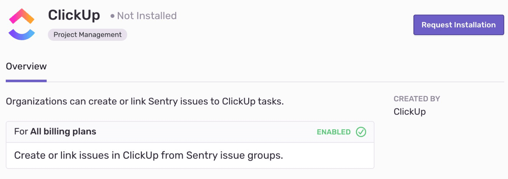

ClickUp’s core focus is about removing frustrations, inefficiencies, and disconnect caused by current project management solutions. You can create an issue in ClickUp from a Sentry issue or link it to an existing issue.

<Alert title="Created by ClickUp">

Built and supported by ClickUp, not Sentry. For help installing or using this integration, contact ClickUp directly.

- **Support:** [Help center](https://help.clickup.com), [Submit a request](https://help.clickup.com/hc/en-us/requests/new)
- **Documentation:** [ClickUp Sentry integration docs](https://docs.clickup.com/en/articles/3420285-sentry-io)
- **In Sentry:** [Settings > Integrations > ClickUp](https://sentry.io/orgredirect/organizations/:orgslug/settings/sentry-apps/clickup/)

</Alert>

## Install and Configure

<Alert>

Sentry owner, manager, or admin permissions are required to install this integration.

ClickUp **won't** work with self-hosted Sentry.

</Alert>

1. Navigate to [**Settings > Integrations**](https://sentry.io/orgredirect/organizations/:orgslug/settings/integrations/) > **ClickUp**

   

2. Follow the full [ClickUp installation instructions](https://docs.clickup.com/en/articles/3420285-sentry-io).
