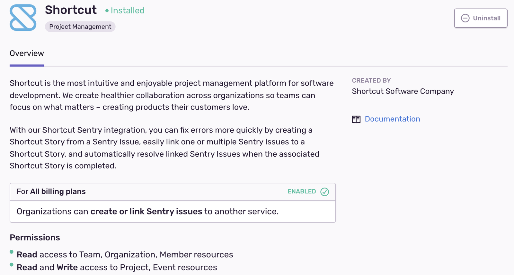

Errors, features, and anything else you track in Shortcut can now live side by side. The new Shortcut integration has feature parity with the Shortcut plugin. If you're choosing between the two, we recommend installing the Shortcut integration.

This integration is maintained and supported by Shortcut, not Sentry. For questions or support, contact Shortcut at [support@shortcut.com](mailto:support@shortcut.com).

## Install and Configure

<Alert>

Sentry owner, manager, or admin permissions are required to install this integration.

Shortcut **won't** work with self-hosted Sentry.

</Alert>

1. Navigate to [**Settings > Integrations**](https://sentry.io/orgredirect/organizations/:orgslug/settings/integrations/) > **Shortcut**

2. Follow the full [Shortcut installation instructions](https://help.shortcut.com/hc/en-us/articles/360026979272-Setting-up-the-Sentry-Integration).
