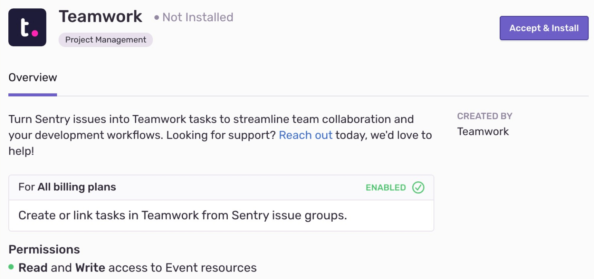

Teamwork needs to set up only once per organization, then it is available for _all_ projects.

<Alert title="Created by Teamwork">

Built and supported by Teamwork, not Sentry. For help installing or using this integration, contact Teamwork directly.

- **Support:** [support@teamwork.com](mailto:support@teamwork.com)
- **Documentation:** [Teamwork Sentry integration docs](https://support.teamwork.com/projects/sentry)
- **In Sentry:** [Settings > Integrations > Teamwork](https://sentry.io/orgredirect/organizations/:orgslug/settings/sentry-apps/teamwork/)

</Alert>

## Install and Configure

<Alert>

Sentry owner, manager, or admin permissions are required to install this integration.

Teamwork **won't** work with self-hosted Sentry.

</Alert>

1. Navigate to [**Settings > Integrations**](https://sentry.io/orgredirect/organizations/:orgslug/settings/integrations/) > **Teamwork**

   

2. Follow the full [Teamwork installation instructions](https://support.teamwork.com/projects/sentry).
