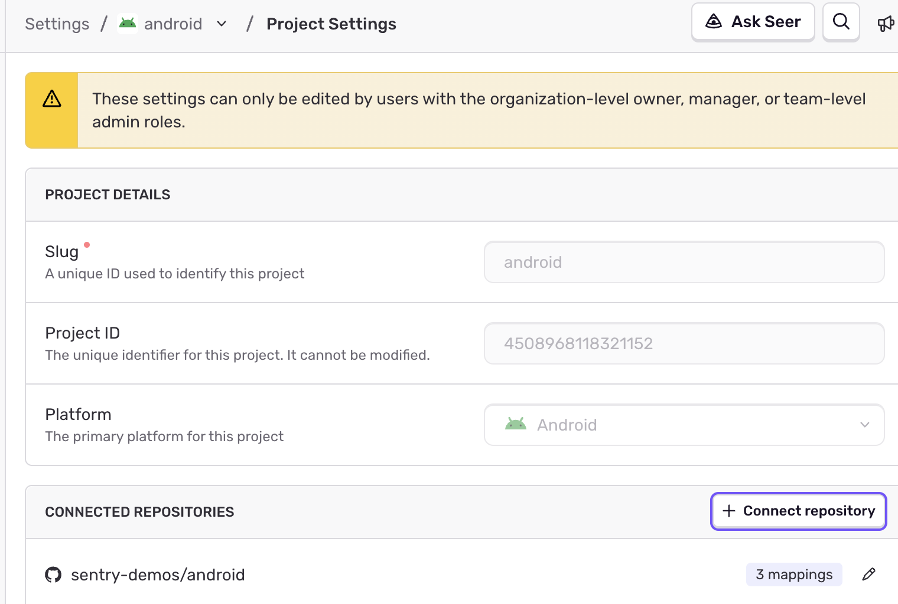
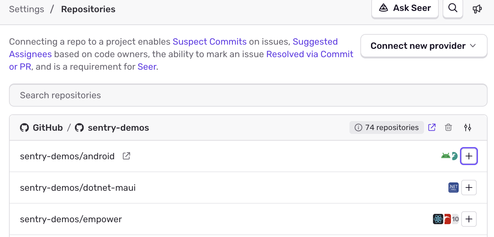
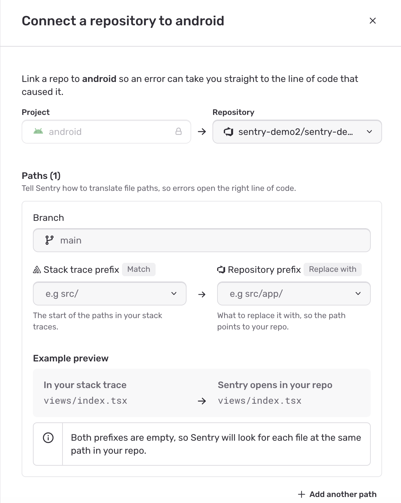
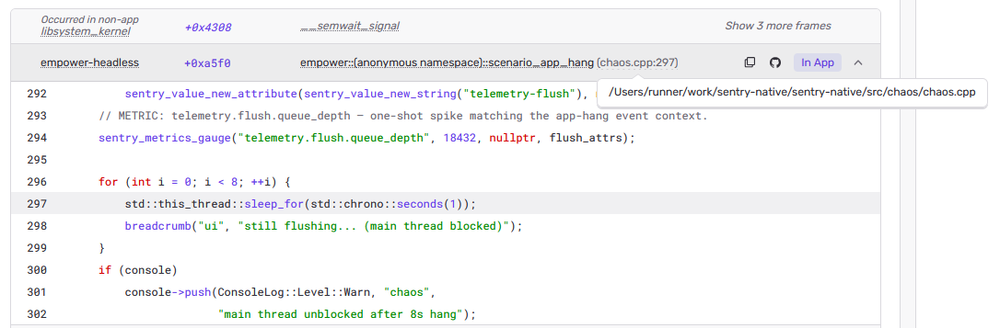

Code mappings enable Sentry to turn a file path from a stack frame into a path in one of your repos.

Code mappings power the following features:

- **Stack trace linking**: Open the file from a stack frame in your source code provider. See the integration docs for [GitHub](/integrations/source-code-mgmt/github/#stack-trace-linking), [GitLab](/integrations/source-code-mgmt/gitlab/#stack-trace-linking), [Bitbucket](/integrations/source-code-mgmt/bitbucket/#stack-trace-linking), [Azure DevOps](/integrations/source-code-mgmt/azure-devops/#stack-trace-linking), [Perforce](/integrations/source-code-mgmt/perforce/#stack-trace-linking), and [Cursor Origin](/integrations/source-code-mgmt/cursor-origin/#stack-trace-linking) for provider-specific instructions.
- **[Suspect commits](/product/issues/suspect-commits/)**: Find the most recent code change in a stack trace.
- **[SCM source context](/integrations/source-code-mgmt/source-context/)**: Fetch the lines around a frame from your repo when the event doesn't include them.
- **[Code Owners](/product/issues/ownership-rules/#code-owners)**: Import a CODEOWNERS file and sync it to stack trace paths.

To get started with code mappings, install a [source code management integration](/integrations/source-code-mgmt/) and add the repo you want to map. This page covers path configuration only; installation, commit tracking, and resolving issues via commit are discussed in detail on each integration's page.

## Where to Configure Code Mappings

A code mapping connects a Sentry project to a single repo, with one or more paths. You can create a connection from either the project or the repo; both open the same modal.

- **From a project**: Go to your project's [**General Settings**](https://sentry.io/orgredirect/organizations/:orgslug/settings/projects/:projectId/), find **Connected Repositories**, and click on **Connect repository**. The project will already be selected.

  

- **From a repo**: Go to [**Settings > Repositories**](https://sentry.io/orgredirect/organizations/:orgslug/settings/repos/) and click **+** on the repo's row. The repo will already be selected. To change an existing connection, click the project's chip on the repo's row.

  

To map more than one path between the same project and repo, click on **Add another path**. When you save, Sentry will apply every path in the connection at once.

If a project uses code from more than one repo, create a separate connection for each one.

## Path Fields

Each path in a connection has three fields:

- **Branch**: The branch Sentry uses when the event isn't associated with a release commit. If you've set up [commit tracking](/product/releases/associate-commits/), Sentry will use the release's commit instead.
- **Stack trace prefix**: The beginning of the file path as it appears in your stack trace. Previously this field was named **Stack Trace Root**.
- **Repository prefix**: The path that replaces the stack trace prefix when Sentry looks up the file in your repo. Previously this field was named **Source Code Root**.

As you fill in the prefixes, **Example preview** shows how a sample path from your stack trace will be rewritten to point at your repo.

An empty **Stack trace prefix** will match every file in the stack trace. If a project has more than one path, set a specific prefix for each so that Sentry knows which path applies to which files.

## Find Your Prefixes

<Alert>

These steps only apply to platforms that use file paths in stack traces. Platforms that use package names require extra steps. See [Platform-Specific Paths](#platform-specific-paths).

</Alert>

Open a stack trace you want to map, then find an **In App** frame. In App frames have a label on the right side of the frame. The filename is the first text on the left side of the frame header. For this example, the filename is `src/main.py`.

<Include name="common-imgs/code-mappings-stacktrace" />

Stack traces from some native platforms may look different. Hover over the filename to see the absolute path.

If you're unsure of which path to use, click `{}` in the event header to open the event JSON and find the frame's `filename` or `abs_path`.

<Include name="common-imgs/code-mappings-event-json" />

Next, find the same file in your repo. In this example, the path is `flask/src/main.py`. Leave out the repo name (`empower`).

<Include name="common-imgs/code-mappings-source-file" />

Compare the two paths. Here, `src/` in the stack trace matches `flask/src/` in the repo, so set:

- **Stack trace prefix**: `src/`
- **Repository prefix**: `flask/src/`

Sentry then replaces `src/` with `flask/src/` at the start of every matching stack trace path when it looks up the file.

## How to Edit a Code Mapping

To edit a connection, you can access it from either entry point. The modal opens with the project and repo locked and the existing paths all filled in. From here, you can change paths, add paths, and save your changes.

If a path is used by a [Code Owners](/product/issues/ownership-rules/#code-owners) import, you can't change its prefixes until you remove that Code Owners import.

## Automatic Code Mappings

If your organization has the [GitHub integration](/integrations/source-code-mgmt/github/) installed, Sentry tries to create code mappings automatically for JavaScript, Python, Java, PHP, Ruby, Go, C#, and Kotlin projects. You can still add or edit mappings yourself.

## Bulk Upload

To create several code mappings in one go, upload them with the [Sentry CLI](/cli/code-mappings/). The CLI's JSON format uses `stackRoot` for the stack trace prefix and `sourceRoot` for the repository prefix.

## Platform-Specific Paths

Some platforms don't put repository-style file paths in their stack traces:

- **Java**: Stack traces use package names. See [Java Source Context](/platforms/java/source-context/#setting-up-code-mappings) to work out the prefixes.
- **Godot**: Stack traces use `res://` paths. See [Godot Source Context](/platforms/godot/configuration/source-context/).
