The GitLab integration connects your repositories to Sentry to bring [commit tracking](#commit-tracking), [suspect commits](#suspect-commits), [stack trace linking](#stack-trace-linking), and [issue management](#issue-management) into the contexts that help Sentry debug issues and power [Seer AI features](#seer) like Autofix and Code Review. It also supports [resolving issues via commit or merge request (MR)](#resolve-via-commit-or-pull-request) and [Code Owners](#code-owners) for automatic issue routing.

## Install

Sentry owner, manager, or admin permissions and GitLab owner or maintainer permissions are required to install this integration.

<Alert title="Note">
  

  We recommend creating a dedicated service account on GitLab when installing this integration rather than using a personal user account. The service account should have owner or maintainer permissions in GitLab. Note: this is a regular GitLab user account dedicated to the integration — do not confuse it with [GitLab's Service Account](https://docs.gitlab.com/user/profile/service_accounts/) feature, which cannot be used with this integration.
  

  

  Since the integration uses personal access tokens for authentication, activities such as comments and work item creation will be attributed to the GitLab user who created the tokens.
  

  

  Using a service account helps maintain proper access control, prevents disruption when team members leave, and ensures consistent attribution for all features across your organization.
  

  

  After creating the GitLab service account, you will need to sign into Sentry with an user account that has owner, manager, or admin permissions to install the integration.
  

</Alert>

1. Navigate to [**Settings > Integrations**](https://sentry.io/orgredirect/organizations/:orgslug/settings/integrations/) > **GitLab**.

   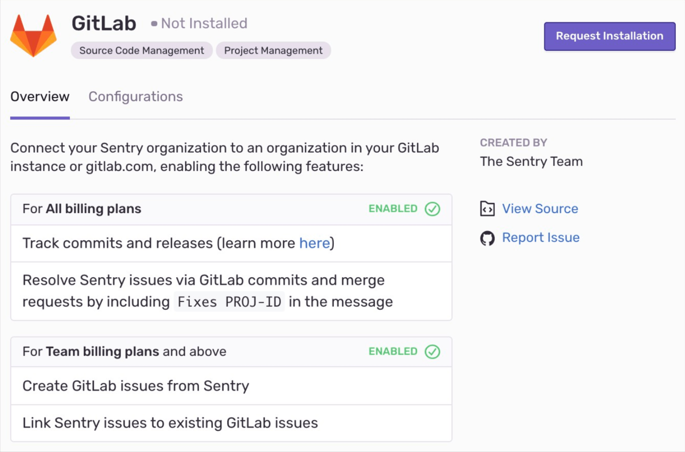

1. In the resulting modal, click "Add Installation".

   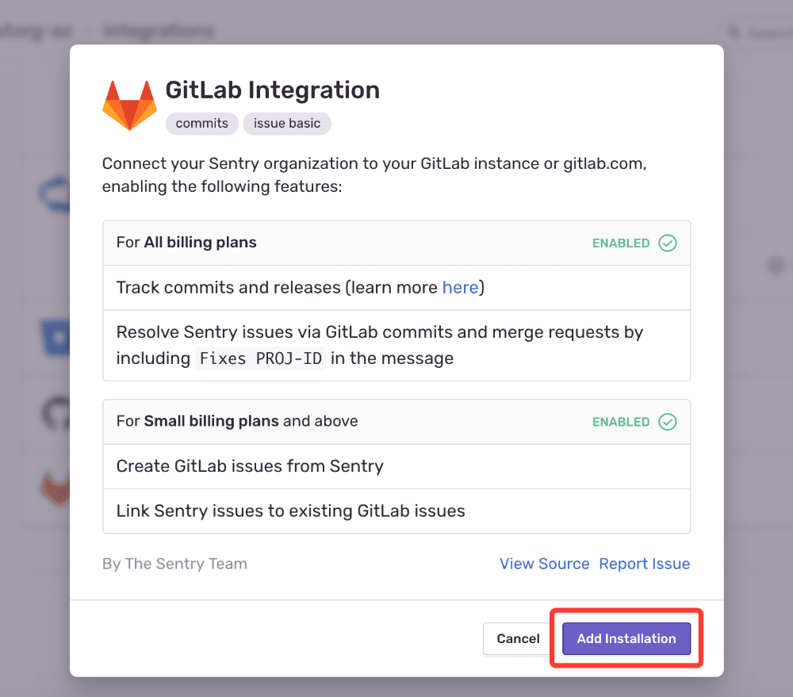

1. In the pop-up window, complete the instructions to create a Sentry app within GitLab. Once you’re finished, click "Next".

   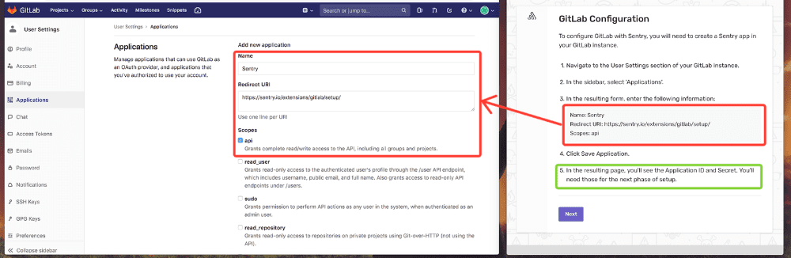

1. Fill out the resulting GitLab Configuration form with the following information:

   1. The GitLab URL is the base URL for your GitLab instance. If using gitlab.com, enter https://gitlab.com/.

   2. Find the GitLab Group Path in your group’s GitLab page. Groups might contain subgroups and projects. You should not specify the URL to any specific project, just to a group or subgroup.

      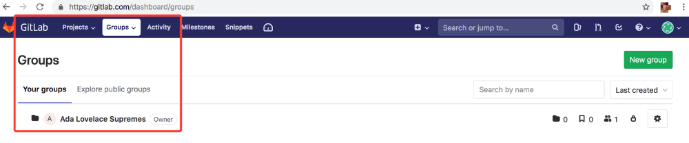

   3. Find the GitLab Application ID and Secret in the Sentry app within GitLab.

      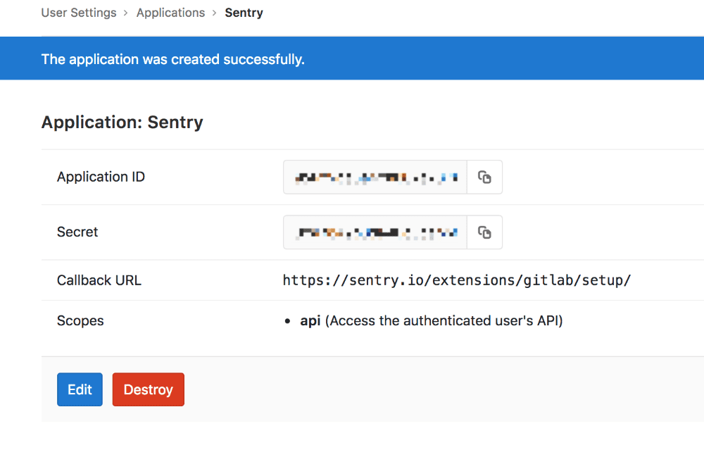

   4. Use this information to fill out the GitLab Configuration and click "Submit".

      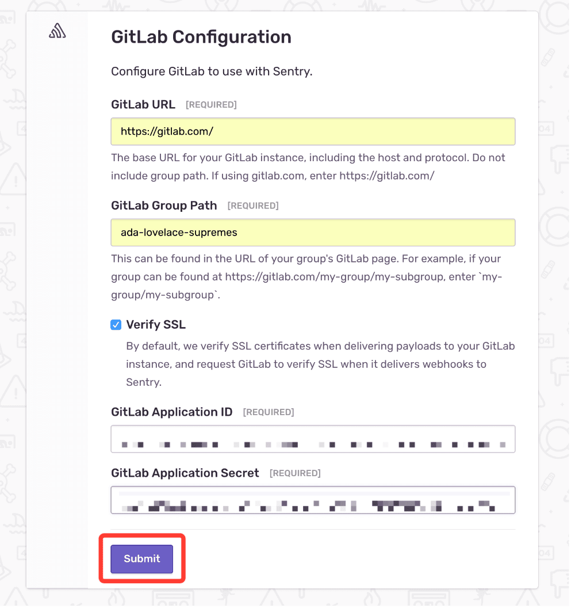

1. In the resulting panel, click "Authorize".

1. In Sentry, return to [Organization Settings > **Integrations**](https://sentry.io/orgredirect/organizations/:orgslug/settings/integrations/). You’ll see a new instance of GitLab underneath the list of integrations.

1. Next to your GitLab Instance, click "Configure". _It’s important to configure to receive the full benefits of commit tracking._

   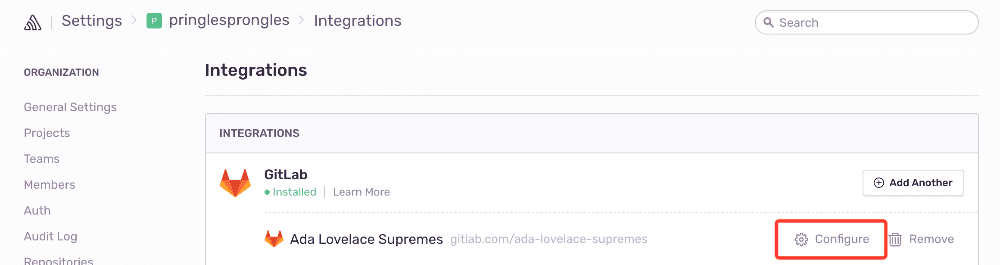

1. On the resulting page, click "Add Repository" to select which repositories in which you’d like to begin tracking commits.

   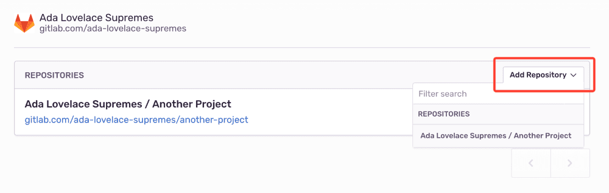

## Configure

Use GitLab to [track commits](#commit-tracking), identify [suspect commits](#suspect-commits), [resolve via commit or PR](#resolve-via-commit-or-pull-request) and [manage issues](#issue-management).

### Issue Management

Issue tracking allows you to create GitLab issues from within Sentry and link Sentry issues to existing GitLab issues.

1. Select your issue

   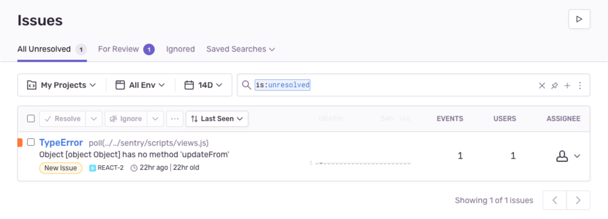

1. Navigate to External Links on the right panel of the issue's page and click "Link Issue".

   

1. You have two options to complete the issue link:

   1. In the pop-up, you can fill out the appropriate details in the _Create_ tab, and then click "Create Issue".

      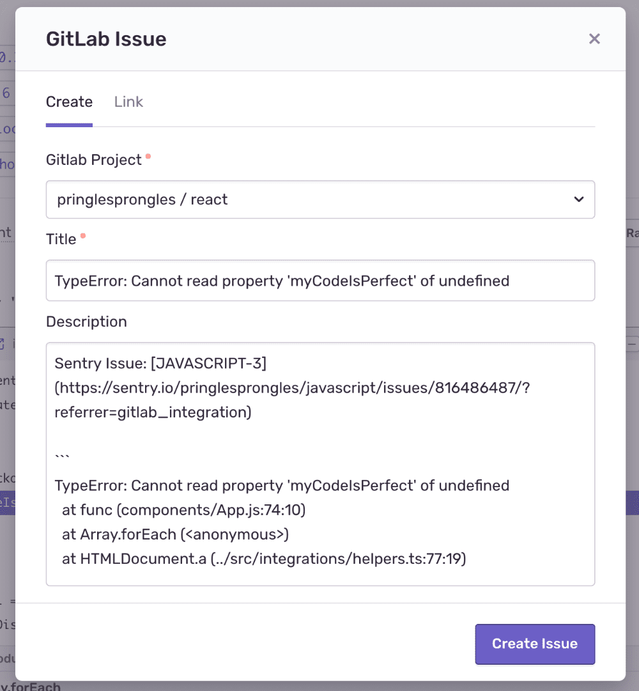

   1. Or, in the pop-up, you can click the Link tab, search the issue by name, and then click "Link Issue". _Issues aren't currently searchable by number._

      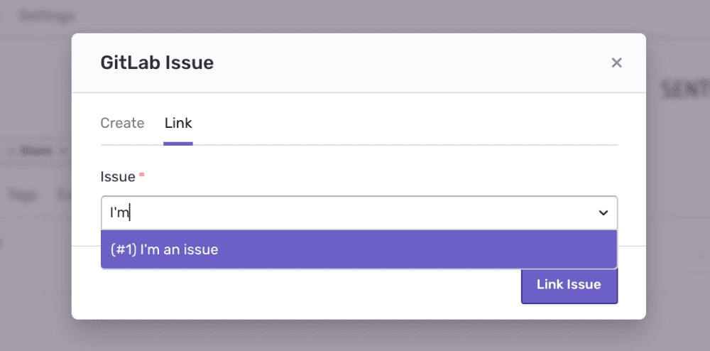

1. To unlink an issue, click on the "X" next to its name under External Links.

   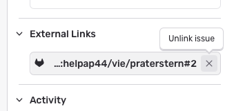

### Commit Tracking

Commit tracking allows you to hone in on problematic commits. With commit tracking, you can better isolate what might be problematic by leveraging information from releases like tags and metadata.

Once you've configured both [release and commit tracking](/product/releases/), you'll be able to see more thorough information about a release: who made commits, which issues were newly introduced by this release, and which deploys were impacted.

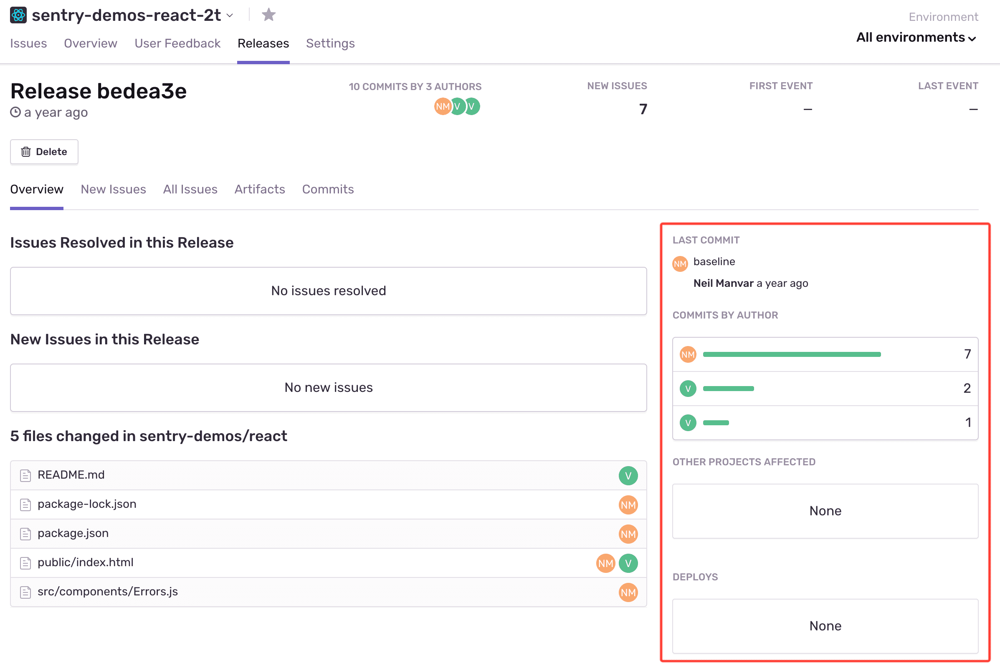

When you investigate deeper into that commit, you can leverage information from metadata like tags.

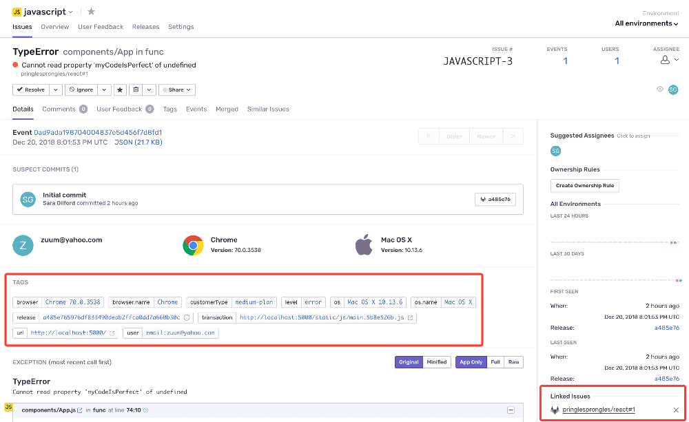

Broadly, this lets you isolate problems in order to see which commits might be problematic.

Learn more about [release and commit tracking](/product/releases/).

### Resolve via Commit or Pull Request

Once you've added a repository (see configuration step 8), you can start resolving issues by including `fixes <SHORT-ID>` in your commit messages. You might want to type something in the commit like: "this fixes MyApp-AB12" or "Fixes MyApp-317". The keyword to include is **fixes**. You can also resolve issues with pull requests by including `fixes <SHORT-ID>` in the title or description. This will automatically resolve the issue in the next release.

A `<SHORT-ID>` may look something like 'BACKEND-C' in the image below.

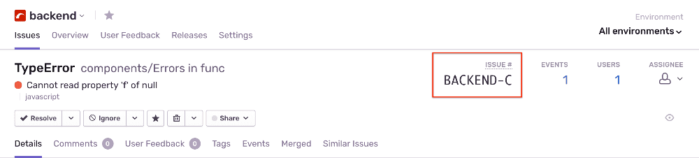

### Stack Trace Linking

Stack trace linking takes you from a file in your Sentry stack trace to the same file in GitLab. If you've set up commit tracking, Sentry links to the version of the file from the commit associated with the event. Otherwise, it links to the branch set in your code mapping.

To set up stack trace linking, [add a code mapping](/integrations/source-code-mgmt/code-mappings/) for each Sentry project and GitLab repository you want to link.

### Source Context

If your events don't carry inline source context (for example, native crashes or releases built without source maps), you can have Sentry fetch the surrounding lines from your repository on demand and render them in the issue stack trace. See [SCM Source Context](/integrations/source-code-mgmt/source-context/) for setup and access details.

### Suspect Commits

Once you've set up stack trace linking, Sentry can use information from your source code provider to suggest the commit that likely introduced the error. The first frame in the stack trace is considered suspect when looking at them top-down. If the first frame is not in-app, the next frame is considered suspect.

After pinpointing the suspect commit, you can also identify the developer who made the commit and assign them the task of fixing the error.

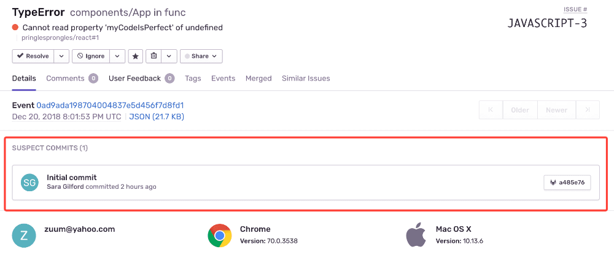

Learn about setting up this functionality in [Suspect Commits](/product/issues/suspect-commits/).

### Code Owners

<Include name="feature-available-for-plan-business.mdx" />

Import your existing GitLab CODEOWNERS files to automatically assign Sentry issues and route alerts to the responsible individuals and teams.

For more details, see the full documentation for [Code Owners](/product/issues/ownership-rules/#code-owners).

## Seer

<Alert>
The Gitlab Seer integration is currently in early beta, slowly opening up to more organizations. Please reach out to seer@sentry.io if you are interested in trying it out.
</Alert>

With the GitLab integration connected, you can use Seer's AI features, including [Autofix](/product/ai-in-sentry/seer/autofix/) and [Code Review](/product/ai-in-sentry/seer/code-review/) with your GitLab repositories.

**Autofix** analyzes Sentry issues using your GitLab repo code as context and can open a merge request with the proposed fix directly in GitLab.

**Code Review** reviews your merge requests for potential errors. Trigger it by commenting `@sentry review` on any MR. Automatic reviews also run when a merge request is opened or updated.

<Alert>
GitLab does not support external status checks. Code Review results appear as MR comments, not as a pipeline status check. You cannot use Seer as a required GitLab CI/CD check.
</Alert>

To set up Seer with GitLab, go to [Seer settings](https://sentry.io/orgredirect/organizations/:orgslug/settings/seer/) and connect your GitLab repositories. Only GitLab.com (cloud) is supported.

## Troubleshooting

- Does Seer support GitLab?

  - Yes. Autofix and Code Review both work with GitLab.com repositories. Self-hosted GitLab is not currently supported for Seer features.

- I'm using GitLab on-premises. Do I need to allow Sentry's IP addresses?

  - Yes. You can find our IP ranges [ here ](/security-legal-pii/security/ip-ranges/).
  - Verify the provided installation URL is a fully qualified domain name (FQDN), which is resolvable on the internet.
  - Make sure that Sentry's access to your installation URL is not path restricted.
  - To add the GitLab repo, navigate to ** GitLab > Admin area > Settings > Network > Outbound requests > Allow requests to the local network from hooks and services ** and enable the option.

- I'm using both GitLab on-premises and self-hosted Sentry, and I get an error `Error Communicating with GitLab (HTTP 422): unknown error` when I try to use the integration. How can I fix this?

  - By default, GitLab does not allow Hooks to communicate with the local private network, which prevents the integration with Sentry from working. To enable local network communication in GitLab, enable "Allow requests to the local network from hooks and services" on the **Admin > Settings > Network** page.

- Do you support subgroups?

  - Currently, we only support subgroups for users using GitLab 11.6 or higher.

- My repositories are hosted under my user account, not a group account. Can I still use this integration?

  - Unfortunately, not. The GitLab integration only works for repositories that are hosted under group accounts.

- Are there pricing restrictions?

  - This integration is available for organizations on the [Team, Business, or Enterprise plan](https://sentry.io/pricing/).

- Who has permission to install this?

  - You must have both owner/manager/admin permissions in Sentry and owner permissions in GitLab to successfully install this integration.

- Why am I getting a `500` response during installation or configuration?

  - First, make sure you’ve allowed our IPs, which can be found [here](/security-legal-pii/security/ip-ranges/). The 500 response is coming from GitLab, so you may need to try again or double-check that your settings and permissions are correct in GitLab. You must have both owner/manager/admin permissions in Sentry as well as owner permissions in GitLab to successfully install this integration.

- Why am I seeing an "Invalid Repository Names" error?

  - GitLab takes into account the whitespace before and after the `/` . On the Repositories page ([Organization Settings > Repositories](https://sentry.io/orgredirect/organizations/:orgslug/settings/repos/)), you’ll notice a space (for example, "Owner / Repo" as opposed to "Owner/Repo"), which will need to be included in any command you’re running. If you are using GitLab’s [environment variables](https://docs.gitlab.com/ee/ci/variables/#debug-tracing) to pass the repository as `CI_PROJECT_PATH` in a cURL request for example, it may not include the spaces and you’ll need to hardcode the name in order for it to work.

- Why am I always the reporter?
  - When using the GitLab integration to create issues, the “reporter” field is populated as the person who set up the integration by default — this is not configurable.
