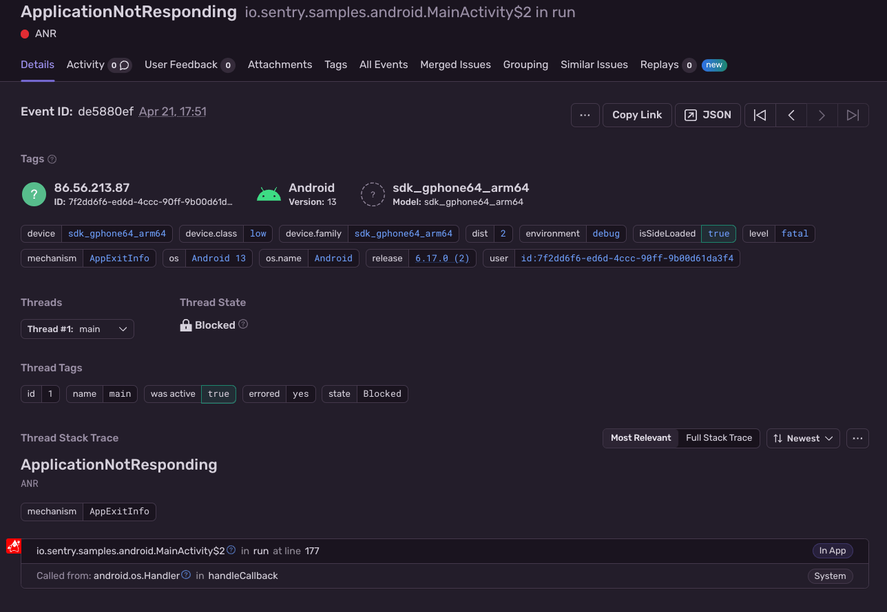
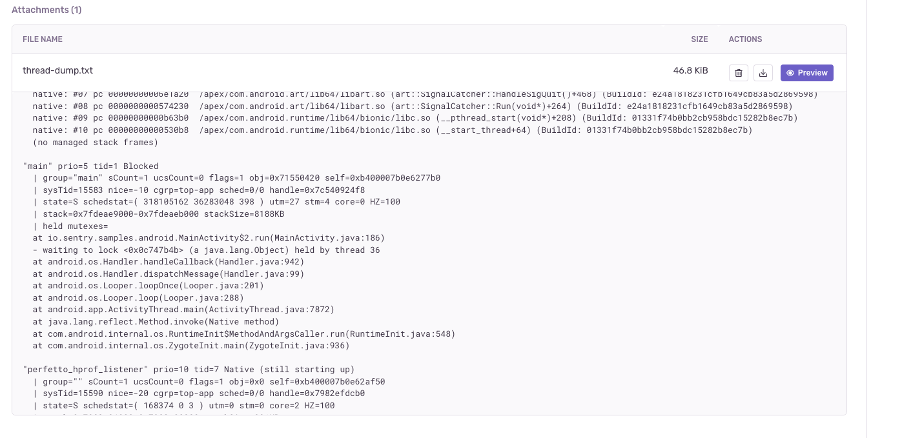
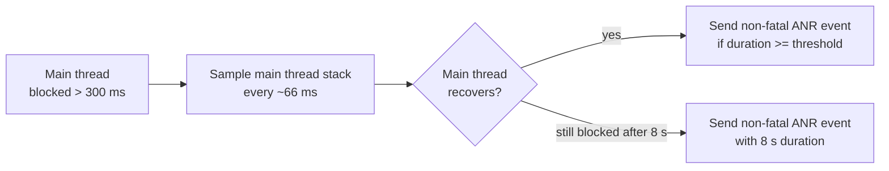
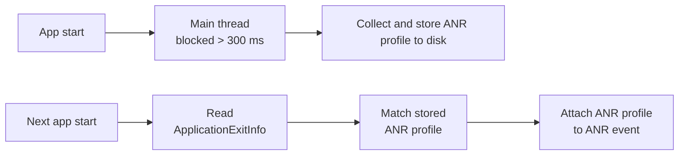
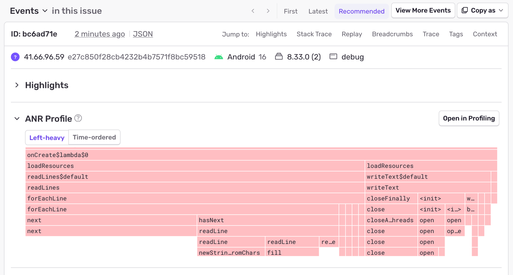
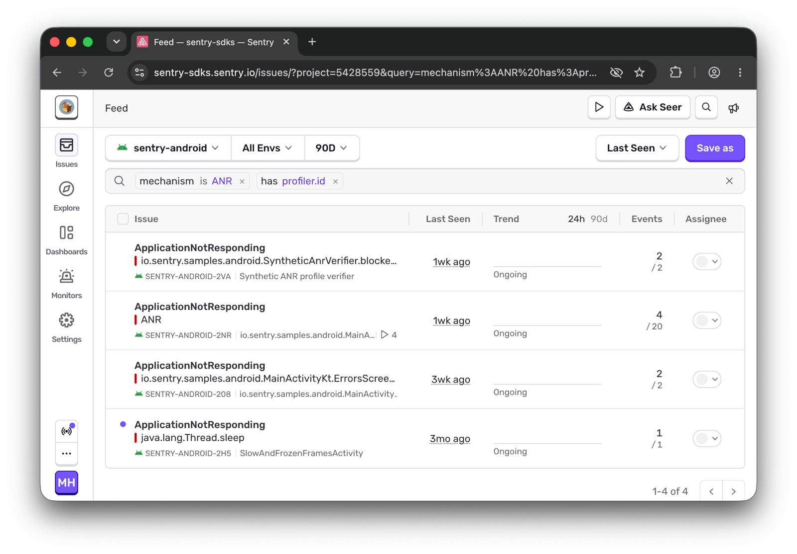
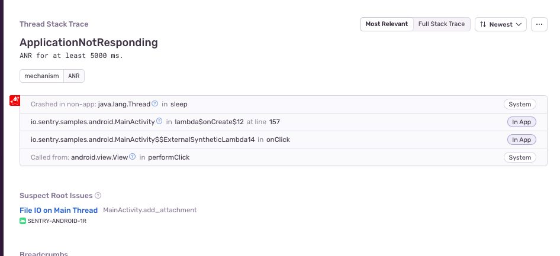
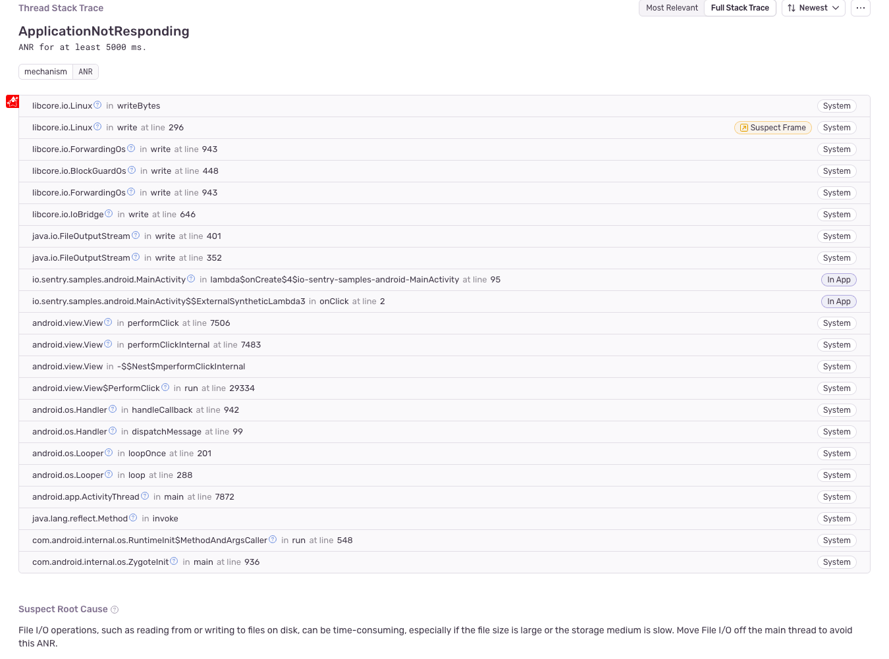
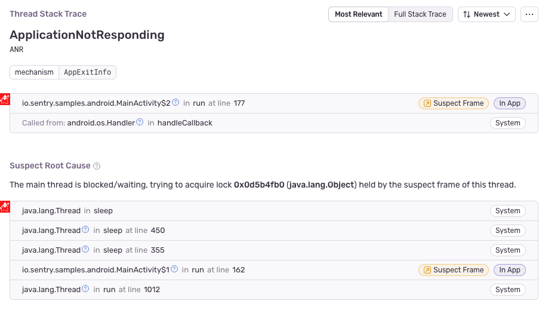
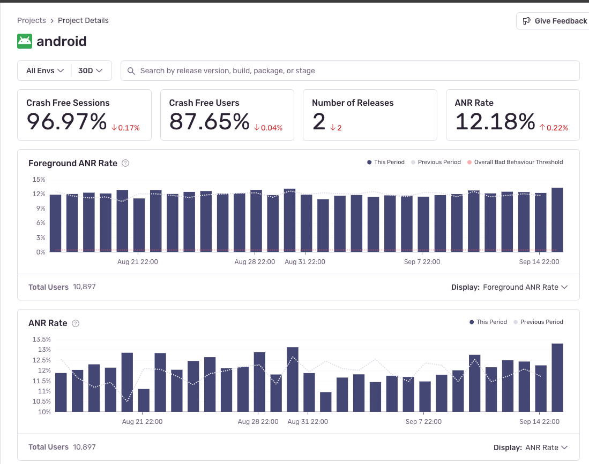

Application Not Responding (ANR) errors are triggered when the main UI thread of an application is blocked for more than five seconds. The Android SDK reports ANR errors as Sentry events. In addition, Sentry calculates [ANR rate](#anr-rate) based on these events and user sessions.

## ANR implementation details

The Android SDK uses different implementations to detect ANRs, depending on what version of Android the device is running:

- Below Android 11: Running a Watchdog thread (v1)
- Android 11 and above: Reading [ApplicationExitInfo](https://developer.android.com/reference/android/app/ApplicationExitInfo) (v2)

The new implementation (v2) uses the same data source as Google Play Console. This means the reported ANR events and [ANR rate](#anr-rate) should match with what you see on Sentry. The new implementation also captures a thread dump with additional information, like held locks, to help you resolve ANRs more efficiently.

While the original Watchdog approach (v1) reports many false positives and is based on heuristics, it still has some advantages over v2, like capturing screenshots and transactions with profiles at the time of ANR.

<Alert>

We're considering SDK support for both approaches working alongside each other on Android 11 and up. Please upvote [this GitHub discussion](https://github.com/getsentry/sentry-java/discussions/2716) and share your feedback if you have a case for v1 and v2 working together.

</Alert>

Both ANR detection implementations are controlled by the same flag:

```xml {filename:AndroidManifest.xml}
<application>
    <meta-data android:name="io.sentry.anr.enable" android:value="false" />
</application>
```

### Watchdog (v1)

Whenever the main UI thread of the application is blocked for more than five seconds, the SDK will report the problem to the server.

The integration reports ANR events with `mechanism:ANR`.

<Alert>

Sentry does not report the ANR while a debugger is attached. To report it anyway, set `io.sentry.anr.report-debug` to `true` (<PlatformIdentifier name="anrReportInDebug" />). This option only applies to the Watchdog (v1).

</Alert>

You can also specify how long the thread should be blocked before the ANR is reported. Provide the duration in the attribute `io.sentry.anr.timeout-interval-millis` in your `AndroidManifest.xml`:

```xml {filename:AndroidManifest.xml}
<application>
    <meta-data android:name="io.sentry.anr.timeout-interval-millis" android:value="2000" />
</application>
```

### ApplicationExitInfo (v2)

This approach reads the [ApplicationExitInfo](https://developer.android.com/reference/android/app/ApplicationExitInfo) API on the next app launch
and asynchronously sends ANR events to Sentry for each ANR in the history, enriching only the latest one with breadcrumbs, contexts, tags, etc.

The integration reports ANR events with `mechanism:AppExitInfo`.

<Alert>

If [ApplicationExitInfo#getTraceInputStream](<https://developer.android.com/reference/android/app/ApplicationExitInfo#getTraceInputStream()>) returns `null`, the SDK will no longer report an ANR event, since these events won't be actionable without it.

</Alert>



#### Historical ANRs

By default, the SDK only reports and enriches the latest ANR and it's the only one counted towards the ANR rate. However, there's also a `setReportHistoricalAnrs` option available in `SentryOptions`, which enables the SDK to report all ANRs from the [getHistoricalExitReasons](<https://developer.android.com/reference/android/app/ActivityManager?hl=en#getHistoricalProcessExitReasons(java.lang.String,%20int,%20int)>) list:

```kotlin
SentryAndroid.init(context) { options ->
  options.isReportHistoricalAnrs = true
}
```

```java
SentryAndroid.init(context) { options ->
  options.setReportHistoricalAnrs(true)
}
```

This option is useful after updating the SDK to the version where the new ANR implementation was introduced, in order to report all ANRs that took place prior to the SDK update. Other than that, the SDK will always pick up the latest ANR from the historical exit reasons list on next app restart, and there won't be any historical ANRs to report.

The integration reports ANR events with `mechanism:HistoricalAppExitInfo`.

#### Attaching Thread Dump

The SDK makes it possible to send the ANR thread dump from [ApplicationExitInfo#getTraceInputStream](<https://developer.android.com/reference/android/app/ApplicationExitInfo#getTraceInputStream()>) as an attachment. This is useful for performing deeper investigations using all available information from the OS (in addition to the SDK parsing the thread dump into threads with stack traces):

```kotlin
SentryAndroid.init(context) { options ->
  options.isAttachAnrThreadDump = true
}
```

```java
SentryAndroid.init(context) { options ->
  options.setAttachAnrThreadDump(true)
}
```



## Non-Fatal ANRs

<Alert>

Non-fatal ANR reporting is available starting in SDK version `<NEXT_VERSION>`, on Android 11 (API level 30) and higher.

</Alert>

The SDK reports a fatal ANR only after Android kills your app. Many hangs are shorter: the main thread is blocked for a second or two, the user notices that the app does not respond, and then the app recovers. These hangs never show up as fatal ANRs.

With non-fatal ANR reporting, the SDK reports a main thread hang in the foreground when the hang ends. The event contains the stack trace that the main thread was in most of the time during the hang, so you can find the code that blocks the main thread.



To enable non-fatal ANR reporting, set `nonFatalAnrSampleRate` to a value between `0.0` and `1.0`:

```xml {filename:AndroidManifest.xml}
<application>
    <meta-data android:name="io.sentry.anr.non-fatal.sample-rate" android:value="1.0" />
</application>
```

```kotlin
SentryAndroid.init(context) { options ->
    options.nonFatalAnrSampleRate = 1.0
}
```

```java
SentryAndroid.init(context, options -> {
    options.setNonFatalAnrSampleRate(1.0);
});
```

The SDK makes the sampling decision for each hang. For example, with a sample rate of `0.1`, the SDK reports about 10% of the hangs as non-fatal ANRs. The SDK samples the main thread stack only for hangs that non-fatal ANR reporting or [ANR profiling](#anr-profiling) selected, so hangs that neither feature selected cost no stack captures.

If you set `io.sentry.anr.enable` to `false`, the SDK also does not report non-fatal ANRs.

### Threshold

By default, the SDK reports hangs that last at least 700 ms. To change this, set `nonFatalAnrThresholdMs`:

```xml {filename:AndroidManifest.xml}
<application>
    <meta-data android:name="io.sentry.anr.non-fatal.sample-rate" android:value="1.0" />
    <meta-data android:name="io.sentry.anr.non-fatal.threshold-ms" android:value="1000" />
</application>
```

```kotlin
SentryAndroid.init(context) { options ->
    options.nonFatalAnrSampleRate = 1.0
    options.nonFatalAnrThresholdMs = 1000
}
```

```java
SentryAndroid.init(context, options -> {
    options.setNonFatalAnrSampleRate(1.0);
    options.setNonFatalAnrThresholdMs(1000);
});
```

The SDK starts to measure a hang when the main thread has been blocked for 300 ms, and it measures a hang for a maximum of 8 seconds. Thus, a threshold below 300 ms works like 300 ms, and a threshold above 8,000 ms never reports a hang.

### What a Non-Fatal ANR Event Contains

- An `ApplicationNotResponding` exception with the mechanism `NonFatalANR`. The exception is marked as handled.
- The culprit stack trace: during the hang, the SDK samples the main thread stack about every 66 ms, and uses the stack that it saw most often. If no stack samples are available, the exception has the value "Non-fatal ANR" and no stack trace.
- The main thread with its thread state (for example, `BLOCKED`).
- A `non_fatal_anr` context with `duration_ms` (the measured duration of the hang) and `sample_count` (the number of stack samples).
- A breadcrumb with the category `anr` and the message "Non-fatal ANR".
- A screenshot and the view hierarchy, if you enabled them. The SDK captures them after the main thread recovers, so they show the screen after the hang. If the main thread is still blocked after 8 seconds, the SDK does not capture them.

Non-fatal ANR events do not end the session as crashed or abnormal, and they do not change the crash-free rate.

Sentry groups non-fatal ANRs separately from fatal ANRs and from other errors with the same stack trace. If [ANR fingerprinting](#anr-fingerprinting) is enabled, Sentry groups all non-fatal ANRs whose stack traces contain only system frames into a single issue.

To find non-fatal ANR issues, search your issue stream for:

```
mechanism:NonFatalANR
```

### Fatal and Non-Fatal ANRs

A hang can become a fatal ANR after the SDK has already reported it as a non-fatal ANR. To prevent duplicate events, the SDK does not send a fatal ANR event on the next app start if all of these conditions are true:

- The non-fatal ANR lasted at least 5 seconds, or the main thread was still blocked after 8 seconds.
- Android killed the app with an ANR less than 30 seconds after the end of the reported hang.
- The SDK stored the non-fatal ANR event. If the hang was not sampled for non-fatal ANRs, or `beforeSend` drops the non-fatal ANR event, the SDK reports the fatal ANR as usual.

The session of that app run still ends as an ANR, so the [ANR rate](#anr-rate) stays correct.

<Alert level="info">

When the SDK does not send the fatal ANR event, the ANR shows only as a non-fatal ANR event in Sentry. This event does not contain the system thread dump of the fatal ANR.

</Alert>

### Filtering Non-Fatal ANRs

To drop or change non-fatal ANR events, use `beforeSend`. This example drops non-fatal ANRs from debug builds:

```kotlin
SentryAndroid.init(context) { options ->
    options.nonFatalAnrSampleRate = 1.0
    options.setBeforeSend { event, _ ->
        val isNonFatalAnr = event.exceptions?.any { it.mechanism?.type == "NonFatalANR" } == true
        if (isNonFatalAnr && BuildConfig.DEBUG) {
            null
        } else {
            event
        }
    }
}
```

```java
SentryAndroid.init(context, options -> {
    options.setNonFatalAnrSampleRate(1.0);
    options.setBeforeSend((event, hint) -> {
        final List<SentryException> exceptions = event.getExceptions();
        if (BuildConfig.DEBUG && exceptions != null) {
            for (final SentryException exception : exceptions) {
                final Mechanism mechanism = exception.getMechanism();
                if (mechanism != null && "NonFatalANR".equals(mechanism.getType())) {
                    return null;
                }
            }
        }
        return event;
    });
});
```

To report only longer hangs, use the [threshold](#threshold) instead of `beforeSend`.

If you drop a non-fatal ANR event, the SDK still reports a fatal ANR for the same hang. See [Fatal and Non-Fatal ANRs](#fatal-and-non-fatal-anrs).

### Limitations

- Only available on Android 11 (API level 30) and higher. On lower Android versions, the [Watchdog (v1)](#watchdog-v1) reports hangs.
- Only hangs in the foreground are reported.
- Hangs while a debugger is attached are ignored, also when `anrReportInDebug` is `true`.
- The SDK measures a hang for a maximum of 8 seconds.

## ANR Profiling

<Alert>

ANR Profiling is available starting in SDK version `8.35.0`. Starting in SDK version `<NEXT_VERSION>`, the profile starts when the main thread has been blocked for 300 ms instead of 1 second, so it also shows the beginning of the hang.

</Alert>

<Alert>

ANR profiles are powered by the Profiling platform and require a plan with profiling enabled. They are billed as UI Profile Hours. See the [pricing page](https://sentry.io/pricing/) for more details.

ANR profiles _don't_ use ART profiler, but are being captured differently. Therefore, they are not prone to the known [issues](https://docs.sentry.io/platforms/android/profiling/troubleshooting/#i-see-an-elevated-number-of-crashes-in-the-android-runtime-when-profiling-is-activated) with ART's profiler, and are safe to use in production.

</Alert>

The SDK can capture stack profiles for foreground ANRs of the main thread when an ANR is detected. A profile is a time-based view of your stack trace, showing which functions were executing and for how long. The captured profile is attached to the ANR event on the next app start, providing a flame graph on the Sentry issue details page. This gives you deeper insight into what the main thread was doing at the time of the ANR.



To enable ANR profiling, set the `anrProfilingSampleRate` to a value between `0.0` and `1.0`. This controls the probability of collecting a profile for each detected foreground ANR. The profile starts when the main thread has been blocked for 300 ms:

```xml {filename:AndroidManifest.xml}
<application>
    <meta-data android:name="io.sentry.anr.profiling.sample-rate" android:value="1.0" />
</application>
```

```kotlin
SentryAndroid.init(context) { options ->
    options.anrProfilingSampleRate = 1.0
}
```

```java
SentryAndroid.init(context, options -> {
    options.setAnrProfilingSampleRate(1.0);
});
```
ANR profiling and [non-fatal ANRs](#non-fatal-anrs) use the same main thread sampling, so you can enable both. If both features select the same hang, the SDK samples the main thread only one time.

Once enabled, ANR events will include a profile section on the issue details page, showing a flame graph of the main thread activity at the time of the ANR:



### Finding ANRs with Profiles

To find ANR issues that have a profile attached, search your issue stream for:

```
mechanism:ANR has:profiler.id
```

This filters for ANR events that include a `profiler.id`, meaning a stack profile and flame graph were successfully captured and attached to the event.



## ANR Fingerprinting

The SDK assigns a static fingerprint to ANR events whose stack traces contain only system frames (for example, classes from `java.lang` or `android.os`). This groups noisy system-frame-only ANRs into a single issue, reducing noise in your issue stream. Foreground and background system-frame-only ANRs are grouped separately.

ANR fingerprinting is enabled by default starting in SDK version `8.35.0`. To disable it:

```xml {filename:AndroidManifest.xml}
<application>
    <meta-data android:name="io.sentry.anr.enable-fingerprinting" android:value="false" />
</application>
```

```kotlin
SentryAndroid.init(context) { options ->
    options.isEnableAnrFingerprinting = false
}
```

```java
SentryAndroid.init(context, options -> {
    options.setEnableAnrFingerprinting(false);
});
```

## ANR Root Cause Analysis

Sentry performs various root cause analyses to give you insights about why certain ANRs might appear. If a potential root cause is detected, it'll be displayed in a new section below the ANR stack trace. Sentry can detect the following root causes:

### Performance Issues

If an ANR is connected to one of the Performance Issues detected by Sentry (for example, [File I/O on Main Thread](/product/issues/issue-details/performance-issues/file-main-thread-io/) or [DB on Main Thread](/product/issues/issue-details/performance-issues/db-main-thread-io/)), the offending span will be linked to the ANR event, showing you exactly which slow operation is to blame.



### Common Patterns

This detector looks at the stack trace of an ANR and tries to identify common pitfalls, such as accessing files, assets, or heavy resources on the main thread. If an offending stack frame is found, it'll be highlighted in the stack trace with some information about how to prevent this type of ANR:



### Deadlock Detection

Sentry will try to detect deadlocks and point out potential causes. If, for example, the main thread is blocked by waiting on a lock object that's held by another thread, the suspect frame that's waiting on the lock will be highlighted. The stack trace of the offending thread that's holding the lock, as well as the offending frame of that thread will also be shown:



## ANR Rate

ANR rate is the percentage of unique users who have experienced an ANR during the specified time period.

<Alert level="info">

Since there's two implementations for ANR detection, Sentry calculates the ANR Rate depending on the implementation. On Android 11 and above Sentry only accounts for **Fatal ANRs** - ANRs that lead to your app being terminated, either by the user or the OS. On Android 10 and below both Fatal and Non-Fatal ANRs contribute to the ANR Rate calculation.

[Non-fatal ANR](#non-fatal-anrs) events do not count toward the ANR rate. If the SDK does not send a fatal ANR event because it already reported the hang as a non-fatal ANR, the fatal ANR still counts, because the session ends as an ANR.

</Alert>

### User-perceived ANR Rate

User-perceived ANR rate is a core Android vital and is defined more specifically, as the unique percentage of users who've experienced the lack of response to an input event in an app, lasting more than five seconds.

A user-perceived ANR rate that's more than 0.47%, is considered over the [bad behavior threshold](https://developer.android.com/topic/performance/vitals#what_are_the_bad_behavior_thresholds), as set by Google. If your app exceeds this threshold, Google Play may choose to reduce your app's visibility in their app store.

### Foreground ANR Rate

In Sentry, we can monitor the foreground ANR rate, which is the percentage of unique users who've experienced an ANR event lasting more than five seconds, while the app was running in the foreground. Because it's more noticeable to the user, a foreground ANR event is more likely to be seen as an annoyance.

While foreground ANR rates may not map exactly to user-perceived ANR rates, they can provide a close proxy. In Sentry, the foreground ANR rate chart has a bad behavior threshold line for comparison.

To see your ANR Rate in Sentry:

1. Go to the **Projects** page
2. Click on your Android project
3. Look for the "ANR Rate" card in the "Project Details" section
4. Click "View Issues" to see a list of ANR issues that were created in the selected timeframe and environment

You can also see an ANR rate graph on a separate card. Opening the "Display" menu will allow you to switch back and forth between the "ANR Rate" and the "Foreground ANR Rate" view.



Sentry's Android SDK, version 6.13.0 and above, reports ANR rate errors if the main UI thread of your application is blocked for more than five seconds.
