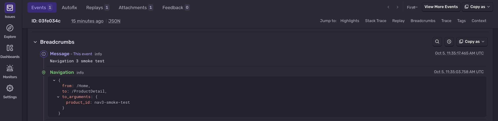
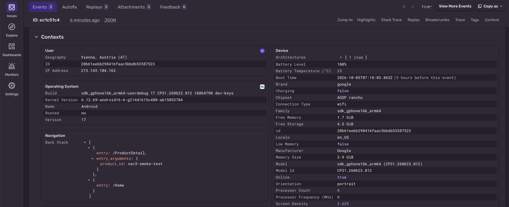
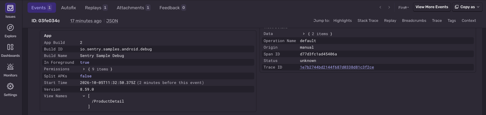
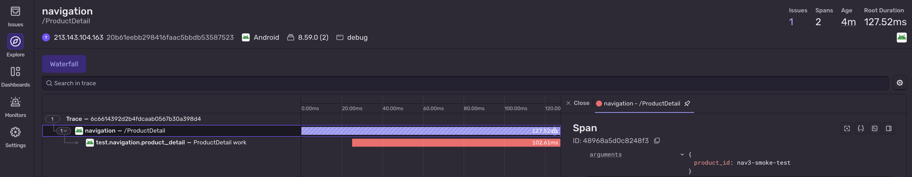

The `sentry-android-navigation`, `sentry-android-navigation3`, and `sentry-compose-android` libraries provide support for Sentry's Android navigation instrumentation. Use them to automatically add breadcrumbs, track screen names, and start navigation transactions whenever users navigate around your app.

This page covers:

- **[Navigation 2](#classic-views)** for classic Views via `SentryNavigationListener`
- **[Navigation 2](#jetpack-compose)** for Jetpack Compose via `NavHostController.withSentryObservableEffect`
- **[Navigation 3](#navigation-3)** for Jetpack Compose via `SentryNavEffect`

## Navigation 2

`SentryNavigationListener` for [Navigation 2](https://developer.android.com/guide/navigation/) integrations lets you observe destination changes reported by your `NavController`. Upon every destination change the listener:

- starts a new navigation transaction and binds it to the current [Sentry scope](https://docs.sentry.io/platforms/android/enriching-events/scopes/)<sup>†</sup>
- emits a breadcrumb
- updates the currently tracked screen name

`SentryNavigationListener` can be used directly with [classic Views](#classic-views) or in wrapped form with [Jetpack Compose](#jetpack-compose).

<small>
  † A new navigation transaction will *not* be bound if another unfinished
  transaction is already bound to the current scope.
</small>

### Classic Views

#### Install

Install the [Android SDK](/platforms/android/), then add the `sentry-android-navigation` dependency using Gradle:

```groovy {filename:build.gradle}
implementation 'io.sentry:sentry-android:{{@inject packages.version('sentry.java.android', '6.2.0') }}'
implementation 'io.sentry:sentry-android-navigation:{{@inject packages.version('sentry.java.android.navigation', '6.2.0') }}'
```

```kotlin {filename:build.gradle.kts}
implementation("io.sentry:sentry-android:{{@inject packages.version('sentry.java.android', '6.2.0') }}")
implementation("io.sentry:sentry-android-navigation:{{@inject packages.version('sentry.java.android.navigation', '6.2.0') }}")
```

#### Configure

Registration of the `SentryNavigationListener` should happen in the appropriate lifecycle callbacks of the entity that owns your `NavController`:

```kotlin
import androidx.navigation.NavController
import io.sentry.android.navigation.SentryNavigationListener

private val navController = findNavController(R.id.nav_host)
private val sentryNavListener = SentryNavigationListener(
  enableNavigationBreadcrumbs = true, // enabled by default
  enableNavigationTracing = true  // enabled by default
)

override fun onResume() {
  super.onResume()
  navController.addOnDestinationChangedListener(sentryNavListener)
}

override fun onPause() {
  super.onPause()
  navController.removeOnDestinationChangedListener(sentryNavListener)
}
```

```java
import androidx.navigation.NavController;
import androidx.navigation.Navigation;
import io.sentry.android.navigation.SentryNavigationListener;

private final NavController navController = Navigation.findNavController(this, R.id.nav_host);
private final SentryNavigationListener navListener = new SentryNavigationListener(
  /* enableNavigationBreadcrumbs = */ true,
  /* enableNavigationTracing = */ true
);

@Override
protected void onResume() {
  super.onResume();
  navController.addOnDestinationChangedListener(sentryNavListener);
}

@Override
protected void onPause() {
  super.onPause();
  navController.removeOnDestinationChangedListener(sentryNavListener);
}
```

#### Verify

The snippet below includes a sample `Fragment` with example navigation events. It captures an intentional message, so you can test that everything is working as soon as you set it up:

```kotlin
import android.os.Bundle
import android.view.LayoutInflater
import android.view.View
import android.view.ViewGroup
import androidx.fragment.app.Fragment
import androidx.navigation.NavController
import io.sentry.android.navigation.SentryNavigationListener
import io.sentry.Sentry

class HomeFragment : Fragment() {

  private val sentryNavListener = SentryNavigationListener()

  override fun onCreateView(
    inflater: LayoutInflater,
    container: ViewGroup?,
    savedInstanceState: Bundle?
  ): View {
    // generated databinding
    return FragmentHomeBinding.inflate(inflater).apply {
        this.sendMessage.setOnClickListener {
            Sentry.captureMessage("Some message.")
        }
        this.openFirstFragment.setOnClickListener {
          findNavController().navigate(R.id.fragment_a)
        }
        this.openSecondFragment.setOnClickListener {
          findNavController().navigate(R.id.fragment_b)
        }
    }.root
  }

  override fun onResume() {
    super.onResume()
    findNavController().addOnDestinationChangedListener(sentryNavListener)
  }

  override fun onPause() {
    super.onPause()
    findNavController().removeOnDestinationChangedListener(sentryNavListener)
  }
}
```

### Jetpack Compose

#### Auto-Installation with the Sentry Android Gradle Plugin

If you're using the [Sentry Android Gradle Plugin](/platforms/android/configuration/gradle/), it will automatically register `SentryNavigationListener` with any `NavHostController`s you create via [`rememberNavController`](https://developer.android.com/reference/kotlin/androidx/navigation/compose/rememberNavController.composable).

<Alert>

Be sure not to call Sentry's `withSentryObservableEffect` method (discussed [below](#configure-1)) on a `NavHostController` that the Sentry Android Gradle Plugin already auto-instruments. Doing so can register multiple `SentryNavigationListener`s and produce duplicate navigation data.

</Alert>

##### Install

Add the Sentry Android Gradle plugin in your `build.gradle` file:

```groovy
plugins {
  id "io.sentry.android.gradle" version "{{@inject packages.version('sentry.java.android.gradle-plugin', '3.0.0') }}"
}
```

```kotlin
plugins {
  id("io.sentry.android.gradle") version "{{@inject packages.version('sentry.java.android.gradle-plugin', '3.0.0') }}"
}
```

<Alert>

Learn more about the Sentry Android Gradle plugin in our [Gradle](/platforms/android/configuration/gradle/) documentation. Details about auto-installation can be found in the [Auto Instrumentation](/platforms/android/configuration/gradle/#tracing-auto-instrumentation) section.

</Alert>

##### Disable

If you want to disable the plugin's automatic Compose instrumentation, including Navigation 2 instrumentation, add the following to your `build.gradle` file:

```groovy
import java.util.EnumSet
import io.sentry.android.gradle.extensions.InstrumentationFeature

sentry {
  tracingInstrumentation {
    enabled = true
    features = EnumSet.allOf(InstrumentationFeature) - InstrumentationFeature.COMPOSE
  }
}
```

```kotlin
import java.util.EnumSet
import io.sentry.android.gradle.extensions.InstrumentationFeature

sentry {
  tracingInstrumentation {
    enabled.set(true)
    features.set(EnumSet.allOf(InstrumentationFeature::class.java) - InstrumentationFeature.COMPOSE)
  }
}
```

#### Manual Installation

##### Install

Sentry captures data via a `NavHostController.withSentryObservableEffect` extension function that registers a `SentryNavigationListener` under the hood. To use it, install the Android SDK, then add the `sentry-compose-android` dependency in Gradle:

```groovy
implementation 'io.sentry:sentry-android:{{@inject packages.version('sentry.java.android', '6.2.0') }}'
implementation 'io.sentry:sentry-compose-android:{{@inject packages.version('sentry.java.compose.android', '6.2.0') }}'
```

```kotlin
implementation("io.sentry:sentry-android:{{@inject packages.version('sentry.java.android', '6.2.0') }}")
implementation("io.sentry:sentry-compose-android:{{@inject packages.version('sentry.java.compose.android', '6.2.0') }}")
```

##### Configure

Configuration should happen in the `@Composable` function that owns your `NavHost`:

```kotlin
import androidx.navigation.compose.NavHost
import androidx.navigation.compose.rememberNavController
import io.sentry.compose.withSentryObservableEffect

val navController = rememberNavController().withSentryObservableEffect(
  enableNavigationBreadcrumbs = true, // enabled by default
  enableNavigationTracing = true  // enabled by default
)

NavHost(
  navController = navController
) {
  ...
}
```

#### Verify

This snippet includes a sample `Activity` with example navigation events between composables. It captures an intentional message, so you can test that everything is working as soon as you set it up:

```kotlin
import android.os.Bundle
import androidx.activity.ComponentActivity
import androidx.activity.compose.setContent
import androidx.compose.foundation.layout.Arrangement
import androidx.compose.foundation.layout.Column
import androidx.compose.foundation.layout.fillMaxSize
import androidx.compose.foundation.layout.padding
import androidx.compose.material3.Button
import androidx.compose.material3.Text
import androidx.compose.runtime.Composable
import androidx.compose.ui.Alignment
import androidx.compose.ui.Modifier
import androidx.compose.ui.unit.dp
import androidx.navigation.NavHostController
import androidx.navigation.NavType
import androidx.navigation.compose.NavHost
import androidx.navigation.compose.composable
import androidx.navigation.compose.rememberNavController
import io.sentry.Sentry
import io.sentry.compose.withSentryObservableEffect

class ComposeActivity : ComponentActivity() {

  override fun onCreate(savedInstanceState: Bundle?) {
    super.onCreate(savedInstanceState)

    setContent {
      val navController = rememberNavController().withSentryObservableEffect()
      SampleNavigation(navController)
    }
  }
}

@Composable
fun SampleNavigation(navController: NavHostController) {
  NavHost(
    navController = navController,
    startDestination = "first"
  ) {
    composable("first") {
      First(
        navigateToSecond = { navController.navigate("second") }
      )
    }
    composable("second") {
      Second()
    }
  }
}

@Composable
fun First(
  navigateToSecond: () -> Unit
) {
  Column(
    verticalArrangement = Arrangement.Center,
    horizontalAlignment = Alignment.CenterHorizontally,
    modifier = Modifier.fillMaxSize()
  ) {
    Button(
      onClick = { navigateToSecond() },
      modifier = Modifier.padding(top = 32.dp)
    ) {
      Text("Navigate to Second")
    }
    Button(
      onClick = { Sentry.captureMessage("Some message from Compose.") },
      modifier = Modifier.padding(top = 32.dp)
    ) {
      Text("Message from Compose")
    }
  }
}

@Composable
fun Second() {
  Column(
    verticalArrangement = Arrangement.Center,
    horizontalAlignment = Alignment.CenterHorizontally,
    modifier = Modifier.fillMaxSize()
  ) {
    Text("Second Screen")
  }
}
```

### Scrub Sensitive Info from the Recorded Breadcrumb/Transaction

`SentryNavigationListener` captures route arguments as additional data on breadcrumbs and transactions. If the arguments contain PII, you can strip them out with `BeforeBreadcrumbCallback` and `BeforeSendTransactionCallback`.<sup>†</sup>

To do so, [manually initialize](/platforms/android/manual-setup/#configuration-via-sentryoptions) the SDK and add the following snippet:

```kotlin
import io.sentry.android.core.SentryAndroid
import io.sentry.SentryOptions.BeforeBreadcrumbCallback
import io.sentry.SentryOptions.BeforeSendTransactionCallback
import io.sentry.android.navigation.SentryNavigationListener

SentryAndroid.init(this) { options ->
  options.beforeBreadcrumb = BeforeBreadcrumbCallback { breadcrumb, hint ->
    if (SentryNavigationListener.NAVIGATION_OP == breadcrumb.category) {
      breadcrumb.data.remove("from_arguments")
      breadcrumb.data.remove("to_arguments")
    }
    breadcrumb
  }

  options.beforeSendTransaction = BeforeSendTransactionCallback { transaction, _ ->
    val trace = transaction.contexts.trace
    if (SentryNavigationListener.NAVIGATION_OP == trace?.operation) {
      trace.setData("arguments", null)
    }
    transaction
  }
}
```

<small>
  † The snippet above removes route arguments, but it doesn't scrub route names.
  Define routes with stable names and placeholders, such as `profile/{user_id}`,
  and pass only sanitized values as arguments. Avoid putting PII directly in
  route names, as they can appear in breadcrumb `from` and `to` fields,
  transaction names, and screen names.
</small>

## Navigation 3

<Alert>

Navigation 3 support is available in `sentry-android-navigation3` `8.60.0` and later.

Review [Supported Setups](#supported-setups) and [Limitations](#limitations) before configuring `SentryNavEffect`.

</Alert>

Android's [Navigation 3 library](https://developer.android.com/guide/navigation/navigation-3) expects apps to manage their own back stack and to push and pop entries in order to navigate. `SentryNavEffect` instruments the back stack passed to your `NavDisplay`. By default, every time the top of the back stack changes, `SentryNavEffect` will:

- start a new navigation transaction and binds it to the current [Sentry scope](https://docs.sentry.io/platforms/android/enriching-events/scopes/)<sup>†</sup>
- emit a breadcrumb
- update the currently tracked screen name
- record the latest 5 entries from the back stack as event context

See [Customize Nav3 Options](#customize-nav3-options) to learn how to modify those defaults.

<small>
  † A new navigation transaction will *not* be started if another unfinished
  transaction is already bound to the current scope.
</small>

### Install

Install the Android SDK and add the `sentry-android-navigation3` library:

At runtime, this integration requires Compose UI `1.7` or later, or `lifecycle-runtime-compose` `2.8.3` or later.

```groovy {filename:build.gradle}
dependencies {
  implementation 'io.sentry:sentry-android:{{@inject packages.version('sentry.java.android', '8.60.0') }}'
  implementation 'io.sentry:sentry-android-navigation3:{{@inject packages.version('sentry.java.android.navigation', '8.60.0') }}'
}
```

```kotlin {filename:build.gradle.kts}
dependencies {
  implementation("io.sentry:sentry-android:{{@inject packages.version('sentry.java.android', '8.60.0') }}")
  implementation("io.sentry:sentry-android-navigation3:{{@inject packages.version('sentry.java.android.navigation', '8.60.0') }}")
}
```

### Configure

To use `SentryNavEffect`, add it to the composable that owns your `NavDisplay` and pass your back stack to both:

```kotlin
import androidx.navigation3.runtime.NavKey
import androidx.navigation3.runtime.rememberNavBackStack
import androidx.navigation3.ui.NavDisplay
import io.sentry.compose.navigation3.SentryNavEffect
import kotlinx.serialization.Serializable

@Composable
fun AppNavigation() {
  // Create your back stack like usual.
  val backStack = rememberNavBackStack(Home)

  // Place SentryNavEffect in the same composable as your NavDisplay and call the
  // effect first. Provide a BackStackEntryMapper with the values you want to
  // show up in Sentry. Omit PII and other sensitive info.
  SentryNavEffect(
    backStack = backStack,
    backStackEntryMapper = { entry ->
      when (entry) {
        is Home -> SentryBackStackEntry("Home")
        is ProductDetail ->
          SentryBackStackEntry("ProductDetail", mapOf("product_id" to entry.productId))
        ...
      }
    }
  )

  // Configure your NavDisplay like usual.
  NavDisplay(
    backStack = backStack,
    ...
  )
}
```

**Note:** Be sure to call `SentryNavEffect` before `NavDisplay` so the effect's transaction-creating machinery can be set up before any spans are produced by the initial nav destination. Otherwise, initial destination spans may be lost or parented under the wrong transaction.

Provide a `BackStackEntryMapper` that maps each entry in your back stack to the name and optional arguments you want displayed in Sentry. Keep names stable and arguments lightweight and performant. Avoid using `::class.simpleName` or anything else that R8 will obfuscate.

<Alert>

Values returned from `BackStackEntryMapper` are **not** scrubbed by the Sentry SDK of PII or other potentially sensitive information before being sent to Sentry. Only return names and arguments known to be safe, or sanitize them yourself in your `BackStackEntryMapper`.

</Alert>

### Customize Nav3 Options

Use `SentryNavOptions` to disable breadcrumbs or transactions, or to limit how much of the back stack Sentry stores with captured events.

```kotlin
import io.sentry.compose.navigation3.SentryNavEffect
import io.sentry.compose.navigation3.SentryNavOptions

SentryNavEffect(
  backStack = backStack,
  ...
  options = SentryNavOptions {
    enableNavigationBreadcrumbs = true
    enableNavigationTransactions = true
    captureBackStack = true
    maxCapturedBackStackEntries = 5
  },
)
```

If you want to turn screen names on or off, configure the main SDK options when you initialize the Sentry SDK:

```kotlin
import io.sentry.android.core.SentryAndroid

SentryAndroid.init(this) { options ->
  options.isEnableScreenTracking = true
}
```

### Verify

The snippet below defines `Home` and `ProductDetail` routes and a composable for displaying them. It adds both routes to an in-memory back stack and captures a message from the `ProductDetail` destination so you can verify the navigation data the Sentry SDK emits.

The snippet assumes the default `SentryNavOptions`. Screen names additionally require screen tracking to be enabled.

```kotlin
import androidx.compose.material3.Button
import androidx.compose.material3.Text
import androidx.compose.runtime.Composable
import androidx.compose.runtime.LaunchedEffect
import androidx.compose.runtime.mutableStateListOf
import androidx.compose.runtime.remember
import androidx.navigation3.runtime.NavKey
import androidx.navigation3.runtime.entryProvider
import androidx.navigation3.ui.NavDisplay
import io.sentry.Sentry
import io.sentry.compose.navigation3.SentryBackStackEntry
import io.sentry.compose.navigation3.SentryNavEffect
import kotlinx.coroutines.delay

data object Home : NavKey

data class ProductDetail(val productId: String) : NavKey

@Composable
fun AppNavigation() {
  val backStack = remember { mutableStateListOf<NavKey>(Home) }

  SentryNavEffect(
    backStack = backStack,
    backStackEntryMapper = { entry ->
      when (entry) {
        is Home -> SentryBackStackEntry("Home")
        is ProductDetail -> SentryBackStackEntry(
          name = "ProductDetail",
          arguments = mapOf("product_id" to entry.productId),
        )
        else -> null
      }
    },
  )

  NavDisplay(
    backStack = backStack,
    onBack = { backStack.removeLastOrNull() },
    entryProvider = entryProvider {
      entry<Home> {
        Button(
          onClick = {
            backStack.add(ProductDetail(productId = "nav3-smoke-test"))
          },
        ) {
          Text("Open product detail")
        }
      }
      entry<ProductDetail> {
        val parentSpan = Sentry.getSpan()

        // Generate a fake span so that the nav transaction isn't dropped after its idle timeout
        // expires.
        LaunchedEffect(parentSpan) {
          val span =
            parentSpan?.startChild(
              "test.navigation.product_detail",
              "ProductDetail work",
            )
          try {
            delay(100)
          } finally {
            span?.finish()
          }
        }

        Button(onClick = { Sentry.captureMessage("Navigation 3 smoke test") }) {
          Text("Send test message")
        }
      }
    },
  )
}
```

Tap **Open product detail**, then **Send test message**. In Sentry, open the event for `Navigation 3 smoke test` and verify the following:

- In **Breadcrumbs**, look for a navigation breadcrumb whose destination is `ProductDetail`. It should include `product_id` under `to_arguments`.



- In **Contexts**, check the Navigation context for a back stack containing `/ProductDetail` followed by `/Home`, with `product_id` under `entry_arguments`. Also check the App context for View Names containing `/ProductDetail`.




- If tracing is enabled and the transaction is sampled, open the [Traces](https://sentry.io/orgredirect/organizations/:orgslug/traces/) view after the [idle timeout](/platforms/android/configuration/options/#idleTimeout) and inspect the `ProductDetail` transaction. Emitted nav data should appear under **Attributes → Arguments**, **Contexts → Navigation**, and **Breadcrumbs**.



### Using kotlinx.serialization

If your Nav3 back stack uses `@Serializable` keys, you can use [Kotlin serialization](https://kotlinlang.org/docs/serialization.html) to produce stable entry names. For performance reasons, don't serialize keys in their entirety as `arguments` if they might be large, deeply nested, or contain PII or other sensitive information.

```kotlin
import androidx.navigation3.runtime.NavKey
import io.sentry.compose.navigation3.BackStackEntryMapper
import io.sentry.compose.navigation3.SentryBackStackEntry
import kotlinx.serialization.SerialName
import kotlinx.serialization.Serializable

@Serializable
@SerialName("Home")
data class Home(val userName: String) : NavKey

@Serializable
@SerialName("ProductDetail")
data class ProductDetail(val userName: String, val productId: String) : NavKey

val backStackItemMapper = BackStackEntryMapper<NavKey> { entry ->
  when (entry) {
    is Home -> SentryBackStackEntry(Home.serializer().descriptor.serialName)
    is ProductDetail -> SentryBackStackEntry(
      name = ProductDetail.serializer().descriptor.serialName,
      arguments = mapOf("product_id" to entry.productId)
    )
    ...
  }
}
```

### Supported Setups

The setups below require `sentry-android-navigation3` `8.63.0` or later. Earlier versions support only one active `SentryNavEffect` per [Sentry scope](/platforms/android/enriching-events/scopes/).

`SentryNavEffect` is compatible with most, but not all, Nav3 setups. Each effect uses the lifecycle of its nearest `LocalLifecycleOwner` to decide when it can write to Sentry's shared scope, and compatibility between effects depends on how those lifecycle owners interact. Incompatible effects won't crash, but they can generate stale navigation data, produce interleaved breadcrumbs, or interfere with each other's transactions.

**Supported:**

- A single-Activity app with one `NavDisplay` and `SentryNavEffect` pair.
- A multi-Activity app where each Activity has at most one `NavDisplay` and `SentryNavEffect` pair.
- A multi-Fragment app where each Fragment has at most one `NavDisplay` and `SentryNavEffect` pair (and the host Activity or Activities have no `SentryNavEffect`(s) of their own).
- A `ViewPager2` whose pages are Fragments, each with at most one `NavDisplay` and `SentryNavEffect` pair.
- An Activity or Fragment with its own `NavDisplay` and `SentryNavEffect` pair that stays visible beneath a `DialogFragment` or translucent Activity with its own pair.

<Alert>

All supported setups assume that each `SentryNavEffect` is called in the same composable as the `NavDisplay` it observes, and that the effect is called before it.

They also assume that `SentryNavEffect` is **_not_** called from content rendered by `NavDisplay`, such as a `NavEntry`, `NavEntryDecorator`, or `Scene`. (`SentryNavEffect` needs the lifecycle of the Activity or Fragment hosting a `NavDisplay`, rather than the navigation-scoped lifecycle that `NavDisplay` provides to its content.)

</Alert>

**Not supported:**

- Sibling `NavDisplay` and `SentryNavEffect` pairs in the same Activity or Fragment.
- Nested `NavDisplay` and `SentryNavEffect` pairs in the same Activity or Fragment. (If you nest `NavDisplay`s, consider using `SentryNavEffect` only with the outermost one.)
- `SentryNavEffect` instances in multiple Activities or Fragments that users can interact with at the same time, such as two Activities from the same app in [multi-resume mode](https://developer.android.com/develop/ui/views/layout/support-multi-window-mode#multi-resume), or an Activity and hosted Fragments where the Activity and Fragments each have their own `NavDisplay` and `SentryNavEffect` pairs.
- `SentryNavEffect` instances in pages or tabs that share their host's lifecycle, such as Compose `HorizontalPager` pages, `ViewPager2` pages that aren't Fragments, or tabs that are kept in the composition when inactive. Those pages or tabs share one `LifecycleOwner`, so at most one can call `SentryNavEffect`.

### Limitations

`SentryNavEffect` treats the top entry in your back stack as the current screen. That works well for most Nav3 setups, but it means that `SentryNavEffect` does **_not_**:

- understand the concept of Nav3 [Scenes](https://developer.android.com/guide/navigation/navigation-3/scenes) or multi-pane layouts
- track multiple back stacks with one `SentryNavEffect` instance
- make special accommodations for [predictive back](https://developer.android.com/guide/navigation/custom-back/predictive-back-gesture) gestures (e.g., spans produced by predictively rendered composables may appear under the current destination's transaction)

## Navigation 2 and Navigation 3 Interoperability

Navigation 2 and Navigation 3 can coexist in the same app. Their Sentry integrations observe navigation independently, but both write to the same Sentry scope by default.

If both integrations observe the same navigation flow – for instance, a Nav2 destination hosts a Nav3 flow – Sentry can receive duplicate breadcrumbs or conflicting screen names and transactions. Choose one integration to report each flow, or configure the integrations so they don't report the same data to the same scope.

If you're using the Sentry Android Gradle Plugin, be sure to account for automatically enabled Navigation 2 instrumentation when deciding which integration should report a flow.
