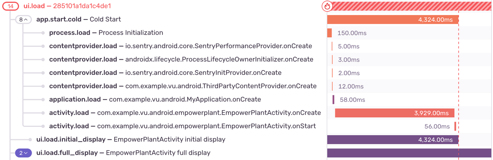
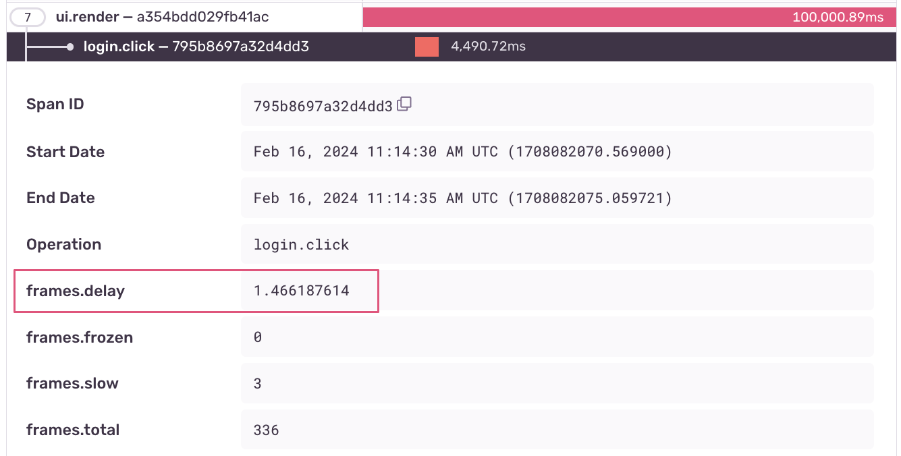

Performance V2 contains a set of features that enrich performance instrumentation. It tightly integrates with the [Mobile Vitals](/product/dashboards/sentry-dashboards/mobile/mobile-vitals/) dashboard module, enabling <PlatformLink to="/tracing/instrumentation/perf-v2/#app-start">App Start</PlatformLink> and <PlatformLink to="/tracing/instrumentation/perf-v2/#frames-delay">Frames Delay</PlatformLink> reporting.

Performance V2 is always on. Version 9 of the SDK removes the `enablePerformanceV2` option. If you're upgrading from version 8, see the <PlatformLink to="/migration/v8-to-v9/#removed-performance-v2-option">migration guide</PlatformLink>.

### App Start

This feature requires the <PlatformLink to="/configuration/gradle/">Sentry Android Gradle Plugin</PlatformLink> (version `4.2.0` or above) to be applied to your app module.

Your App Start transaction shows a detailed span breakdown of various components:
* `process.load`: The process initialization time
* `contentprovider.load`: `ContentProvider.onCreate()` execution time
* `application.load`: `Application.onCreate()` execution time
* `activity.load`: The execution time of your `Activity` lifecycle prior to the first frame being drawn

### Frames Delay

Frames Delay is the user-perceived delayed duration of rendered frames. The Android SDK automatically attaches this information to every span, giving useful insights and showcasing which spans correlate the most to an impaired user experience. For more technical details about frame delay, head over to our [develop docs](https://develop.sentry.dev/sdk/performance/frames-delay/).

