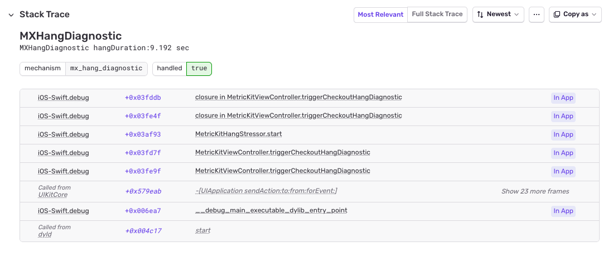
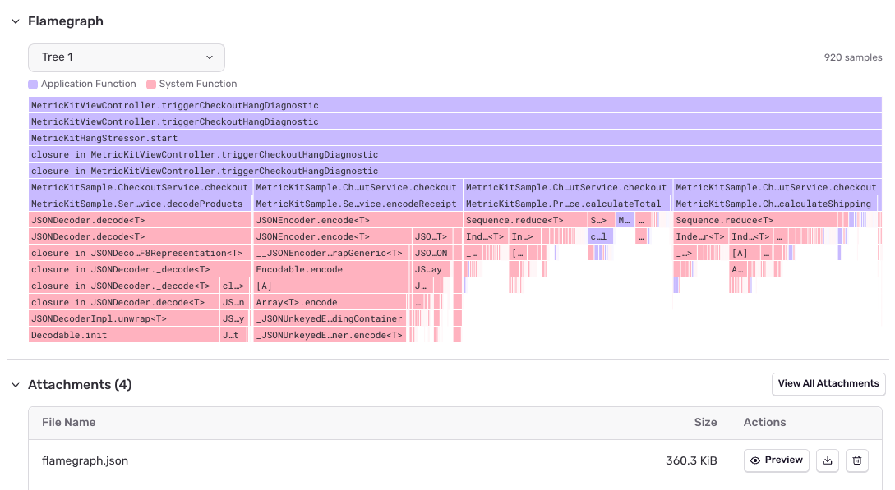

The [MetricKit](https://developer.apple.com/documentation/metrickit) integration subscribes to [MXHangDiagnostic](https://developer.apple.com/documentation/metrickit/mxhangdiagnostic), [MXDiskWriteExceptionDiagnostic](https://developer.apple.com/documentation/metrickit/mxdiskwriteexceptiondiagnostic)
and [MXCPUExceptionDiagnostic](https://developer.apple.com/documentation/metrickit/mxcpuexceptiondiagnostic), which it converts to Sentry events.

This integration is available in SDK version 8.14.0 and later on iOS 15 and later and macOS 12 and later.

MetricKit controls the stack traces included in each diagnostic. Some contain only a few frames. To discard reports that aren't useful to you, filter them in <PlatformLink to="/configuration/filtering/#filtering-error-events">`beforeSend`</PlatformLink>.

Identify MetricKit events by their `mechanism.type`: `mx_hang_diagnostic`, `mx_cpu_exception`, or `mx_disk_write_exception`.

## Enable MetricKit

Enable this feature by setting the `enableMetricKit` option to `true`:

```swift {tabTitle:Swift} {mdExpandTabs}
import Sentry

SentrySDK.start { options in
    options.dsn = "___PUBLIC_DSN___"
    options.enableMetricKit = true
}
```

```objc {tabTitle:Objective-C}
@import Sentry;

[SentrySDK startWithConfigureOptions:^(SentryOptions *options) {
    options.dsn = @"___PUBLIC_DSN___";
    options.enableMetricKit = YES;
}];
```

```objc {tabTitle:Objective-C (SentryObjC)}
#import <SentryObjC/SentryObjC.h>

[SentryObjCSDK startWithConfigureOptions:^(SentryObjCOptions *options) {
    options.dsn = @"___PUBLIC_DSN___";
    options.enableMetricKit = YES;
}];
```

## Hang Diagnostics

MetricKit reports periods when your app is unresponsive. Each hang diagnostic includes a hang duration and a sampled call stack tree, which can contain multiple execution paths rather than a single stack trace. Apple controls which hangs are reported and how much detail they contain, so not every hang produces a diagnostic.

We recommend MetricKit for system-provided hang diagnostics. Disabling or pausing <PlatformLink to="/configuration/app-hangs/">App Hang tracking</PlatformLink> does not stop MetricKit reports, and `appHangTimeoutInterval` does not change MetricKit's detection threshold.

### Enable Flame Graph Attachments

By default, the SDK stores the sampled call tree in the event's stack trace. Large trees are subject to stack trace limits, which can leave the flame graph incomplete. Starting with SDK version 9.31.0, send the tree as a separate attachment to preserve it independently of those limits.

<Alert>

Flame graph attachment reporting is available for public testing. The configuration option is experimental and may change in a future release.

</Alert>

Set `hangReportingMode` to `.flamegraphAttachment` when configuring the SDK. This option affects hang diagnostics only:

```swift {tabTitle:Swift} {mdExpandTabs}
import Sentry

SentrySDK.start { options in
    options.dsn = "___PUBLIC_DSN___"
    options.enableMetricKit = true
    options.experimental.metrickit.hangReportingMode = .flamegraphAttachment
}
```

```objc {tabTitle:Objective-C (SentryObjC)}
#import <SentryObjC/SentryObjC.h>

[SentryObjCSDK startWithConfigureOptions:^(SentryObjCOptions *options) {
    options.dsn = @"___PUBLIC_DSN___";
    options.enableMetricKit = YES;
    options.experimental.metrickit.hangReportingMode =
        SentryObjCMetricKitHangReportingModeFlamegraphAttachment;
}];
```

The SDK sends a `flamegraph.json` attachment with each hang event. Upload your app's <PlatformLink to="/dsym/">debug information files</PlatformLink> so Sentry can symbolicate the flame graph using the same debug symbols as error events. Profiling does not need to be enabled.

To capture only hang diagnostics with MetricKit in Swift, replace `options.enableMetricKit = true` with `options.experimental.metrickit.enabledDiagnosticReports = [.hang]`. This requires SDK version 9.32.0 or later.

To return to default reporting, set `hangReportingMode` to `.legacy` (`SentryObjCMetricKitHangReportingModeLegacy` in Objective-C).

### Investigate a Hang

Open a MetricKit hang event in Sentry to view its stack trace and flame graph. Sentry selects a representative stack trace from the sampled call trees for issue grouping, considering sample counts, stack depth, and in-app frames. Use this stack as a starting point for investigation, not proof of the hang's cause.



The **Flamegraph** section shows the sampled call paths, including branches outside the representative stack trace. If the diagnostic contains multiple call trees, use the tree selector to inspect them individually.



When reading the graph:

- **Width represents sample count**, including samples in a frame's descendants. Wider paths were observed more often.
- Horizontal position does not represent execution order, and frame width is not an exact duration. MetricKit provides aggregate observations, not timestamped samples.
- Some call trees aggregate samples across threads. Do not assume every tree represents a single thread or the main thread.

For a step-by-step walkthrough, see the Sentry cookbook guide to [debugging iOS hangs with MetricKit](https://sentry.io/cookbook/debug-ios-hangs-with-metrickit/).

### Attachment Limits

Flame graph attachments are subject to these limits:

- Attachments count toward your attachment quota, and the associated hang events count toward your error-event quota. No profiling quota is consumed. Attachment retention and access permissions apply.
- Each attachment is limited to 10 MiB. If the SDK cannot create it, for example because sample counts are invalid or the payload exceeds this limit, it falls back to storing the tree in the event's stack trace.
- Sentry symbolicates at most the first 2,500 frame entries in an attachment. Additional frames remain in the graph but may be unresolved. Missing debug information can also leave frames unresolved.

## Attach the Raw Diagnostic Payload

Starting with SDK version 8.29.0, enable `enableMetricKitRawPayload` to attach the original MetricKit diagnostic payload as JSON to the event.

The raw payload is separate from `flamegraph.json` and is not required for the flame graph viewer. Enabling both options sends both attachments and consumes additional attachment quota.

```swift {tabTitle:Swift} {mdExpandTabs}
import Sentry

SentrySDK.start { options in
    options.dsn = "___PUBLIC_DSN___"
    options.enableMetricKit = true
    options.enableMetricKitRawPayload = true
}
```

```objc {tabTitle:Objective-C}
@import Sentry;

[SentrySDK startWithConfigureOptions:^(SentryOptions *options) {
    options.dsn = @"___PUBLIC_DSN___";
    options.enableMetricKit = YES;
    options.enableMetricKitRawPayload = YES;
}];
```

```objc {tabTitle:Objective-C (SentryObjC)}
#import <SentryObjC/SentryObjC.h>

[SentryObjCSDK startWithConfigureOptions:^(SentryObjCOptions *options) {
    options.dsn = @"___PUBLIC_DSN___";
    options.enableMetricKit = YES;
    options.enableMetricKitRawPayload = YES;
}];
```
