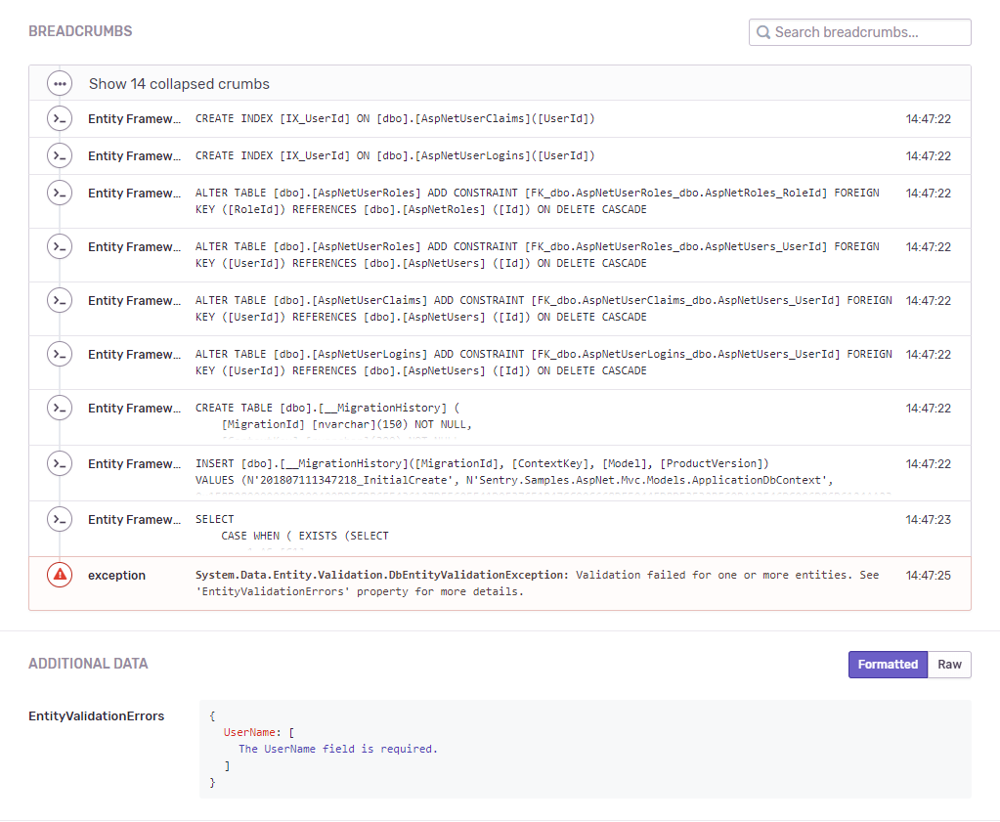

Sentry provides an integration with Entity Framework 6 through the [Sentry.EntityFramework NuGet package](https://www.nuget.org/packages/Sentry.EntityFramework).

> Looking for `EntityFramework Core`? If you're targeting .NET Core 3.1 or newer, that's already built in to the main Sentry .NET SDK. It's also enabled by default for our ASP.NET or ASP.NET Core integrations, even for older targets. For other scenarios, you may need to add the `Sentry.DiagnosticSource` package and call `AddDiagnosticSourceIntegration`, [as described here](/platforms/dotnet/tracing/instrumentation/automatic-instrumentation/#diagnosticsource-integration). (The rest of this page describes our EF6 integration, not EFCore.)

**Overview of the features**

- Queries as breadcrumbs
- Validation errors

All queries executed are added as breadcrumbs and are sent with any event which happens on the same [scope](enriching-events/scopes/). Besides that, validation errors are also included as `Extra`.

## Install
```powershell {tabTitle:Package Manager}
Install-Package Sentry.EntityFramework -Version {{@inject packages.version('sentry.dotnet.ef') }}
```

```shell {tabTitle:.NET Core CLI}
dotnet add package Sentry.EntityFramework -v {{@inject packages.version('sentry.dotnet.ef') }}
```

This package extends `Sentry` main SDK. That means that besides the EF features, through this package you'll also get access to all API and features available in the main `Sentry` SDK.

## Configure

**Error Monitoring** starts working as soon as you initialize the SDK. **Logs** sent through `SentrySdk.Logger` and **Application Metrics** need no extra configuration. You'll learn how to send them in [Send Logs](#send-logs) and [Send Application Metrics](#send-application-metrics-).

This guide also enables **Tracing**.


Add the Entity Framework 6 support to your project in one step:

- When initializing the SDK, call the extension method `AddEntityFramework()` on `SentryOptions`. This will register all error processors to extract extra data, such as validation errors, from the exceptions thrown by Entity Framework.

### Example configuration

The following example configures an ASP.NET application in `Global.asax.cs`. In addition to `Sentry.EntityFramework`, install [Sentry.AspNet](/platforms/dotnet/guides/aspnet/), which provides request context, request-scoped data, and the HTTP transaction helpers used here:

```powershell {tabTitle:Package Manager}
Install-Package Sentry.AspNet -Version {{@inject packages.version('sentry.dotnet.aspnet') }}
```

```shell {tabTitle:.NET Core CLI}
dotnet add package Sentry.AspNet -v {{@inject packages.version('sentry.dotnet.aspnet') }}
```

The snippet also turns on:

- Tracing: via <PlatformLink to="/configuration/options/#TracesSampleRate">`TracesSampleRate`</PlatformLink>

Don't need a feature? Remove its options from the snippet.

```csharp {filename:Global.asax.cs}
using System;
using System.Configuration;
using Sentry;
using Sentry.AspNet;

public class MvcApplication : System.Web.HttpApplication
{
    private IDisposable _sentrySdk;

    protected void Application_Start()
    {
        _sentrySdk = SentrySdk.Init(options =>
        {
            // We store the DSN inside Web.config
            options.Dsn = ConfigurationManager.AppSettings["SentryDsn"];
            // Adds request URL and headers, IP and name for users, etc.
            options.SendDefaultPii = true;
            // Enables Tracing.
            // Set to 1.0 to capture 100% of spans for tracing.
            // We recommend reducing this value in production.
            options.TracesSampleRate = 1.0;
            options.AddAspNet();
            options.AddEntityFramework();
        });
    }

    // Global error catcher
    protected void Application_Error() => Server.CaptureLastError();
    protected void Application_BeginRequest()
    {
        Context.StartSentryTransaction();
    }

    protected void Application_EndRequest()
    {
        Context.FinishSentryTransaction();
    }
    protected void Application_End()
    {
        _sentrySdk?.Dispose();
    }
}
```

## Send Logs

Use `SentrySdk.Logger` to send logs at different levels. These logs are sent without an additional option.

See <PlatformLink to="/logs/">Set Up Logs</PlatformLink> for all available logging methods and formatting options.

```csharp
SentrySdk.Logger.LogInfo("Order processed");
SentrySdk.Logger.LogWarning("Rate limit reached for /api/orders");
```

## Send Application Metrics <FeatureBadge type="new" />

Metrics are enabled by default in Sentry .NET SDK 6.1.0 and later. Use `SentrySdk.Metrics` to send counters, gauges, and distributions from your app.

See <PlatformLink to="/metrics/">Set Up Metrics</PlatformLink> for all available metric types and configuration options.

```csharp
SentrySdk.Metrics.EmitCounter("button_click", 5,
    new Dictionary<string, object> { ["browser"] = "Firefox" });
SentrySdk.Metrics.EmitGauge("page_load", 15.0, MeasurementUnit.Duration.Millisecond,
    new Dictionary<string, object> { ["page"] = "/home" });
SentrySdk.Metrics.EmitDistribution("api_latency", 187, MeasurementUnit.Duration.Millisecond,
    new Dictionary<string, object> { ["endpoint"] = "/api/orders" });
```

## Verify Your Setup

Let's test your setup and confirm that data reaches your Sentry project.

<PlatformContent includePath="getting-started-verify" />

### View Captured Data in Sentry

<PlatformContent includePath="getting-started-verify-data" />

## Sample

See the [Entity Framework sample](https://github.com/getsentry/sentry-dotnet/tree/main/samples/Sentry.Samples.EntityFramework) for a standalone application using this integration.



## Next Steps

At this point, you should have integrated Sentry into your Entity Framework application. Here's what to explore next:

- Explore [practical guides](/get-started/guides/) on what to monitor, log, track, and investigate after setup
- Learn how to [manually capture errors](/platforms/dotnet/usage/)
- Explore [Tracing](/platforms/dotnet/tracing/)
