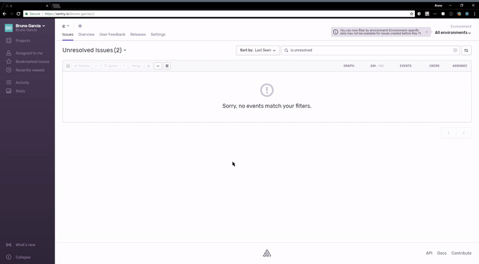

Sentry provides an integration with log4net through the [Sentry.Log4Net NuGet package](https://www.nuget.org/packages/Sentry.Log4Net).

The `SentryAppender` captures log events as Sentry events and breadcrumbs, including additional properties like `Exception` data and more.

Log messages are also sent to Sentry as [Structured Logs](logs/).

## Install

Add the Sentry dependency:

```powershell {tabTitle:Package Manager}
Install-Package Sentry.Log4Net -Version {{@inject packages.version('sentry.dotnet.log4net') }}
```

```shell {tabTitle:.NET Core CLI}
dotnet add package Sentry.Log4Net -v {{@inject packages.version('sentry.dotnet.log4net') }}
```

This package extends `Sentry` main SDK. That means besides the log4net `Appender`, through this package you'll also get access to all API and features available in the main `Sentry` SDK.

## Configure

Initialize Sentry first, with `SentrySdk.Init` or a host integration such as [ASP.NET Core](/platforms/dotnet/guides/aspnetcore/):

```csharp
SentrySdk.Init(options =>
{
    options.Dsn = "___PUBLIC_DSN___";
});
```

Then add the appender to your log4net configuration.
This can be done, for example, via the `app.config` for console and desktop apps or `web.config` in case of ASP.NET.


```xml {filename:app.config}
  <appender name="SentryAppender" type="Sentry.Log4Net.SentryAppender, Sentry.Log4Net">
    <!--Sends the log event Identity value as the user-->
    <SendIdentity value="true" />
    <threshold value="INFO" />
  </appender>
```

Other [SDK options](/platforms/dotnet/guides/log4net/configuration/options/) can also be configured when calling `SentrySdk.Init`.

The appender drops log events while Sentry isn't initialized. If a DSN can be found anyway, for example in the `SENTRY_DSN` environment variable, the appender also writes a warning to standard error the first time it drops an event. To fix it, initialize Sentry at startup as shown above.

### SendIdentity

In the example above, the `SendIdentity` flag was switched on. The SDK then will take the log4net `Identity` value and report to Sentry as the user's id.

## Verify

This snippet includes an intentional error, so you can test that everything is working as soon as you set it up.

<PlatformContent includePath="getting-started-verify" />

## Sample

For a [sample app.config](https://github.com/getsentry/sentry-dotnet/blob/main/samples/Sentry.Samples.Log4Net/app.config) or a complete working [sample](https://github.com/getsentry/sentry-dotnet/tree/main/samples/Sentry.Samples.Log4Net) to see it in action.



## Next Steps

- Explore [practical guides](/get-started/guides/) on what to monitor, log, track, and investigate after setup
