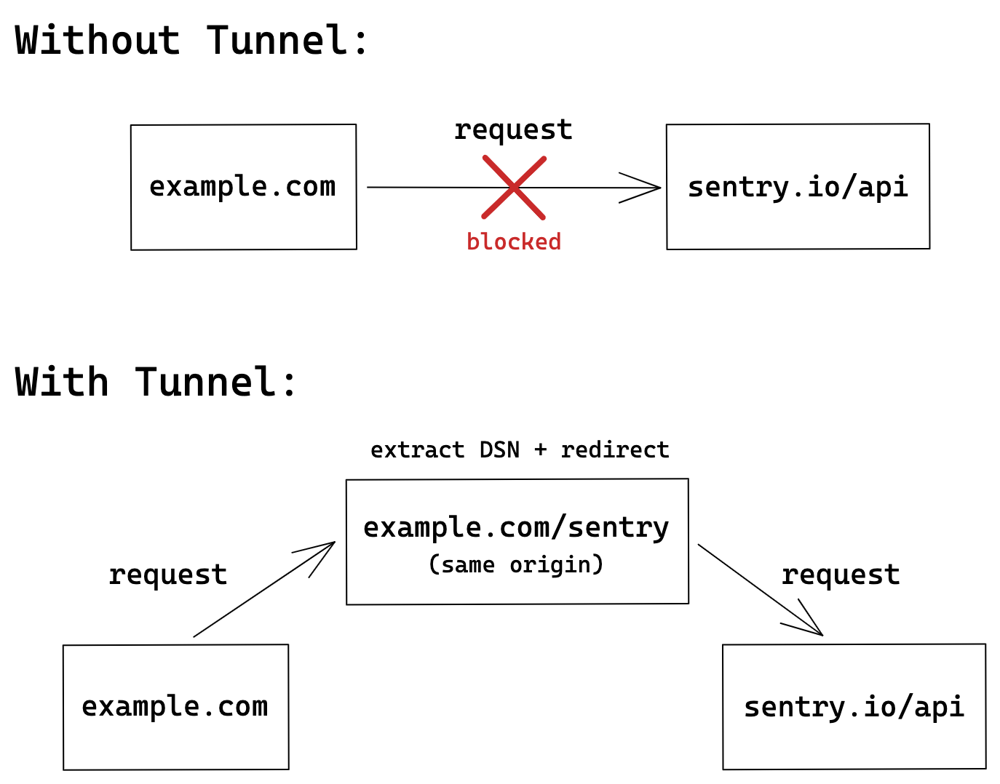

Ad blockers often block requests to Sentry's ingest endpoints, so errors, sessions, and performance data never reach Sentry. A tunnel is an endpoint on your own origin that forwards these events to Sentry. Ad blockers don't treat requests to your own origin as third-party requests, so they let them through.



## Choosing an Approach

<PlatformSection supported={["javascript.nextjs"]}>

- **`tunnelRoute` (recommended):** The Next.js SDK creates the tunnel route for you. See <PlatformLink to="/configuration/build/#tunnelRoute">`tunnelRoute`</PlatformLink>.
- **Your own tunnel:** Point the `tunnel` option at an endpoint you write. See [Setting Up Your Own Tunnel](#setting-up-your-own-tunnel).

</PlatformSection>

<PlatformSection supported={["javascript.solidstart"]}>

Point the `tunnel` option at an endpoint you write. See [Setting Up Your Own Tunnel](#setting-up-your-own-tunnel).

</PlatformSection>

<PlatformSection notSupported={["javascript.nextjs", "javascript.solidstart"]}>

- **Managed tunnel (recommended):** The SDK picks the tunnel path and your server SDK forwards the events. See [Using the Managed Tunnel](#using-the-managed-tunnel).
- **Your own tunnel:** Point the `tunnel` option at an endpoint you write. Use this on SDK versions before `11.10.0`, or when your server doesn't run a Sentry JavaScript SDK. See [Setting Up Your Own Tunnel](#setting-up-your-own-tunnel).

## Using the Managed Tunnel

<AvailableSince version="11.10.0" />

Set `tunnel: true` in your browser `Sentry.init`, and add `serveTunnelIntegration` to your server `Sentry.init`:

```javascript {tabTitle:Browser}
Sentry.init({
  dsn: "___PUBLIC_DSN___",
  tunnel: true,
});
```

```javascript {tabTitle:Server}
Sentry.init({
  dsn: "___PUBLIC_DSN___",
  integrations: [Sentry.serveTunnelIntegration()],
});
```

The browser then sends its events to a path on your own origin derived from the DSN, and your server forwards them to Sentry.

<PlatformSection supported={["javascript.sveltekit", "javascript.nuxt", "javascript.nitro", "javascript.astro", "javascript.tanstackstart-react"]}>

The SDK serves the tunnel for you, so this is all the setup you need.

</PlatformSection>

<PlatformSection supported={["javascript.react-router"]}>

In framework mode, the SDK serves the tunnel for you. In other modes, you also need to <PlatformLink to="/configuration/integrations/servetunnel/#mounting-the-tunnel-handler">mount the tunnel handler</PlatformLink>.

</PlatformSection>

<PlatformSection supported={["javascript.remix"]}>

On Remix 3, the SDK serves the tunnel for you. On earlier versions, you also need to <PlatformLink to="/configuration/integrations/servetunnel/#mounting-the-tunnel-handler">mount the tunnel handler</PlatformLink>.

</PlatformSection>

<PlatformCategorySection supported={["server"]}>

<PlatformSection notSupported={["javascript.sveltekit", "javascript.nuxt", "javascript.nitro", "javascript.astro", "javascript.tanstackstart-react", "javascript.react-router", "javascript.remix"]}>

<PlatformSection supported={["javascript.cloudflare"]}>

The integration doesn't handle requests by itself. Call `handleTunnelRequestIfMatched` at the start of your `fetch` handler:

```javascript
import * as Sentry from "@sentry/cloudflare";

export default Sentry.withSentry(
  (env) => ({
    dsn: "___PUBLIC_DSN___",
    integrations: [Sentry.serveTunnelIntegration()],
  }),
  {
    async fetch(request, env, ctx) {
      return (
        (await Sentry.handleTunnelRequestIfMatched(request)) ??
        new Response("Hello")
      );
    },
  }
);
```

</PlatformSection>

<PlatformSection notSupported={["javascript.cloudflare"]}>

The integration doesn't handle requests by itself. Mount the tunnel handler, `handleTunnelRequestIfMatched`, before your routes and body parsers. It forwards tunnel requests and returns `undefined` for everything else:

```javascript {tabTitle:Express}
const express = require("express");
const Sentry = require("@sentry/node");

const app = express();

app.use(
  (req, res, next) => Sentry.handleTunnelRequestIfMatched(req, res) ?? next()
);
```

```javascript {tabTitle:Fastify}
const Fastify = require("fastify");
const Sentry = require("@sentry/node");

const app = Fastify();

app.addHook("onRequest", async (request, reply) => {
  const tunnelResponse = Sentry.handleTunnelRequestIfMatched(
    request.raw,
    reply.raw
  );
  if (tunnelResponse) {
    await tunnelResponse;
    return reply;
  }
});
```

```javascript {tabTitle:Fetch API}
export default {
  fetch(request) {
    return (
      Sentry.handleTunnelRequestIfMatched(request) ?? new Response("Hello")
    );
  },
};
```

</PlatformSection>

</PlatformSection>

See <PlatformLink to="/configuration/integrations/servetunnel/">`serveTunnelIntegration`</PlatformLink> for all options, like a fixed path or more allowed DSNs, and for registering the tunnel as a route instead.

</PlatformCategorySection>

<PlatformCategorySection notSupported={["server"]}>

Your server also needs to serve the tunnel. See [`serveTunnelIntegration`](/platforms/javascript/guides/node/configuration/integrations/servetunnel/) for how to set it up, and for all options, like a fixed path or more allowed DSNs.

</PlatformCategorySection>

</PlatformSection>

## Setting Up Your Own Tunnel

Set the `tunnel` option to the URL of your endpoint. We recommend a path on your own origin, like `/tunnel`, so the browser doesn't send a CORS preflight request:

```javascript
Sentry.init({
  dsn: "___PUBLIC_DSN___",
  tunnel: "/tunnel",
});
```

The SDK now sends all events to `/tunnel`. Your endpoint must:

- Forward the request body to Sentry, without cookies or auth headers.
- Accept only envelopes whose DSN is on a list of allowed DSNs. Otherwise, anyone can use your endpoint to send requests to other servers.
- Send the envelope only to the host of that DSN.

If your server runs a Sentry JavaScript SDK, `handleTunnelRequest` does all of this for you:

```javascript
// Import from your server SDK. On version 10, import from @sentry/core instead.
import { handleTunnelRequest } from "@sentry/node";

export async function POST(request) {
  return handleTunnelRequest(request, {
    allowedDsns: ["___PUBLIC_DSN___"],
  });
}
```

<Expandable title="Examples in other languages">

```csharp {tabTitle:ASP.NET Core}
// This functionality is now built-in to the Sentry.AspNetCore package.
// See https://docs.sentry.io/platforms/dotnet/guides/aspnetcore/#tunnel
// docs for more information.

// This example shows how you could implement it yourself:

using System;
using System.Collections.Generic;
using System.IO;
using System.Net.Http;
using System.Text.Json;
using Microsoft.AspNetCore;
using Microsoft.AspNetCore.Builder;
using Microsoft.AspNetCore.Hosting;
using Microsoft.AspNetCore.Http;

// Change host appropriately if you run your own Sentry instance.
const string host = "sentry.io";
// Set knownProjectIds to a list with your Sentry project IDs which you
// want to accept through this proxy.
var knownProjectIds = new HashSet<string>() {  };

var client = new HttpClient();
WebHost.CreateDefaultBuilder(args).Configure(a =>
    a.Run(async context =>
    {
        context.Request.EnableBuffering();
        using var reader = new StreamReader(context.Request.Body);
        var header = await reader.ReadLineAsync();
        var headerJson = JsonSerializer.Deserialize<Dictionary<string, object>>(header);
        if (headerJson.TryGetValue("dsn", out var dsnString)
            && Uri.TryCreate(dsnString.ToString(), UriKind.Absolute, out var dsn))
        {
            var projectId = dsn.AbsolutePath.Trim('/');
            if (knownProjectIds.Contains(projectId) && string.Equals(dsn.Host, host, StringComparison.OrdinalIgnoreCase)) {
              context.Request.Body.Position = 0;
              await client.PostAsync($"https://{dsn.Host}/api/{projectId}/envelope/",
                  new StreamContent(context.Request.Body));
            }
        }
    })).Build().Run();
```

```ruby {tabTitle:Rails}
require 'net/http'

class HomeController < ApplicationController

  SENTRY_HOST = "oXXXXXX.ingest.sentry.io"
  SENTRY_PROJECT_IDS = ["123456"]

  def tunnel
    envelope = request.body.read
    piece = envelope.split("\n").first
    header = JSON.parse(piece)
    dsn = URI.parse(header['dsn'])
    project_id = dsn.path.tr('/', '')

    raise "Invalid sentry hostname: #{dsn.hostname}" if dsn.hostname != SENTRY_HOST
    raise "Invalid sentry project id: #{project_id}" unless SENTRY_PROJECT_IDS.include?(project_id)

    upstream_sentry_url = "https://#{SENTRY_HOST}/api/#{project_id}/envelope/"
    Net::HTTP.post(URI(upstream_sentry_url), envelope)

    head(:ok)
  rescue => e
    # handle exception in your preferred style,
    # e.g. by logging or forwarding to server Sentry project
    Rails.logger.error('error tunneling to sentry')
  end

end
```

</Expandable>

### Credentials on Tunnel Requests

The browser SDK doesn't set the [`credentials`](https://developer.mozilla.org/en-US/docs/Web/API/Request/credentials) option of `fetch`. With the default value `same-origin`, the browser sends credentials (cookies and HTTP authentication) to a tunnel on the same origin as your app. A tunnel that forwards request headers sends these credentials to Sentry.

<PlatformSection supported={["javascript.nextjs"]}>

The Next.js `tunnelRoute` option handles this for you.

</PlatformSection>

Forward only the request body, or tell the browser to send no credentials:

```javascript
Sentry.init({
  dsn: "___PUBLIC_DSN___",
  tunnel: "/tunnel",
  transportOptions: {
    fetchOptions: { credentials: "omit" },
  },
});
```

If a layer in front of your tunnel requires credentials (for example, Vercel Deployment Protection, Cloudflare Access, or HTTP Basic authentication), it rejects requests without credentials. Keep the default in this case, and make sure that your tunnel doesn't forward the request headers.
