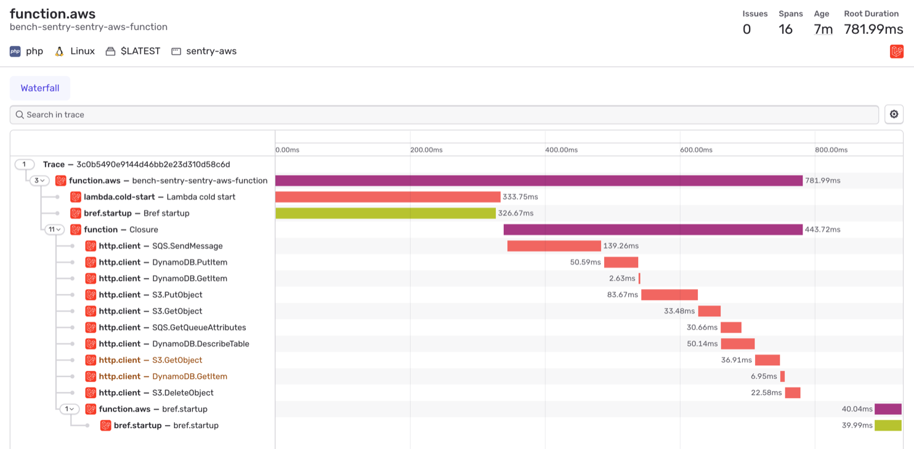
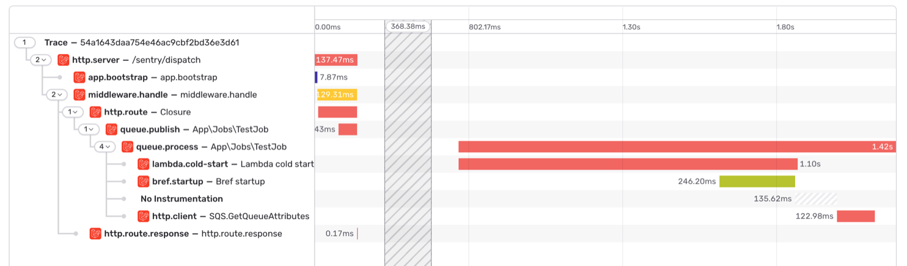
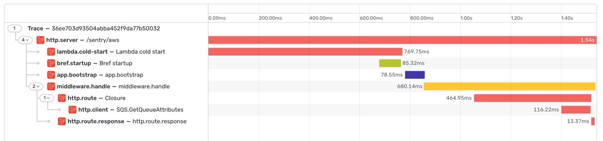
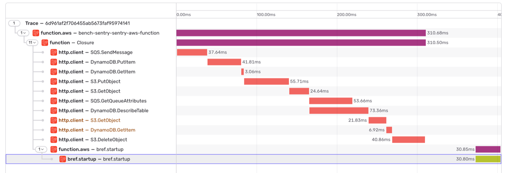

Once [tracing is enabled](/platforms/php/guides/bref/tracing/), the integration traces event handlers and cold starts without any code.

## Event Handlers

[Event handlers](https://bref.sh/docs/runtimes/function) process SQS messages, EventBridge events, S3 notifications, and more. There's no HTTP request around them, so the Sentry SDK doesn't start transactions on its own. The integration creates a transaction for each invocation, named after the Lambda function.

With Laravel, the Sentry SDK for Laravel already creates a transaction for each queued job and Octane request, named after the job or the route. The integration adds the cold start to these transactions instead of creating its own.

## Cold Starts

On a cold start, Lambda creates a new instance before it handles the request, and your users wait for it. The integration adds this time to the first transaction of each instance, as two spans:

- `lambda.cold-start`: from the start of PHP to the start of the request
- `bref.startup`: the startup of Bref, inside the cold start

The cold start span begins when PHP starts. The time Lambda spends before that, to create the instance, is missing.

When Lambda [initializes an instance proactively](https://docs.aws.amazon.com/lambda/latest/dg/lambda-runtime-environment.html), before any request needs it, nobody waits for it. These cold starts aren't added to transactions.

## Restarts of Event Handlers

By default, Bref restarts the PHP process of event handlers after each invocation (see [`BREF_LOOP_MAX`](https://bref.sh/docs/environment/performances#bref-for-event-driven-functions)). The restart happens after the invocation's response, so it's not part of its transaction. The integration reports it as a separate `bref.startup` transaction, in the same trace as the previous invocation.

