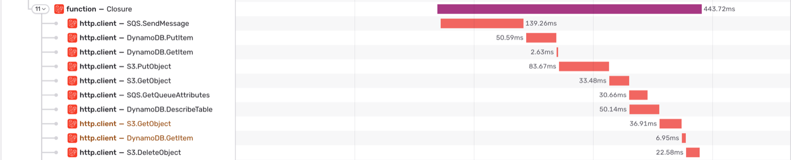

Slow or failing AWS calls, like an SQS message that takes a second to send, are a common cause of slow or failing requests. To see these calls in Sentry, trace each AWS SDK client after creating it:

```php
use Aws\Sqs\SqsClient;
use Sentry\Bref\AwsSdk\AwsSdkTracer;

$sqs = new SqsClient([
    // ...
]);
AwsSdkTracer::trace($sqs);
```

Each call adds a breadcrumb and, during a transaction, a span. They contain the operation (for example, `SQS.SendMessage`), the HTTP status, the AWS request ID, and the resource: the SQS queue, the SNS topic, the DynamoDB tables, or the S3 bucket.



Clients that your framework creates, like the SQS client of Laravel queues, aren't traced.
