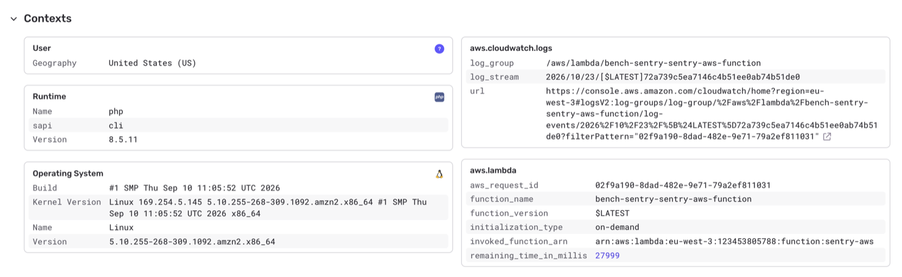

The Sentry SDK reports the exceptions of your application. On Lambda, the integration also reports the errors that the SDK can't see: errors outside PHP-FPM, and exceptions thrown by event handlers.

## Lambda Errors

With PHP-FPM, some errors happen in the Lambda runtime, outside the PHP-FPM worker where the Sentry SDK runs. These include:

- Lambda timeouts
- Responses larger than the 6 MB Lambda limit
- PHP-FPM crashes

Without the integration, these requests would fail without any trace in Sentry. The integration reports them along with the URL and method of the request.

<Alert level="warning">
  This only works with Laravel and `bref/laravel-bridge`: the integration boots
  Laravel to load your Sentry configuration in the Lambda runtime.
</Alert>

## Event Handlers

[Event handlers](https://bref.sh/docs/runtimes/function) process SQS messages, EventBridge events, S3 notifications, and more. There's no HTTP request around them, so the Sentry SDK doesn't catch their exceptions on its own. The integration reports the exceptions thrown by the handler, and adds two contexts to the events of the invocation:

- `aws.lambda`: the function, its version, and the AWS request ID
- `aws.cloudwatch.logs`: the log group and log stream, with a link to the logs of the invocation in CloudWatch



If you don't use a framework, initialize the SDK in your handler file:

```php {filename:index.php}
<?php

require __DIR__ . '/vendor/autoload.php';

\Sentry\init([
    'dsn' => '___PUBLIC_DSN___',
]);

return function (array $event) {
    // ...
};
```

With Laravel, the integration also adds these contexts to the events of queued jobs and Octane requests.
