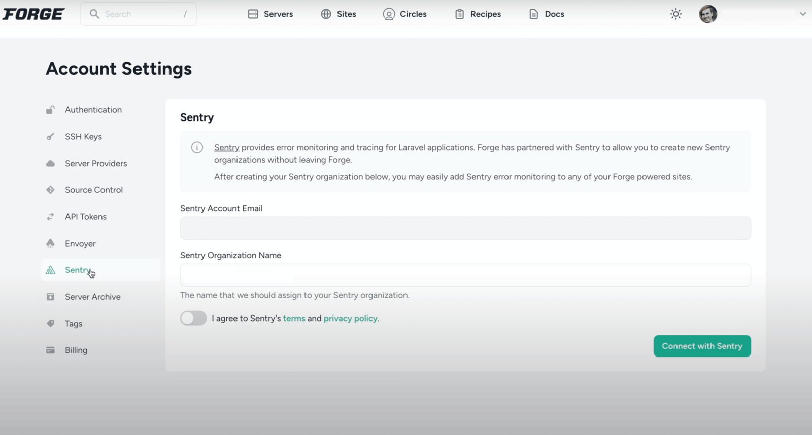

## Prerequisites

You need:

- a [Sentry account](https://sentry.io/signup/) and project
- an application running on PHP `7.2` or later
- Laravel version `11.x`+
- [Composer](https://getcomposer.org/)

Read one of these guides if you use an [older Laravel version](/platforms/php/guides/laravel/other-versions/) or need [Lumen-specific instructions](/platforms/php/guides/laravel/other-versions/lumen/).

<Expandable title="Deploying with Forge?">

If you use Laravel Forge to provision and deploy your PHP application, you can create a Sentry organization through [Forge](https://forge.laravel.com/docs/integrations/sentry).



</Expandable>

<StepConnector selector="h2" showNumbers={true}>

## Install

Install the latest `sentry/sentry-laravel` package:

```bash
composer require sentry/sentry-laravel
```

### Install Excimer for Profiling

<Include name="php-quick-start-excimer" />

## Configure

**Error Monitoring** starts working as soon as you initialize Sentry. **Application Metrics** need no extra configuration and you'll learn how to send them in step [#4](#send-application-metrics-).
This guide also enables **Tracing**, **Profiling**, and **Logs**.

<Include name="quick-start-features-expandable" />

### Initialize the Sentry SDK

Publish the Sentry config file and set your DSN:

```shell
php artisan sentry:publish --dsn=___PUBLIC_DSN___
```

This creates the config file `config/sentry.php` and adds your DSN, along with any options you confirm at the prompts, to your `.env` file.

The snippet shown below also configures:

- Tracing: via <PlatformLink to="/configuration/options/#traces_sample_rate">`traces_sample_rate`</PlatformLink>
- Profiling: via <PlatformLink to="/configuration/options/#profiles_sample_rate">`profiles_sample_rate`</PlatformLink>
- Logs: via the <PlatformLink to="/logs/">`sentry_logs`</PlatformLink> channel in `LOG_STACK`

Don't need a feature? Remove its lines from your `.env` file.

```shell {filename:.env}
SENTRY_LARAVEL_DSN=___PUBLIC_DSN___

# Enables Tracing.
# Set to 1.0 to capture 100% of spans for tracing.
# We recommend reducing this value in production.
SENTRY_TRACES_SAMPLE_RATE=1.0

# Enables Profiling.
# Profiles are sampled relative to SENTRY_TRACES_SAMPLE_RATE.
SENTRY_PROFILES_SAMPLE_RATE=1.0

# Sends Laravel logs to Sentry through the sentry_logs channel.
LOG_CHANNEL=stack
LOG_STACK=single,sentry_logs
```

<Alert level="warning" title="Capture stack trace arguments">
  To receive stack trace arguments in your errors, set `zend.exception_ignore_args = Off` in your `php.ini`.
</Alert>

### Disable Sentry During Local Development and Testing

When Sentry is installed in your application, it's also active when you're developing or running tests. This can send unwanted events to Sentry and slow down your application or test suite.

To stop sending events to Sentry, leave `SENTRY_LARAVEL_DSN` out of your `.env` file or set it to `SENTRY_LARAVEL_DSN=null`.

### Control the Data You Send to Sentry

By default, the SDK sends user identity data (IP address, ID, and similar) and other data (HTTP bodies, URL query parameters, etc.), with sensitive values scrubbed.

To opt out of individual categories use the `data_collection` option. For the full list of categories and their defaults, <PlatformLink to="/configuration/options/#data_collection">see the `data_collection` options</PlatformLink>.

```php
'data_collection' => [
    // opt out of collecting user info
    'user_info' => false,
    // opt out of collecting cookies
    'cookies' => ['mode' => 'off'],
    // other categories
],
```

### Report Unhandled Exceptions

Enable capturing unhandled exceptions to report to Sentry by making the following change to your `bootstrap/app.php`:

```php {filename:bootstrap/app.php}
<?php

use Illuminate\Foundation\Application;
use Illuminate\Foundation\Configuration\Exceptions;
use Illuminate\Foundation\Configuration\Middleware;
use Sentry\Laravel\Integration;

return Application::configure(basePath: dirname(__DIR__))
    ->withRouting(
        web: __DIR__.'/../routes/web.php',
        commands: __DIR__.'/../routes/console.php',
        health: '/up',
    )
    ->withMiddleware(function (Middleware $middleware) {
        //
    })
    ->withExceptions(function (Exceptions $exceptions) {
        Integration::handles($exceptions);
    })
    ->create();
```

## Send Logs

<PlatformContent includePath="getting-started-logs" />

## Send Application Metrics <FeatureBadge type="new" />

<PlatformContent includePath="getting-started-metrics" />

## Verify Your Setup

Let's test your setup and confirm that Sentry is working correctly and sending data to your Sentry project.

### Verify With Artisan

You can test your configuration using the `sentry:test` artisan command:

```shell
php artisan sentry:test
```

### Verify With Code

Add a route that throws an exception, then visit it:

```php {filename:routes/web.php}
Route::get('/debug-sentry', function () {
    throw new Exception('My first Sentry error!');
});
```

### View Captured Data in Sentry

Now, head over to your project on [Sentry.io](https://sentry.io) to view the collected data (it takes a couple of moments for the data to appear).

<Include name="quick-start-locate-data-expandable" />

## Next Steps

At this point, you should have integrated Sentry into your Laravel application. Here's what to explore next:

- Explore [practical guides](/get-started/guides/) on what to monitor, log, track, and investigate after setup
- Monitor and debug your Laravel agents with <PlatformLink to="/agent-tracing/">Agent Tracing</PlatformLink>
- Learn how to use <PlatformLink to="/crons/">Crons</PlatformLink> and <PlatformLink to="/feature-flags/">Feature Flags</PlatformLink>
- Collect user feedback via the <PlatformLink to="/user-feedback/">Crash-Report Modal</PlatformLink>

<Expandable permalink={false} title="Are you having problems setting up the SDK?">

- Find various topics in <PlatformLink to="/troubleshooting/">Troubleshooting</PlatformLink>
- [Get support](https://www.sentry.help/en/)

</Expandable>

</StepConnector>
