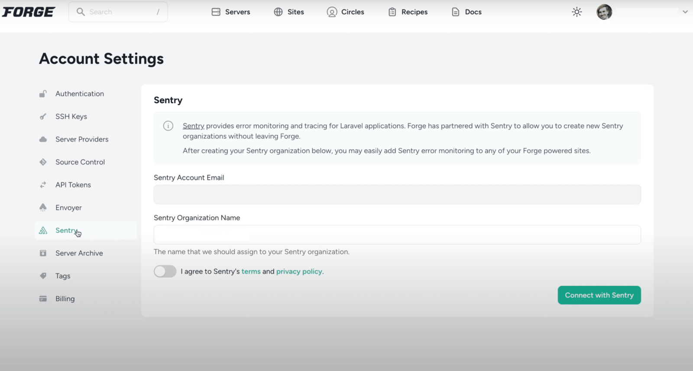

## Prerequisites

- You need a [Sentry account](https://sentry.io/signup/) and project
- Your application needs to meet your Laravel version's PHP requirements (PHP 8.2 or later for Laravel 11)
- Your Laravel version needs to be 11.x or higher
- Read one of these guides if you use an [older version](/platforms/php/guides/laravel/other-versions/) or need [Lumen-specific instructions](/platforms/php/guides/laravel/other-versions/lumen/)

## Install

Install Sentry Laravel SDK 4.28.0 or later. This requires PHP SDK 4.31.0 or later, where Logs and Application Metrics don't need enable options:

```bash
composer require "sentry/sentry-laravel:^4.28"
```

## Configure

**Error Monitoring** starts working once you add your DSN and register Sentry's exception handler. **Logs** need the `sentry_logs` log channel in your log stack, which the snippet below sets up. **Application Metrics** need no extra configuration. You'll learn how to send both in [Send Logs](#send-logs) and [Send Application Metrics](#send-application-metrics-).
This guide also enables **Tracing** and **Profiling**. Laravel also supports <PlatformLink to="/crons/">Crons</PlatformLink>, <PlatformLink to="/agent-tracing/">Agent Tracing</PlatformLink>, <PlatformLink to="/feature-flags/">Feature Flags</PlatformLink>, and <PlatformLink to="/user-feedback/">User Feedback</PlatformLink>.

Publish the Sentry config file and set your DSN with this command:

```shell
php artisan sentry:publish --dsn=___PUBLIC_DSN___
```

It creates the config file (`config/sentry.php`) and adds your DSN, along with any options you confirm at the prompts, to your `.env` file. Make sure your `.env` file includes the following:

```shell {filename:.env}
SENTRY_LARAVEL_DSN=___PUBLIC_DSN___
# Send request headers, cookies, and IP address.
SENTRY_SEND_DEFAULT_PII=true

# Enables Tracing.
# Set to 1.0 to capture 100% of spans for tracing.
# We recommend reducing this value in production.
SENTRY_TRACES_SAMPLE_RATE=1.0

# Enables Profiling.
# Profiles are sampled relative to SENTRY_TRACES_SAMPLE_RATE.
SENTRY_PROFILES_SAMPLE_RATE=1.0

# Sends Laravel logs to Sentry through the sentry_logs channel.
LOG_CHANNEL=stack
LOG_STACK=single,sentry_logs
```

The snippet also turns on:

- Request headers, cookies, and IP address: via <PlatformLink to="/configuration/options/#send_default_pii">`send_default_pii`</PlatformLink>
- Tracing: via <PlatformLink to="/configuration/options/#traces_sample_rate">`traces_sample_rate`</PlatformLink>
- Profiling: via <PlatformLink to="/configuration/options/#profiles_sample_rate">`profiles_sample_rate`</PlatformLink>
- Logs: via the `sentry_logs` channel in `LOG_STACK`

Don't need a feature? Remove its lines from your `.env` file.

### Report Unhandled Exceptions

Enable capturing unhandled exceptions to report to Sentry by making the following change to your `bootstrap/app.php`:

```php {filename:bootstrap/app.php}
<?php

use Illuminate\Foundation\Application;
use Illuminate\Foundation\Configuration\Exceptions;
use Illuminate\Foundation\Configuration\Middleware;
use Sentry\Laravel\Integration;

return Application::configure(basePath: dirname(__DIR__))
    ->withRouting(
        web: __DIR__.'/../routes/web.php',
        commands: __DIR__.'/../routes/console.php',
        health: '/up',
    )
    ->withMiddleware(function (Middleware $middleware) {
        //
    })
    ->withExceptions(function (Exceptions $exceptions) {
        Integration::handles($exceptions);
    })
    ->create();
```

### Install Excimer for Profiling

Profiling requires the Excimer PHP extension. Install it with PECL:

```bash
pecl install excimer
```

Excimer supports PHP 7.2 and later, and requires Linux or macOS. It doesn't support Windows. For other installation methods, see the <PlatformLink to="/profiling/#installation">Excimer installation guide</PlatformLink>.

Depending on your PHP installation, you may also need to enable `extension=excimer.so` in the `php.ini` used by your application and restart your PHP workers or web server. Confirm that Excimer is loaded in the PHP runtime serving your application.

### Capture Stack Trace Arguments

<Alert level="warning">
  To receive stack trace arguments in your errors, set
  `zend.exception_ignore_args = Off` in your `php.ini`.
</Alert>

### Disable Sentry During Local Development and Testing

When Sentry is installed in your application, it's also active when you're developing or running tests. This can send unwanted events to Sentry and slow down your application or test suite.

To stop sending events to Sentry, set the DSN to `null`. You can do this by leaving `SENTRY_LARAVEL_DSN` out of your `.env` file or by setting `SENTRY_LARAVEL_DSN=null`.

### Set Up Sentry Through Forge

If you use Laravel Forge to provision and deploy your PHP application, you can create a Sentry organization through [Forge](https://forge.laravel.com/docs/integrations/sentry).



## Send Logs

Once the `sentry_logs` channel is in your log stack, Laravel's `Log` facade sends logs to Sentry. Laravel flushes logs automatically when a request, command, or job finishes.

```php
use Illuminate\Support\Facades\Log;

Log::info('Checkout completed', ['order_id' => 12345]);
```

If your `config/logging.php` defines the stack's `channels` array directly instead of reading `LOG_STACK`, add `sentry_logs` to that array. See <PlatformLink to="/logs/#setup">Set Up Logs</PlatformLink> for older SDK versions, custom channel configuration, log levels, and filtering.

## Send Application Metrics <FeatureBadge type="new" />

Use `\Sentry\traceMetrics()` to send counters, gauges, and distributions. Metrics are enabled by default after you install the SDK; no metrics option is required. Laravel flushes metrics automatically at the end of each request or command.

```php
\Sentry\traceMetrics()->count('checkout.failed', 1);
```

See <PlatformLink to="/metrics/">Set Up Metrics</PlatformLink> for all available metric types and configuration options.

## Verify Your Setup

Add a route that throws an exception, then visit it to confirm that Sentry captures the error:

```php {filename:routes/web.php}
Route::get('/debug-sentry', function () {
    throw new Exception('My first Sentry error!');
});
```

To check your DSN and connectivity from the command line, you can also run:

```shell
php artisan sentry:test
```

### View Captured Data in Sentry

Run the logging and metrics examples above in a request, command, or job. If you kept Tracing and Profiling enabled, make a request to a route in your application. After a few moments, open your project in [Sentry](https://sentry.io/) and check:

- **Issues** for the test error.
- **Logs** for `Checkout completed`.
- **Application Metrics** for the `checkout.failed` counter.
- **Tracing and Profiling** for the request's trace and its associated profile. Very short requests may not collect enough profiling samples to produce a profile.

## Next Steps

At this point, you should have integrated Sentry into your Laravel application. Here's what to explore next:

- Explore [practical guides](/get-started/guides/) on what to monitor, log, track, and investigate after setup
- <PlatformLink to="/usage/">Learn how to manually capture errors</PlatformLink>
- Fine-tune Tracing with <PlatformLink to="/configuration/sampling/#setting-a-sampling-function">`traces_sampler`</PlatformLink> or <PlatformLink to="/configuration/laravel-options/#lower-sample-rate-for-specific-jobs">lower the sample rate for specific jobs</PlatformLink>
- Review all <PlatformLink to="/configuration/laravel-options/">Laravel options</PlatformLink>

<Expandable permalink={false} title="Are you having problems setting up the SDK?">

- <PlatformLink to="/troubleshooting/">Troubleshooting</PlatformLink>
- [Get support](https://www.sentry.help/en/)

</Expandable>
