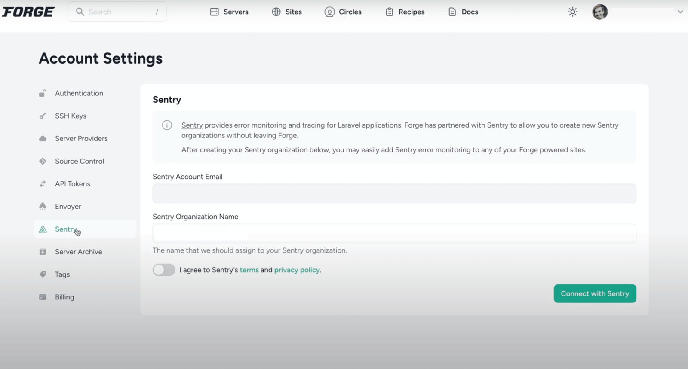

<AgentSetupCallout skill="sentry-php-sdk" platformName="PHP" />

<Alert level="warning" title="Using a framework?">
    This guide focuses on plain PHP. Read one of these other guides if you use <PlatformLink to="/guides/laravel/">Laravel</PlatformLink> or <PlatformLink to="/guides/symfony/">Symfony</PlatformLink>.
</Alert>

## Prerequisites
You need:
- a [Sentry account](https://sentry.io/signup/) and project
- an application running on PHP `7.2` or later
- [Composer](https://getcomposer.org/)

<Expandable title="Deploying with Forge?">

If you use Laravel Forge to provision and deploy your PHP application, you can create a Sentry organization through [Forge](https://forge.laravel.com/docs/integrations/sentry).



</Expandable>

<StepConnector selector="h2" showNumbers={true}>

## Install

Install the Sentry PHP SDK using Composer:

```bash
composer require "sentry/sentry:^4.31"
```

### Install Excimer for Profiling

<Include name="php-quick-start-excimer" />

## Configure

**Error Monitoring** starts working as soon as you call `\Sentry\init()`. **Logs** and **Application Metrics** need no extra configuration as of SDK version `4.31.0`, and you'll learn how to send them in steps [#3](#send-logs) and [#4](#send-application-metrics-).
This guide also configures **Tracing** and **Profiling**.

<Include name="quick-start-features-expandable" />

### Initialize the Sentry SDK

To capture errors that occur during startup, initialize the Sentry PHP SDK as early as possible in your application's lifecycle, after loading Composer's autoloader. The example below assumes your entry point is in the project root.

The snippet configures:

- Tracing: via <PlatformLink to="/configuration/options/#traces_sample_rate">`traces_sample_rate`</PlatformLink>
- Profiling: via <PlatformLink to="/configuration/options/#profiles_sample_rate">`profiles_sample_rate`</PlatformLink>

Don't need a feature? Remove its options from the snippet.

```php
require_once __DIR__ . '/vendor/autoload.php';

\Sentry\init([
  'dsn' => '___PUBLIC_DSN___',

  // Configures sampling for transactions you create below.
  // Set to 1.0 to capture 100% of spans for tracing.
  // We recommend reducing this value in production.
  'traces_sample_rate' => 1.0,

  // Enables Profiling.
  // Profiles are sampled relative to traces_sample_rate.
  'profiles_sample_rate' => 1.0,
]);
```

<Alert level="warning" title="Capture stack trace arguments">
  To receive stack trace arguments in your errors, set `zend.exception_ignore_args = Off` in your `php.ini`.
</Alert>

### Control the Data You Send to Sentry

By default, the SDK sends user identity data (IP address, ID, and similar) and other data (HTTP bodies, URL query parameters, etc.), with sensitive values scrubbed.

To opt out of individual categories use the `data_collection` option. For the full list of categories and their defaults, <PlatformLink to="/configuration/options/#data_collection">see the `data_collection` options</PlatformLink>.

```php
\Sentry\init([
    'dsn' => '___PUBLIC_DSN___',
    'data_collection' => [
        'user_info' => false,
        'cookies' => ['mode' => 'off'],
        // other categories
    ],
]);
```

### Start a Transaction

In plain PHP, the tracing and profiling sampling options don't create transactions automatically. Start a transaction around the work you want to trace and profile, and finish it to send the data to Sentry:

```php
$transactionContext = \Sentry\Tracing\TransactionContext::make()
    ->setName('Example transaction')
    ->setOp('task');

$transaction = \Sentry\startTransaction($transactionContext);
\Sentry\SentrySdk::getCurrentHub()->setSpan($transaction);

try {
    // Run the application code you want to trace and profile.
} finally {
    $transaction->finish();
    \Sentry\SentrySdk::getCurrentHub()->setSpan(null);
}
```

See <PlatformLink to="/tracing/instrumentation/custom-instrumentation/">Custom Instrumentation</PlatformLink> to add child spans and instrument more of your application.

## Send Logs

<PlatformContent includePath="getting-started-logs" />

If you already use Monolog, its <PlatformLink to="/integrations/monolog/#logs">Sentry LogsHandler</PlatformLink> can send messages to Sentry.

## Send Application Metrics <FeatureBadge type="new" />

<PlatformContent includePath="getting-started-metrics" />

## Verify Your Setup

Let's test your setup and confirm that Sentry is working correctly and sending data to your Sentry project.

Add an uncaught exception to a route or test script and run it:

```php
throw new \RuntimeException('Sentry test exception');
```

### View Captured Data in Sentry

Now, head over to your project on [Sentry.io](https://sentry.io) to view the collected data (it takes a couple of moments for the data to appear).

<Include name="quick-start-locate-data-expandable" />

## Next Steps

At this point, you should have integrated Sentry into your PHP application. Here's what to explore next:

- Explore [practical guides](/get-started/guides/) on what to monitor, log, track, and investigate after setup
- Learn how to use <PlatformLink to="/crons/">Crons</PlatformLink> and <PlatformLink to="/feature-flags/">Feature Flags</PlatformLink>
- Collect user feedback via the <PlatformLink to="/user-feedback/">Crash-Report Modal</PlatformLink>

<Expandable permalink={false} title="Are you having problems setting up the SDK?">

- Find various topics in <PlatformLink to="/troubleshooting/">Troubleshooting</PlatformLink>
- [Get support](https://www.sentry.help/en/)

</Expandable>

</StepConnector>
