The Sentry SDK for Python does a very good job of auto instrumenting your application. If you use one of the popular frameworks, we've got you covered because well-known operations like HTTP calls and database queries will be instrumented out of the box. The Sentry SDK will also check your installed Python packages and auto-enable the matching SDK integrations. If you want to enable tracing in a piece of code that performs some other operations, add the `@sentry_sdk.trace` decorator.

<Alert>

The examples on this page are for SDK `3.x`. The **SDK 2.x** tabs show the equivalent code for the default transaction mode of SDK `2.x`. If you use <PlatformLink to="/tracing/streamed-spans/">stream mode</PlatformLink> in SDK `2.x`, follow the **SDK 3.x** examples, but call the tracing functions on `sentry_sdk.traces` (for example, `sentry_sdk.traces.start_span()`) and set `trace_lifecycle="stream"` in `sentry_sdk.init()`.

</Alert>

<Alert title="Changed in 2.15.0">

The parameter `name` in `start_span()` used to be called `description`. In version 2.15.0 `description` was deprecated and from 2.15.0 on, only `name` should be used. `description` will be removed in `3.0.0`.

</Alert>

## Add a Service Span

Adding service spans (transactions in SDK `2.x`) will allow you to instrument and capture certain regions of your code.

<Alert>

If you're using one of Sentry's SDK integrations, service spans will be created for you automatically.

</Alert>

The following example creates a service span for an expensive operation (in this case, `eat_pizza`), and then sends the result to Sentry:

```python {tabTitle:SDK 3.x}
import sentry_sdk

def eat_slice(slice):
    ...

def eat_pizza(pizza):
    with sentry_sdk.start_span(
        name="Eat Pizza",
        attributes={"sentry.op": "task"},
        # set parent span to None to create service span
        parent_span=None,
    ):
        while pizza.slices > 0:
            span = sentry_sdk.start_span(name="Eat Slice")
            eat_slice(pizza.slices.pop())
            span.end()
```

```python {tabTitle:SDK 2.x}
import sentry_sdk

def eat_slice(slice):
    ...

def eat_pizza(pizza):
    with sentry_sdk.start_transaction(op="task", name="Eat Pizza"):
        while pizza.slices > 0:
            eat_slice(pizza.slices.pop())
```

The [API reference](https://getsentry.github.io/sentry-python/api.html#performance-monitoring) documents `start_span`, along with its parameters.

<Alert>

`sentry_sdk.start_span()` can, but doesn't have to be, used as a context manager. If you don't use it as a context manager, make sure to call `span.end()` to finish the span.

In SDK `2.x`, `sentry_sdk.start_transaction()` is meant to be used as a context manager. This ensures that the transaction will be properly set as active and any spans created within will be attached to it.

</Alert>

## Add Spans to a Service Span

If you want to have more fine-grained performance monitoring, you can add child spans to your service span, which can be done by either:

- Using a context manager
- Using a decorator (this works on sync and async functions)
- Manually starting and finishing a span

Calling `sentry_sdk.start_span()` will find the current active span and attach the new span to it.

### Using a Context Manager

```python {tabTitle:SDK 3.x}
import sentry_sdk

def eat_slice(slice):
    ...

def eat_pizza(pizza):
    with sentry_sdk.start_span(
        name="Eat Pizza",
        attributes={"sentry.op": "task"},
        parent_span=None,
    ):
        while pizza.slices > 0:
            with sentry_sdk.start_span(name="Eat Slice"):
                eat_slice(pizza.slices.pop())
```

```python {tabTitle:SDK 2.x}
import sentry_sdk

def eat_slice(slice):
    ...

def eat_pizza(pizza):
    with sentry_sdk.start_transaction(op="task", name="Eat Pizza"):
        while pizza.slices > 0:
            with sentry_sdk.start_span(name="Eat Slice"):
                eat_slice(pizza.slices.pop())
```

### Using a Decorator

```python {tabTitle:SDK 3.x}
import sentry_sdk

@sentry_sdk.trace
def eat_slice(slice):
    ...

def eat_pizza(pizza):
    with sentry_sdk.start_span(
        name="Eat Pizza",
        attributes={"sentry.op": "task"},
        parent_span=None,
    ):
        while pizza.slices > 0:
            eat_slice(pizza.slices.pop())
```

```python {tabTitle:SDK 2.x}
import sentry_sdk

@sentry_sdk.trace
def eat_slice(slice):
    ...

def eat_pizza(pizza):
    with sentry_sdk.start_transaction(op="task", name="Eat Pizza"):
        while pizza.slices > 0:
            eat_slice(pizza.slices.pop())
```

See the [@sentry_sdk.trace decoration section](#sentry_sdktrace-decorator) below for more details.

<Alert level="warning" title="Static & class methods">

When tracing a static or class method, you **must** add the `@sentry_sdk.trace` decorator **after** the `@staticmethod` or `@classmethod` decorator (i.e., **closer** to the function definition). Otherwise, your function will break.

</Alert>

### Manually Starting and Finishing a Span

```python {tabTitle:SDK 3.x}
import sentry_sdk

def eat_slice(slice):
    ...

def eat_pizza(pizza):
    with sentry_sdk.start_span(
        name="Eat Pizza",
        attributes={"sentry.op": "task"},
        parent_span=None,
    ):
        while pizza.slices > 0:
            span = sentry_sdk.start_span(name="Eat Slice")
            eat_slice(pizza.slices.pop())
            span.end()
```

```python {tabTitle:SDK 2.x}
import sentry_sdk

def eat_slice(slice):
    ...

def eat_pizza(pizza):
    with sentry_sdk.start_transaction(op="task", name="Eat Pizza"):
        while pizza.slices > 0:
            span = sentry_sdk.start_span(name="Eat Slice")
            eat_slice(pizza.slices.pop())
            span.finish()
```

When you create your span manually, make sure to call `span.end()` (in SDK `2.x`, `span.finish()`) after the block of code you want to wrap in a span to finish the span. If you do not finish the span it will not be sent to Sentry.

## Nested Spans

Spans can be nested to form a span tree. If you'd like to learn more, read our [distributed tracing](/concepts/key-terms/tracing/distributed-tracing/) documentation.

### Using a Context Manager

```python {tabTitle:SDK 3.x}
import sentry_sdk

def chew():
    ...

def eat_slice(slice):
    with sentry_sdk.start_span(name="Eat Slice"):
        with sentry_sdk.start_span(name="Chew"):
            chew()
```

```python {tabTitle:SDK 2.x}
import sentry_sdk

def chew():
    ...

def eat_slice(slice):
    with sentry_sdk.start_span(name="Eat Slice"):
        with sentry_sdk.start_span(name="Chew"):
            chew()
```

### Using a Decorator

```python {tabTitle:SDK 3.x}
import sentry_sdk

@sentry_sdk.trace
def chew():
    ...

@sentry_sdk.trace
def eat_slice(slice):
    chew()
```

```python {tabTitle:SDK 2.x}
import sentry_sdk

@sentry_sdk.trace
def chew():
    ...

@sentry_sdk.trace
def eat_slice(slice):
    chew()
```

See the [@sentry_sdk.trace decoration section](#sentry_sdktrace-decorator) below for more details.

### Manually Starting and Finishing

```python {tabTitle:SDK 3.x}
import sentry_sdk

def chew():
    ...

def eat_slice(slice):
    parent_span = sentry_sdk.start_span(name="Eat Slice")

    # pass the parent span via `parent_span` to create a child span
    child_span = sentry_sdk.start_span(name="Chew", parent_span=parent_span)
    chew()
    child_span.end()

    parent_span.end()
```

```python {tabTitle:SDK 2.x}
import sentry_sdk

def chew():
    ...

def eat_slice(slice):
    parent_span = sentry_sdk.start_span(name="Eat Slice")

    child_span = parent_span.start_child(name="Chew")
    chew()
    child_span.finish()

    parent_span.finish()
```

There's no separate `start_child()` method. Instead, the span will become the child of the currently active span. Alternatively, you can pass the parent span explicitly via `parent_span` when starting the child (as shown in the example above). See the [API reference](https://getsentry.github.io/sentry-python/api.html#sentry_sdk.api.start_span) for more details.

In SDK `2.x`, the parameters of `start_span()` and `start_child()` are the same.

When you create your span manually, make sure to call `span.end()` (in SDK `2.x`, `span.finish()`) after the block of code you want to wrap in a span to finish the span. If you do not finish the span it will not be sent to Sentry.

### Sibling Spans

<Alert>

In SDK `2.x`, only available in stream mode.

</Alert>

A span normally attaches to whatever span is currently active. To control parentage explicitly, for example to make a span a sibling instead of a child, pass `parent_span` directly:

```python
import sentry_sdk

def eat_slice(slice):
    ...

def chew():
    ...

def eat_pizza(pizza):
    with sentry_sdk.start_span(name="Eat Pizza") as pizza_span:
        with sentry_sdk.start_span(name="Eat Slice"):
            with sentry_sdk.start_span(name="Chew", parent_span=pizza_span):
                # "Chew" is a sibling of "Eat Slice", not its child
                chew()
            eat_slice(pizza.slices.pop())
```

## @sentry_sdk.trace decorator

The `@sentry_sdk.trace` decorator accepts `name`, `attributes`, and `active` to customize your spans. Note that there's no `op` parameter; set the operation as the `sentry.op` key in `attributes` instead. Attribute values can only be primitive types (like `int`, `float`, `bool`, `str`) or a list of those types without mixing types.

In SDK `2.x`, the decorator accepts `op`, `name`, and `attributes`.

<Alert level="warning" title="Static & class methods">

When tracing a static or class method, you **must** add the decorator **after** the `@staticmethod` or `@classmethod` decorator (i.e., **closer** to the function definition). Otherwise, your function will break.

</Alert>

```python {tabTitle:SDK 3.x}
import sentry_sdk

@sentry_sdk.trace(name="Paul", attributes={"sentry.op": "my_op", "x": True})
def my_function(i):
    ...

@sentry_sdk.trace
def root_function():
    for i in range(3):
        my_function(i)

root_function()
```

```python {tabTitle:SDK 2.x}
import sentry_sdk

@sentry_sdk.trace(op="my_op", name="Paul", attributes={"x": True})
def my_function(i):
    ...

@sentry_sdk.trace
def root_function():
    for i in range(3):
        my_function(i)

root_function()
```

The code above will customize the `my_function` spans like this:

```mermaid
gantt
    dateFormat DD
    todayMarker off
    axisFormat %
    SPAN(op=function, name=root_function)   :a1, 01, 7d
    SPAN(op=my_op, name=Paul, x=True)    :a2, 02, 2d
    SPAN(op=my_op, name=Paul, x=True)    :a3, 04, 2d
    SPAN(op=my_op, name=Paul, x=True)    :a4, 06, 2d
```



### Span Templates

<Alert>

Only available in SDK versions prior to `3.0`.

</Alert>

In the `@sentry_sdk.trace` decorator you can also specify a `template`. This helps create spans that follow a certain template. Currently this is only available for spans that are created for the [agents instrumentation](/platforms/python/agent-tracing/manual-instrumentation/) of Sentry.

Available templates are `AI_AGENT`, `AI_TOOL`, and `AI_CHAT`.

```python {diff}
 import sentry_sdk
 from sentry_sdk.consts import SPANTEMPLATE

+@sentry_sdk.trace(template=SPANTEMPLATE.AI_AGENT)
 def my_function(i):
     ...

 @sentry_sdk.trace
 def root_function():
     for i in range(3):
         my_function(i)

 root_function()
```

This will treat `my_function` as an agent and will create the following span tree that is compatible with the [OpenTelemetry Semantic Conventions](https://opentelemetry.io/docs/specs/semconv/gen-ai/gen-ai-agent-spans/) and the Sentry conventions for [agents instrumentation](/platforms/python/agent-tracing/manual-instrumentation/). Depending on the template, there will also be a couple of attributes set by default, but those are omitted in the graph below for readability reasons:

```mermaid
gantt
    dateFormat DD
    todayMarker off
    axisFormat %
    SPAN(op=function, name=root_function)   :a1, 01, 7d
    SPAN(op=gen_ai.invoke_agent, name="invoke_agent my_function")    :a2, 02, 2d
    SPAN(op=gen_ai.invoke_agent, name="invoke_agent my_function")    :a3, 04, 2d
    SPAN(op=gen_ai.invoke_agent, name="invoke_agent my_function")    :a4, 06, 2d
```



For the span attributes that are set for the different available templates, see the agents instrumentation documentation:

- `SPANTEMPLATE.AI_AGENT` -> [Invoke Agent Span](/platforms/python/agent-tracing/manual-instrumentation/#invoke-agent-span)
- `SPANTEMPLATE.AI_CHAT` -> [AI Request span](/platforms/python/agent-tracing/manual-instrumentation/#ai-request-span)
- `SPANTEMPLATE.AI_TOOL` -> [Execute Tool Span](/platforms/python/agent-tracing/manual-instrumentation/#execute-tool-span)

Currently it is not possible to define custom span templates.

## Define Span Creation in a Central Place

To avoid having custom performance instrumentation code scattered all over your code base, pass a parameter <PlatformIdentifier name="functions-to-trace" /> to your `sentry_sdk.init()` call.

```python
import sentry_sdk

functions_to_trace = [
    {"qualified_name": "myrootmodule.eat_slice"},
    {"qualified_name": "myrootmodule.swallow"},
    {"qualified_name": "myrootmodule.chew"},
    {"qualified_name": "myrootmodule.someothermodule.another.some_function"},
    {"qualified_name": "myrootmodule.SomePizzaClass.some_method"},
]

sentry_sdk.init(
    dsn="___PUBLIC_DSN___",
    functions_to_trace=functions_to_trace,
)
```

Now, whenever a function specified in `functions_to_trace` will be executed, a span will be created and attached as a child to the currently running span.

<Alert title="Important">

To enable performance monitoring for the functions specified in `functions_to_trace`, the SDK needs to load the function modules. Be aware, there may be code being executed in modules during module loading. To avoid this, use the method described above to trace your functions.

</Alert>

## Accessing the Current Transaction

<Alert>

Only available in SDK versions prior to `3.0`. Use [`sentry_sdk.get_current_span()`](#accessing-the-current-span) instead.

</Alert>

The `sentry_sdk.get_current_scope().transaction` property returns the active transaction or `None` if no transaction is active. You can use this property to modify data on the transaction.

```python
import sentry_sdk

def eat_pizza(pizza):
    transaction = sentry_sdk.get_current_scope().transaction

    if transaction is not None:
        transaction.set_tag("num_of_slices", len(pizza.slices))

    while pizza.slices > 0:
        eat_slice(pizza.slices.pop())
```

## Accessing the Current Span

To change data in the current span, use `sentry_sdk.get_current_span()`. This function will return a span if there's one running, otherwise it will return `None`.

In this example, we'll set custom data in the span created by the `@sentry_sdk.trace` decorator.

```python {tabTitle:SDK 3.x}
import sentry_sdk

@sentry_sdk.trace
def eat_slice(slice):
    span = sentry_sdk.get_current_span()

    if span is not None:
        span.set_attribute("slice_id", slice.id)
```

```python {tabTitle:SDK 2.x}
import sentry_sdk

@sentry_sdk.trace
def eat_slice(slice):
    span = sentry_sdk.get_current_span()

    if span is not None:
        span.set_tag("slice_id", slice.id)
```

## Adding Span Attributes

Span attributes describe an operation in a trace: which provider handled a request, which fallback ran, or what outcome it produced. When investigating a slow checkout, compare charge spans by `payment.provider` and open an outlier trace to see what happened. The span already records its duration, so you don't need a separate duration attribute.

Add attributes to the span for the operation they describe, rather than creating an empty span just to hold attributes. Use `set_attribute()` or `set_attributes()` (in SDK `2.x`, `set_data()`). Values can be strings, numbers, booleans, or arrays containing only one of these types. For example, record what happens during a payment charge:

```python {tabTitle:SDK 3.x}
with sentry_sdk.start_span(
    name="Charge payment provider",
    attributes={"sentry.op": "payment.charge", "payment.provider": provider.name},
) as span:
    result = provider.charge(order)
    span.set_attributes({
        "payment.retry_count": result.retry_count,
        "payment.outcome": result.outcome,
    })
```

```python {tabTitle:SDK 2.x}
with sentry_sdk.start_span(op="payment.charge", name="Charge payment provider") as span:
    span.set_data("payment.provider", provider.name)
    result = provider.charge(order)
    span.set_data("payment.retry_count", result.retry_count)
    span.set_data("payment.outcome", result.outcome)
```

Choose consistent names and values you can filter or group by. Avoid sensitive values such as raw search terms and payment details. In [Trace Explorer](/product/trace-explorer/), filter on `span.op:payment.charge`, compare `span.duration` by `payment.provider`, and open a slow sample to inspect retries and other bottlenecks.

Attributes belong to sampled traces. For counters, gauges, or distributions independent of trace sampling, such as failed checkout counts or queue depth, use [Application Metrics](/product/metrics/) instead. To add shared context to every span, use the appropriate callback for your tracing mode:

<PlatformContent includePath="tracing/span-attributes/add-all-spans" />

<Alert>

`before_send_span` can only modify span data and you cannot use it to drop spans. See [Dropping Spans](#dropping-spans) below.

</Alert>

## Dropping Spans

<PlatformContent includePath="performance/dropping-spans" />

## Update Current Span Shortcut

<Alert>

Only available in SDK versions prior to `3.0`. Retrieve the current span with `sentry_sdk.get_current_span()` and update its attributes using `set_attribute()` or `set_attributes()` instead.

</Alert>

In SDK `2.x`, you can update the data of the currently running span using the `sentry_sdk.update_current_span()` function. You can set `op`, `name` and `attributes` to update your span. Attribute values can only be primitive types (like `int`, `float`, `bool`, `str`) or a list of those types without mixing types.

```python {diff}
 import sentry_sdk

 @sentry_sdk.trace(op="my_op", name="Paul", attributes={"x": True})
 def my_function(i):
+    sentry_sdk.update_current_span(
+        op="myOp",
+        name=f"Paul{i}",
+        attributes={"y": i},
+    )
     ...

 @sentry_sdk.trace
 def root_function():
     for i in range(3):
         my_function(i)

 root_function()
```

The code above will update the `my_function` (now `my_op`) spans with custom data like this:


