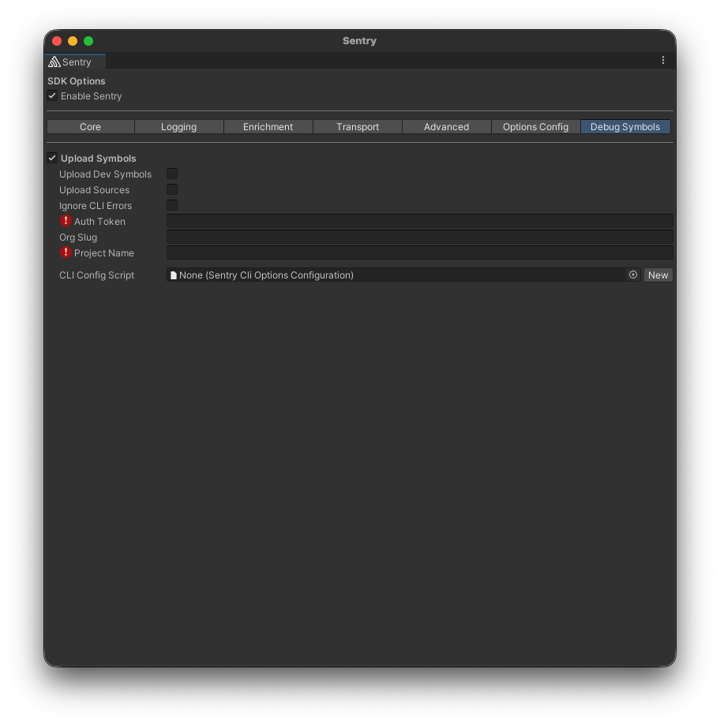

The Unity SDK includes [Sentry CLI](/cli/) as a tool to upload debug symbols to Sentry. Sentry uses these debug symbols to provide stack traces and line numbers for your events. This page describes the options available to configure Sentry CLI. You can set them in **Tools > Sentry**, on the **Debug Symbols** tab.

## Programmatic Configuration

Similar to the [programmatic configuration](/platforms/unity/configuration/options/programmatic-configuration/) of the SDK itself, the debug symbol upload with Sentry CLI also supports programmatic configuration. Create a class that inherits from `SentryCliOptionsConfiguration` and assign it to the **CLI Config Script** field on the **Debug Symbols** tab.



The SDK calls `Configure` during the build and passes it the options used by Sentry CLI, so you can change them.

The SDK doesn't read environment variables such as `SENTRY_AUTH_TOKEN` itself. To pass credentials from your CI system, read them in `Configure`:

```csharp
using System;
using Sentry.Unity;
using UnityEngine;

public class SentryCliConfiguration : SentryCliOptionsConfiguration
{
    public override void Configure(SentryCliOptions cliOptions)
    {
        // Only set secrets for CI builds
        if (!Application.isBatchMode)
        {
            return;
        }

        var authToken = Environment.GetEnvironmentVariable("SENTRY_AUTH_TOKEN");
        if (!string.IsNullOrEmpty(authToken))
        {
            cliOptions.Auth = authToken;
        }
    }
}
```

In CI, store the auth token as a secret and expose it to the Unity build as the `SENTRY_AUTH_TOKEN` environment variable. You can set `Organization` and `Project` the same way.

The SDK runs `Configure` on a copy of the options, so values you set there aren't saved to `SentryCliOptions.asset`.

Exported Xcode and Gradle projects contain the auth token in plain text. See the [warning about `sentry.properties`](/platforms/unity/native-support/#debug-symbols).

## Sentry CLI Options

<SdkOption name="UploadSymbols" type="bool" defaultValue="true">

Whether the SDK should automatically upload debug symbols to Sentry. This requires a valid auth token and project, and the organization slug unless the auth token is an organization token.

</SdkOption>

<SdkOption name="UploadDevelopmentSymbols" type="bool" defaultValue="false">

Whether the SDK should automatically upload debug symbols to Sentry for development builds. In the editor, this is **Upload Dev Symbols**.

</SdkOption>

<SdkOption name="UploadSources" type="bool" defaultValue="false">

Whether the SDK should automatically upload your source code to Sentry, so Sentry can show [source context](/platforms/unity/data-management/debug-files/source-context/) on events. When enabled, the SDK passes `--include-sources` to Sentry CLI.

</SdkOption>

<SdkOption name="UrlOverride" type="string">

The URL of your Sentry instance. Set this only if you use a self-hosted Sentry instance or a custom domain. If you don't set it and your DSN's host isn't `sentry.io` or one of its subdomains, the SDK uses the DSN's host. The **Debug Symbols** tab has no field for this option, so set it in [code](#programmatic-configuration).

</SdkOption>

<SdkOption name="Auth" type="string">

The auth token to use when uploading symbols to Sentry. In the editor, this is **Auth Token**.

</SdkOption>

<SdkOption name="Organization" type="string">

The organization slug to use when uploading symbols to Sentry. It's required unless the auth token is an organization token. In the editor, this is **Org Slug**.

</SdkOption>

<SdkOption name="Project" type="string">

The project to use when uploading symbols to Sentry. In the editor, this is **Project Name**.

</SdkOption>

<SdkOption name="IgnoreCliErrors" type="bool" defaultValue="false">

If set to `true`, a failed upload doesn't fail the build. The SDK passes `--allow-failure` to Sentry CLI. **Be aware** that you might get unsymbolicated crashes in production if the debug symbol upload fails. When you use this option, store the built debug files so you can upload them again later.

</SdkOption>
