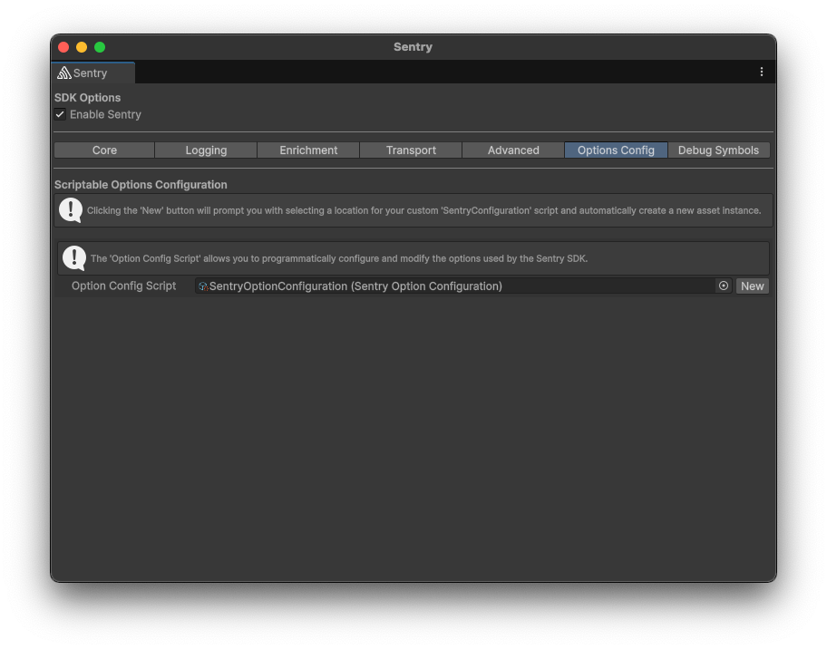
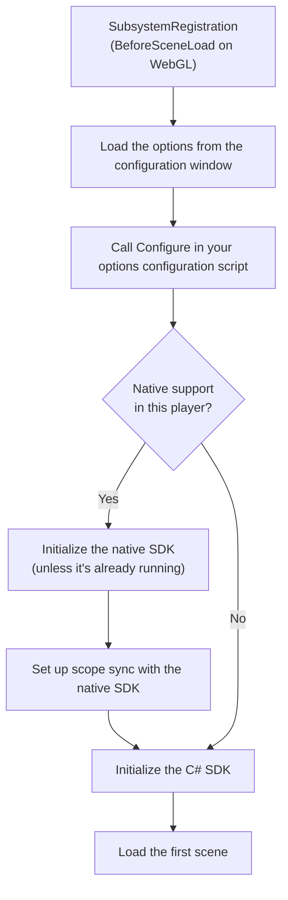

To set options in code, use an options configuration script. In the Sentry configuration window (**Tools > Sentry**), open the **Options Config** tab and click **New** next to the **Option Config Script** field. The SDK asks where to save the script, starting in `Assets/Scripts`, and writes a class that inherits from `SentryOptionsConfiguration`. After Unity compiles the script, the SDK creates its asset in `Assets/Resources/Sentry/` and assigns it to the field, unless the field already has a script.

The SDK calls the script's `Configure` method after it applies the values from the configuration window, so the values you set in `Configure` override the window. `Configure` also runs during player builds, where the SDK uses the options to set up the native SDKs and other build steps. During a build, `Environment` defaults to `production`. Don't rely on the game's runtime state in `Configure`, and wrap code that must only run in the game in `if (Application.isPlaying)`.



## Programmatic Configuration

The Sentry SDK for Unity includes [platform-specific (that is, Native)](/platforms/unity/native-support/) SDKs, such as [Android](/platforms/android/), [Apple](/platforms/apple/guides/ios/), and [Native](/platforms/native/) to provide native crash support. These SDKs share the options with which they get initialized.

The SDK initializes itself at [SubsystemRegistration](https://docs.unity3d.com/ScriptReference/RuntimeInitializeLoadType.SubsystemRegistration.html) through `RuntimeInitializeOnLoadMethod`. On WebGL, it initializes at [BeforeSceneLoad](https://docs.unity3d.com/ScriptReference/RuntimeInitializeLoadType.BeforeSceneLoad.html) instead, because the WebGL transport can't send requests earlier. The native steps only run in a player with native support: not in the Editor, on WebGL, on Android with Mono, or on macOS with Mono and the default `Cocoa` backend. With `BuildTime` initialization on iOS and Android, the native SDK starts before Unity, so the SDK skips that step. With `External`, it skips it when the app that embeds the game has already started the native SDK. Learn more in <PlatformLink to="/native-support/unity-as-a-library/">Unity as a Library</PlatformLink>.



The SDK initializes the native SDK with the same options before the C# SDK, so the options you set in `Configure` also apply to the native layer. With `BuildTime` initialization, the native SDK uses the options from the build instead, and with `External`, usually the options of the app that embeds the game. For example:

```csharp
public override void Configure(SentryUnityOptions options)
{
    // BeforeSend is currently limited to C# code. Native errors - such as crashes in C/C++ code - are getting
    // captured by the native SDKs, but the native SDKs won't invoke this callback.
    options.SetBeforeSend((sentryEvent, _) =>
    {
        if (sentryEvent.Tags.ContainsKey("SomeTag"))
        {
            // Don't send events with a tag "SomeTag" to Sentry
            return null;
        }

        return sentryEvent;
    });

    // Native SDK initialization timing options:
    // Build-time initialization:
    //   + Can capture Unity engine errors
    //   - Options are fixed at build time
    // Runtime initialization:
    //   + Allows dynamic configuration
    //   - May miss some early errors
#if UNITY_ANDROID
    options.AndroidNativeInitializationType = NativeInitializationType.Runtime;
#elif UNITY_IOS
    options.IosNativeInitializationType = NativeInitializationType.Runtime;
#endif
}
```

### Initialize Native SDKs first when targeting iOS or Android

On mobile, the Unity SDK automatically modifies the generated Xcode and Gradle project to also contain the Cocoa and Java SDK respectively. These SDKs are capable of self-initializing before the Unity engine itself is started. This allows us to capture bugs/crashes happening within the engine itself.
There are three initialization types:

- `NativeInitializationType.Runtime`: Native SDKs initialize during runtime alongside the C# SDK
- `NativeInitializationType.BuildTime`: Native SDKs initialize before Unity engine starts
- `NativeInitializationType.External`: The app that embeds the game provides and initializes the native SDKs, when using <PlatformLink to="/native-support/unity-as-a-library/">Unity as a Library</PlatformLink>

### Runtime Initialization (Default)

With runtime initialization, the native SDKs are initialized at runtime alongside the C# SDK. This allows all options to be dynamically configured through C# code during execution.

### Build Time Initialization

When using build time initialization, the native SDKs are configured during build time and initialize before the Unity engine starts. This means the options are baked into the outputted projects and cannot be modified at runtime via C# code. Changes to properties like `Release` and `Environment` will not apply to events generated by the native SDKs.

## Manual Initialization

To initialize the SDK yourself instead of letting it self-initialize, uncheck **Enable Sentry** in the editor window (**Tools > Sentry**) and call `SentrySdk.Init` as early as possible, for example from a `RuntimeInitializeOnLoadMethod`:

```csharp
using Sentry.Unity;
using UnityEngine;

public static class SentryInitializer
{
#if UNITY_WEBGL
    // On WebGL, the SDK sets itself up at BeforeSceneLoad, so initialize after it
    [RuntimeInitializeOnLoadMethod(RuntimeInitializeLoadType.AfterSceneLoad)]
#else
    [RuntimeInitializeOnLoadMethod(RuntimeInitializeLoadType.BeforeSceneLoad)]
#endif
    private static void Init()
    {
        SentrySdk.Init(options =>
        {
            options.Dsn = "___PUBLIC_DSN___";
        });
    }
}
```

When you initialize manually, the options from the editor window and the option configuration script don't apply. Only the options you set in code are used.

<Alert level="warning">

With **Enable Sentry** unchecked, the build doesn't set up native support or upload debug symbols, so the SDK only captures C# errors. To keep native crash support, leave **Enable Sentry** checked and use the option configuration script instead.

</Alert>
