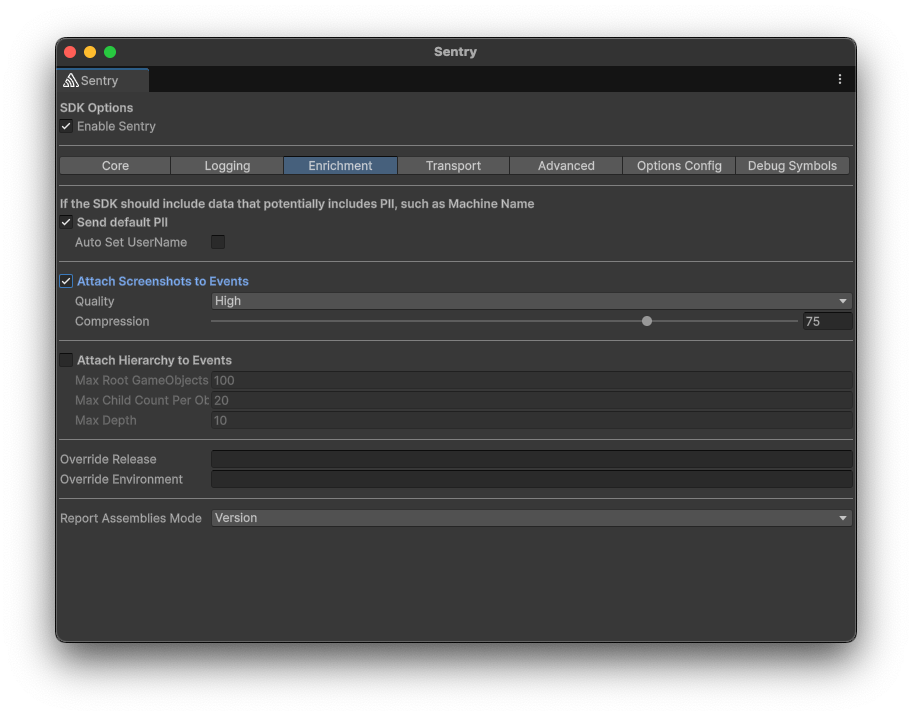
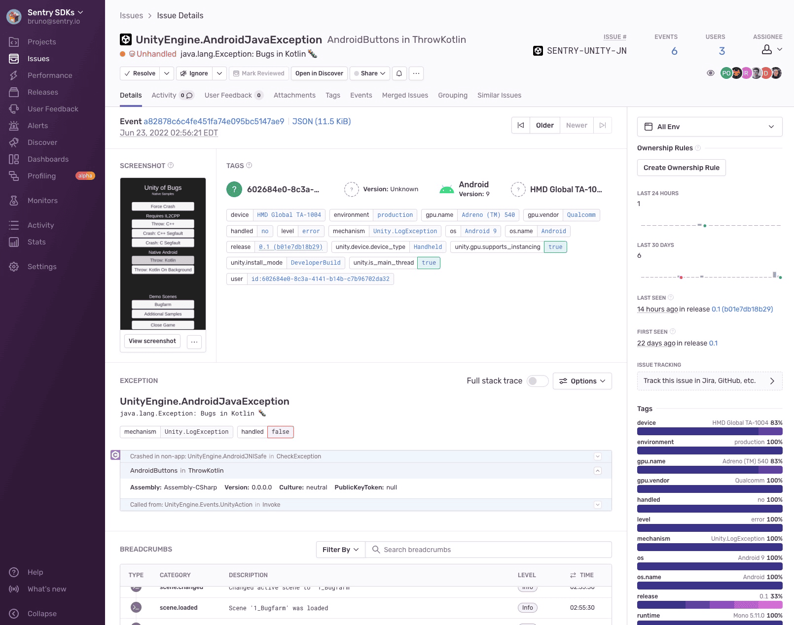
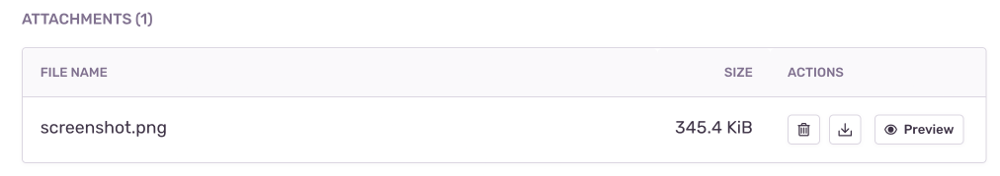

Sentry makes it possible to automatically take a screenshot and include it as an <PlatformLink to="/enriching-events/attachments/">attachment</PlatformLink> when a user experiences an error, an exception or a crash.

This feature is only available for SDKs with a user interface, like the ones for mobile and desktop applications. It's also limited by whether taking a screenshot is possible or not. For example, in some environments, like native iOS, taking a screenshot requires the UI thread, which often isn't available in the event of a crash. Another example where a screenshot might not be available is when the event happens before the screen starts to load. So inherently, this feature is a best effort solution.

## Enabling Screenshots

Because screenshots may contain <PlatformLink to="/data-management/sensitive-data/">PII</PlatformLink>, they are an opt-in feature. You can enable screenshots as shown below through **Tools > Sentry**:



Or, like so, if you're [configuring things programmatically](/platforms/unity/configuration/options/):

```csharp {tabTitle:ScriptableOptionsConfiguration}
options.AttachScreenshot = true;
```

Screenshots aren't attached in the Editor, in batch mode, or on WebGL.

## Screenshot Capture Mechanism

Since the Unity SDK internally consists of multiple SDKs, the mechanism with which a screenshot gets captured depends on where the error originates.

### C# Errors

Events captured by the C# SDK, such as exceptions, messages, and errors logged through `Debug.LogError`, get a screenshot. Transactions and user feedback don't. The SDK captures the screenshot through Unity's built-in [ScreenCapture](https://docs.unity3d.com/ScriptReference/ScreenCapture.html), so it only contains what your game renders. Overlays on top of your game aren't visible.

The SDK takes the screenshot at the end of the frame, so it shows the fully rendered frame. Events captured on background threads get a screenshot as well, taken at the end of a following frame. Events captured while a screenshot is still being taken, for example several errors within the same frame, share it. Events that get dropped by <PlatformIdentifier name="SetBeforeSend" /> or sampling don't trigger a screenshot.

The screenshot gets scaled down according to `ScreenshotQuality` and compressed to JPEG according to `ScreenshotCompression`, and is attached as `screenshot.jpg`. It's sent in the same envelope as the event it belongs to. If the event gets dropped, for example because of rate limiting, its screenshot gets dropped along with it.

To keep the cost of an error low, the main thread only issues the capture to the GPU. Where the device supports [asynchronous GPU readback](https://docs.unity3d.com/ScriptReference/SystemInfo-supportsAsyncGPUReadback.html), the SDK reads the screenshot back [asynchronously](https://docs.unity3d.com/ScriptReference/Rendering.AsyncGPUReadback.html) in the frame's own format and compresses it on a background thread. Otherwise, or when <PlatformIdentifier name="SetBeforeSendScreenshot" /> is set, it reads and compresses the screenshot on the main thread. On Nintendo Switch, screenshots are always read on the main thread.

If the screenshot can't be taken, for example because the main thread doesn't reach the end of the frame within one second while it's blocked or the game is paused, the event gets sent without it.

### Native Errors

| Platform              | Screenshot for native errors and crashes                                                                                                   |
| --------------------- | ------------------------------------------------------------------------------------------------------------------------------------------ |
| iOS                   | Captured by sentry-cocoa, only with <PlatformLink to="/native-support/#build-time-initialization">build time initialization</PlatformLink> |
| Windows               | Captured by sentry-native when the game crashes                                                                                            |
| Android, macOS, Linux | None                                                                                                                                       |

These screenshots are taken by the native SDK, so they include overlays, and <PlatformIdentifier name="SetBeforeCaptureScreenshot" /> and <PlatformIdentifier name="SetBeforeSendScreenshot" /> don't apply to them.

<Alert>

Screenshots might contain PII of your app. For example, if your game has a registration form and an error happens while the form is being displayed.

</Alert>

## Customize Screenshot Capturing

To decide whether an event gets a screenshot, use <PlatformIdentifier name="SetBeforeCaptureScreenshot" />. It runs on the thread that captured the event, which can be a background thread, so don't call the Unity API from within it:

```csharp
options.SetBeforeCaptureScreenshot(sentryEvent =>
{
    // Don't attach screenshots while the payment screen is open
    return !PaymentScreen.IsOpen;
});
```

## Modifying or Discarding Screenshots

To edit a screenshot before it's sent, for example to black out sensitive areas, or to discard it, use <PlatformIdentifier name="SetBeforeSendScreenshot" />:

```csharp
options.SetBeforeSendScreenshot((screenshot, sentryEvent) =>
{
    // Return null to discard the screenshot instead
    return screenshot;
});
```

The callback runs once per screenshot, and events that share a screenshot also share the result.

<Alert level="warning">

Since <PlatformIdentifier name="SetBeforeSendScreenshot" /> hands out the screenshot as a `Texture2D`, setting it makes the SDK read and compress every screenshot on the main thread, which stalls your game.

</Alert>

## User Feedback

Automatic screenshots don't get attached to user feedback. To attach one, pass `addScreenshot: true` to `SentrySdk.CaptureFeedback`. The SDK takes the screenshot right away, so call it from the main thread, ideally after `WaitForEndOfFrame`, so the frame is fully rendered. Feedback screenshots don't depend on <PlatformIdentifier name="AttachScreenshot" />, aren't passed to the screenshot callbacks, and are also taken in the Editor. Learn more in <PlatformLink to="/user-feedback/">User Feedback</PlatformLink>.

## Viewing Screenshots

If one is available, you'll see a thumbnail of the screenshot when you click on a specific issue from the [**Issues**](https://demo.sentry.io/issues/) page.



Once you've clicked on the event ID of a specific issue, you'll be able to see an overview of all the attachments as well as associated events in the "Attachments" tab.


