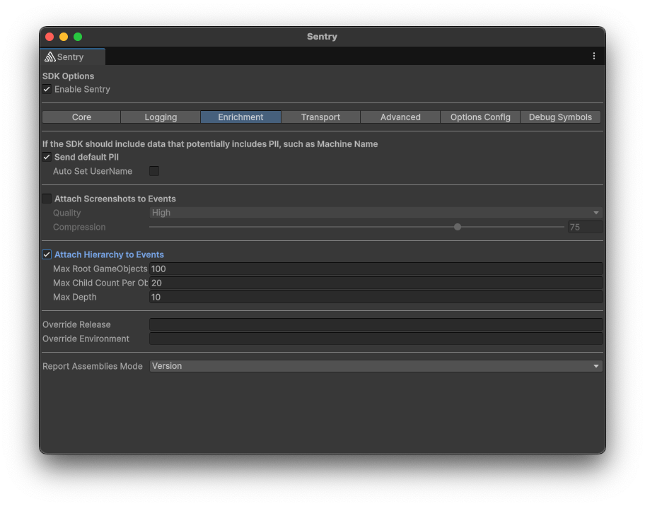
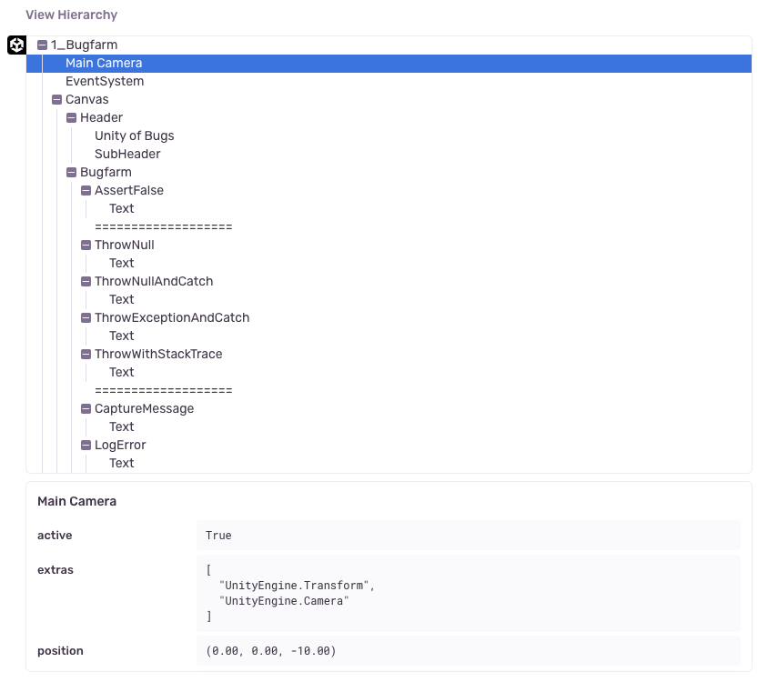

Sentry makes it possible to render a JSON representation of the scene of an error and includes it as an <PlatformLink to="/enriching-events/attachments/">attachment</PlatformLink>.

The SDK captures the view hierarchy of the active scene only, and only for events captured on the main thread. Events captured on background threads and native crashes don't get one. It works in the Unity Editor and on WebGL too.

## Enabling View Hierarchy Attachments

View hierarchy debugging is an opt-in feature. You can enable attaching the view hierarchy as shown below through **Tools > Sentry**:



Or, like so, if you're [configuring things programmatically](/platforms/unity/configuration/options/programmatic-configuration/):

```csharp
options.AttachViewHierarchy = true;
```

## Customize View Hierarchy Capturing

Because capturing view hierarchy can be a resource-intensive operation as the SDK traverses the scene at the time of an error, there are several controls available to you.

<SdkOption name="MaxViewHierarchyRootObjects" type="int" defaultValue="100">

Allows you to limit the amount of gameobjects to be traversed and included in the view hierarchy.

</SdkOption>

<SdkOption name="MaxViewHierarchyDepth" type="int" defaultValue="10">

Allows you to limit the maximum depth of child-gameobject the SDK will attempt to traverse to include in the view hierarchy.

</SdkOption>

<SdkOption name="MaxViewHierarchyObjectChildCount" type="int" defaultValue="20">

Allows you to limit the maximum count of child-gameobjects per individual gameobject the SDK will attempt to include in the view hierarchy.

</SdkOption>

These are also available for programmatic configuration on the options object:

```csharp
options.MaxViewHierarchyDepth = 10;
options.MaxViewHierarchyRootObjects = 100;
options.MaxViewHierarchyObjectChildCount = 20;
```

To decide whether an event gets a view hierarchy, use <PlatformIdentifier name="SetBeforeCaptureViewHierarchy" />. Return `false` to skip it:

```csharp
options.SetBeforeCaptureViewHierarchy(sentryEvent =>
{
    // Don't capture the view hierarchy for warnings
    return sentryEvent.Level != SentryLevel.Warning;
});
```

## Modifying or Discarding the View Hierarchy

To edit the view hierarchy before it's sent, or to discard it, use <PlatformIdentifier name="SetBeforeSendViewHierarchy" />. Return `null` to discard it:

```csharp
options.SetBeforeSendViewHierarchy((viewHierarchy, sentryEvent) =>
{
    // The root node is the scene, and its children are the root GameObjects
    foreach (var scene in viewHierarchy.Windows)
    {
        scene.Children.RemoveAll(node => node.Type == "AccountScreen");
    }

    return viewHierarchy;
});
```

## Viewing View Hierarchy Attachments

View hierarchies appear in the "Attachments" tab, where you can view all attachments, as well as associated events. Click the event ID to open the [Issue Details](/product/issues/issue-details/) page of that specific event.

<Include name="common-imgs/viewhierarchy-list-example" />

On the **Issue Details** page, you can interact with the view hierarchy attachment in a section called "View Hierarchy". This section represents the state of your scene at the time of an error event. There are two displays: a tree view, and detailed view for a selected node. You can select nodes in the tree to view the properties collected by the SDK. The SDK will report on the following keys for each node in the view:

- `tag` The gameobject's tag
- `position` The gameobject's position
- `rotation` The gameobject's rotation in euler angles
- `scale` The gameobject's local scale
- `active` Whether the gameobject itself was active (`activeSelf`)
- `extras` The type names of all components attached to the gameobject

This feature can be used as an exploratory tool to debug reference issues, or gain a better understanding of the relationship between gameobjects.


