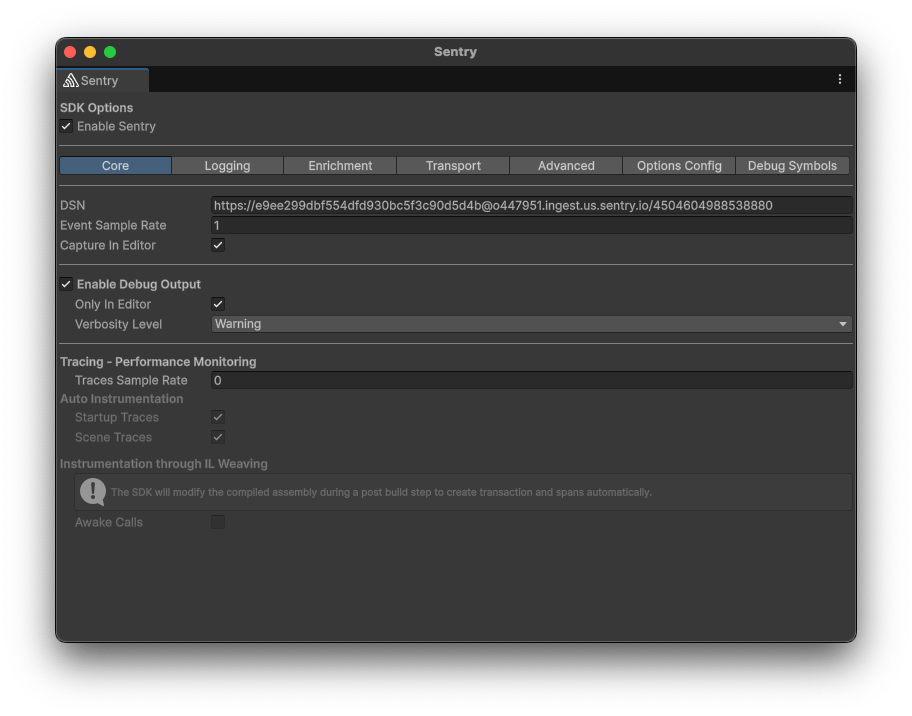

Our Unity SDK builds on top of the [.NET SDK](/platforms/dotnet/) and extends it with Unity-specific features. It gives you helpful hints for where and why an error or performance issue might have occurred.

**Features:**

- [Automatically captures C# errors](/platforms/unity/usage/automatic-error-capture/) on multiple platforms, including: Android, iOS, macOS, Linux, Windows, and WebGL
- Line numbers for C# [exceptions in IL2CPP builds](/platforms/unity/configuration/il2cpp/)
- [Native support](/platforms/unity/native-support/) for automatic crash error tracking for:
  - Android by using the [Android SDK](/platforms/android/) to support Java, Kotlin, C and C++
  - iOS by using the [iOS SDK](/platforms/apple/guides/ios/) to support Objective-C, Swift, C and C++
  - Windows and Linux by using the [Native SDK](/platforms/native/) to support C and C++ with minidumps
  - macOS by using the [macOS SDK](/platforms/apple/guides/macos/) to support Objective-C, Swift, C and C++
  - [PlayStation](/platforms/playstation/), [Xbox](/platforms/xbox/) and [Nintendo Switch](/platforms/nintendo-switch/) support
- [Screenshot attachments](/platforms/unity/enriching-events/screenshots/) for errors
- [ViewHierarchy attachments](/platforms/unity/enriching-events/view-hierarchy/) for errors
- [Offline Caching](/platforms/unity/configuration/options/#InitCacheFlushTimeout) stores event data to disk in case the device is not online
- [Release Health](/platforms/unity/configuration/releases/) to keep track of crash-free users and sessions
- [Structured Logging](/platforms/unity/logs/) to capture and send log messages with additional context
- [Metrics](/platforms/unity/metrics/) to track counters, gauges, and distributions
- [Automatically adding breadcrumbs](/platforms/unity/enriching-events/breadcrumbs/#automatic-breadcrumbs) for
  - Unity's `Debug.Log` and `Debug.LogWarning`
  - Scene load, unload, active change
- [Event debouncing](/platforms/unity/configuration/event-debouncing/) to handle high amounts of log output i.e. during `Update`

On this page, we get you up and running with Sentry's SDK.

Don't already have an account and Sentry project established? Head over to [sentry.io](https://sentry.io/signup/), then return to this page.

## Install

Install the package via the [Unity Package Manager using a Git URL](https://docs.unity3d.com/Manual/upm-ui-giturl.html) to Sentry's SDK repository:

```
https://github.com/getsentry/unity.git
```

To use a specific version of the SDK, append `#{{@inject packages.version('sentry.dotnet.unity', '0.0.5') }}` to the URL.

## Configure

**Error Monitoring**, including native crashes on supported platforms, starts working as soon as the SDK has your DSN. The SDK initializes itself when your game starts, so you don't need to call an init method. **Logs** are supported in Unity SDK 4.0.0 and later and need the `EnableLogs` option. **Application Metrics** are supported in Unity SDK 4.2.0 and later and enabled by default. You'll learn how to send both in [Send Logs](#send-logs) and [Send Application Metrics](#send-application-metrics-).
This guide also enables **Tracing** and **User Feedback**.

### Add Your DSN

Installing the SDK adds an entry to Unity's top menu: **Tools > Sentry**. When you first open the menu, a wizard guides you through associating your game with a Sentry project and sets up the initial configuration for you. The minimum configuration required is the [DSN](/concepts/key-terms/dsn-explainer/) to your project.

```json {tabTitle: Public DSN}
{
  "public-dsn": "___PUBLIC_DSN___"
}
```



Sentry saves your configuration to `Assets/Resources/Sentry/SentryOptions.asset` and reads from there both at build time and runtime.

### Configure the SDK Programmatically

You can set most options in the Sentry configuration window. To set them in code, open **Tools > Sentry**, go to the **Options Config** tab, and click **New** to create an options configuration script. The SDK calls its `Configure` method on each startup, after it reads the configuration window settings, so values you set here take precedence.

The snippet also turns on:

- Tracing: via <PlatformLink to="/configuration/options/#TracesSampleRate">`TracesSampleRate`</PlatformLink>. The SDK automatically creates <PlatformLink to="/tracing/instrumentation/automatic-instrumentation/">transactions for startup and scene loading</PlatformLink>.
- Logs: via <PlatformLink to="/logs/">`EnableLogs`</PlatformLink>. You can also check **Enable Structured Logging** in **Tools > Sentry > Logging**.
- Screenshots: via <PlatformLink to="/configuration/options/#AttachScreenshot">`AttachScreenshot`</PlatformLink>, which attaches a <PlatformLink to="/enriching-events/screenshots/">screenshot</PlatformLink> of your game to errors.
- View Hierarchy: via <PlatformLink to="/configuration/options/#AttachViewHierarchy">`AttachViewHierarchy`</PlatformLink>, which attaches the active scene's <PlatformLink to="/enriching-events/view-hierarchy/">view hierarchy</PlatformLink> to errors.

Don't need a feature? Remove its options from the snippet.

```csharp {filename:SentryOptionConfiguration.cs}
using Sentry.Unity;

public class SentryOptionConfiguration : SentryOptionsConfiguration
{
    public override void Configure(SentryUnityOptions options)
    {
        // Enables Tracing.
        // Set to 1.0 to capture 100% of transactions for tracing.
        // We recommend reducing this value in production.
        options.TracesSampleRate = 1.0;

        // Enables Logs. Requires Unity SDK 4.0.0 or later.
        options.EnableLogs = true;

        // Attaches a screenshot and the active scene's view hierarchy to errors.
        options.AttachScreenshot = true;
        options.AttachViewHierarchy = true;
    }
}
```

See <PlatformLink to="/configuration/options/programmatic-configuration/">Programmatic Configuration</PlatformLink> for how these options apply to the native SDKs, and <PlatformLink to="/configuration/options/">Options</PlatformLink> for all available options.

### Collect User Feedback

To let players report problems from inside your game, drag the **User Feedback** prefab from the Sentry SDK package into any scene. The prefab adds a feedback button and form and works without additional configuration. It's available in Unity SDK 4.0.0 and later.

See <PlatformLink to="/user-feedback/">Set Up User Feedback</PlatformLink> to customize the form or send feedback with your own UI.

### Upload Debug Symbols

Sentry needs <PlatformLink to="/data-management/debug-files/">debug information files</PlatformLink> to symbolicate native crashes and to show C# line numbers for <PlatformLink to="/configuration/il2cpp/">exceptions in IL2CPP builds</PlatformLink>. The SDK uploads these files automatically when you build your game in the editor, but you need to configure the upload first.

Open **Tools > Sentry**, go to the **Debug Symbols** tab, and enter your [Auth Token](https://sentry.io/orgredirect/organizations/:orgslug/settings/auth-tokens/), organization slug, and project name. The SDK stores these settings in `Assets/Plugins/Sentry/SentryCliOptions.asset`, which should **not** be made publicly available.

IL2CPP line number support is enabled by default and relies on this upload.

### Include the Crash Handler on Windows

On Windows, the SDK captures native crashes with the [Native SDK](/platforms/native/) and copies `crashpad_handler.exe` to your build output directory. Include this executable when you ship your game. Learn more about native crash support on each platform in <PlatformLink to="/native-support/">Native Support</PlatformLink>.

## Send Logs

Use `SentrySdk.Logger` to send logs at different levels, such as `LogInfo`, `LogWarning`, or `LogError`. Logs require Unity SDK 4.0.0 or later and `EnableLogs`, which the snippet in [Configure](#configure-the-sdk-programmatically) turns on.

With logs enabled, the SDK also forwards Unity's `Debug.LogWarning`, `Debug.LogAssertion`, `Debug.LogError`, and `Debug.LogException` calls to Sentry by default. You can change which log types it forwards with <PlatformLink to="/logs/#automatic-unity-log-forwarding">automatic Unity log forwarding</PlatformLink>.

See <PlatformLink to="/logs/">Set Up Logs</PlatformLink> for all available logging methods and configuration options.

```csharp
SentrySdk.Logger.LogInfo("A simple debug log message");

SentrySdk.Logger.LogWarning(log =>
{
    log.SetAttribute("player_id", playerId);
    log.SetAttribute("scene", SceneManager.GetActiveScene().name);
}, "Player {0} is low on health", playerId);
```

## Send Application Metrics <FeatureBadge type="new" />

Use `SentrySdk.Metrics` to send counters, gauges, and distributions from your game. Metrics require Unity SDK 4.2.0 or later and are enabled by default.

See <PlatformLink to="/metrics/">Set Up Metrics</PlatformLink> for all available metric types and configuration options.

```csharp
SentrySdk.Metrics.EmitCounter("player_interaction", 5,
    new Dictionary<string, object> { ["scene"] = "MainMenu" });

SentrySdk.Metrics.EmitGauge("scene_load", 15.0, MeasurementUnit.Duration.Millisecond,
    new Dictionary<string, object> { ["scene"] = "Level1" });

SentrySdk.Metrics.EmitDistribution("scene_load", 15.0, MeasurementUnit.Duration.Millisecond,
    new Dictionary<string, object> { ["scene"] = "Level1" });
```

## Verify Your Setup

Add this script to a GameObject in your scene and enter Play mode. The script throws an unhandled `NullReferenceException`, which Sentry captures as an error.

```csharp {filename:TestMonoBehaviour.cs}
using UnityEngine;

public class TestMonoBehaviour : MonoBehaviour
{
    private GameObject testObject = null;

    void Start()
    {
        // This throws an unhandled 'NullReferenceException'
        testObject.GetComponent<Transform>();
    }
}
```

### View Captured Data in Sentry

To view and resolve the recorded error, log into [sentry.io](https://sentry.io) and select your project. Select **Issues** in the sidebar to find the new issue. Errors captured in the Unity Editor use the `editor` environment.

## Next Steps

At this point, you should have integrated Sentry into your Unity game. Here's what to explore next:

- Explore [practical guides](/get-started/guides/) on what to monitor, log, track, and investigate after setup
- Import the **Unity of Bugs** sample from the Package Manager to trigger common bugs, including native errors, without writing them yourself
- Learn how to [manually capture errors and messages](/platforms/unity/usage/)
- Instrument more operations with [custom instrumentation](/platforms/unity/tracing/instrumentation/custom-instrumentation/)
