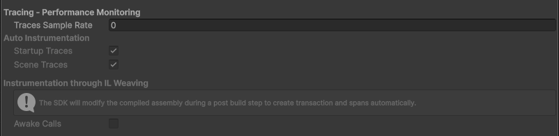
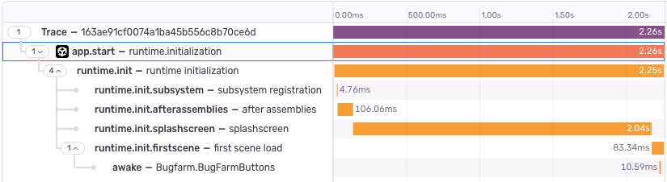

## Automatically Captured Transactions

The Unity SDK can automatically instrument:

| What                                                     | Option                                                                                                                                  | Default |
| -------------------------------------------------------- | --------------------------------------------------------------------------------------------------------------------------------------- | ------- |
| The game's startup                                       | <PlatformLink to="/configuration/options/#AutoStartupTraces">`AutoStartupTraces`</PlatformLink>                                         | `true`  |
| Scene loading                                            | <PlatformLink to="/configuration/options/#AutoSceneLoadTraces">`AutoSceneLoadTraces`</PlatformLink>                                     | `true`  |
| Spans for `Awake` calls during startup and scene loading | <PlatformLink to="/configuration/options/#PerformanceAutoInstrumentationEnabled">`PerformanceAutoInstrumentationEnabled`</PlatformLink> | `false` |

All three need <PlatformIdentifier name="traces-sample-rate" /> to be greater than `0`. The SDK doesn't create startup transactions in the editor, on WebGL, or when you initialize the SDK yourself after the first scene has loaded.

Set these options under **Auto Instrumentation** on the **Core** tab of **Tools > Sentry**, or in your <PlatformLink to="/configuration/options/programmatic-configuration/">options configuration script</PlatformLink>:



```csharp
public override void Configure(SentryUnityOptions options)
{
    options.PerformanceAutoInstrumentationEnabled = true;
}
```

The SDK adds the `Awake` spans when you build the game, by modifying the compiled code. It only instruments classes in `Assembly-CSharp` that inherit directly from `MonoBehaviour`. Because the SDK reads `PerformanceAutoInstrumentationEnabled` during the build, set it in the editor or in your options configuration script. Setting it in `SentrySdk.Init` has no effect.

After you've configured your instrumentation, the Unity SDK will generate traces as shown in the image below.



## Scene Loading and `SceneManagerAPI`

To trace scene loading, the SDK sets `SceneManagerAPI.overrideAPI` and replaces any override you set before. If your game uses its own `SceneManagerAPI` override, set `AutoSceneLoadTraces` to `false`.
