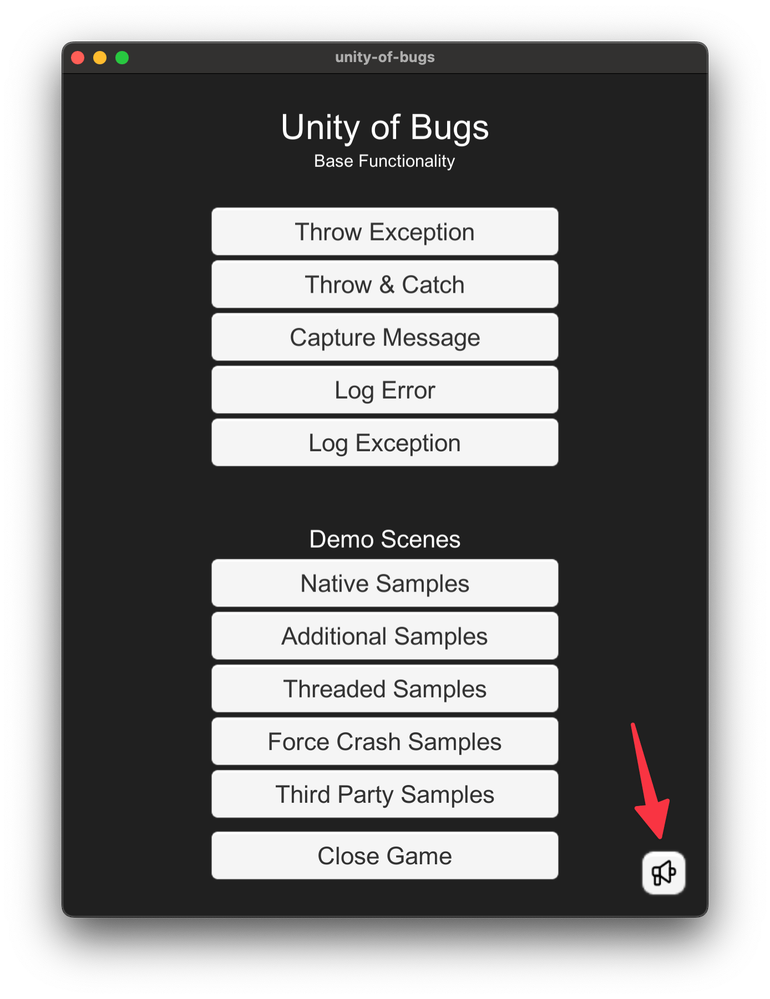
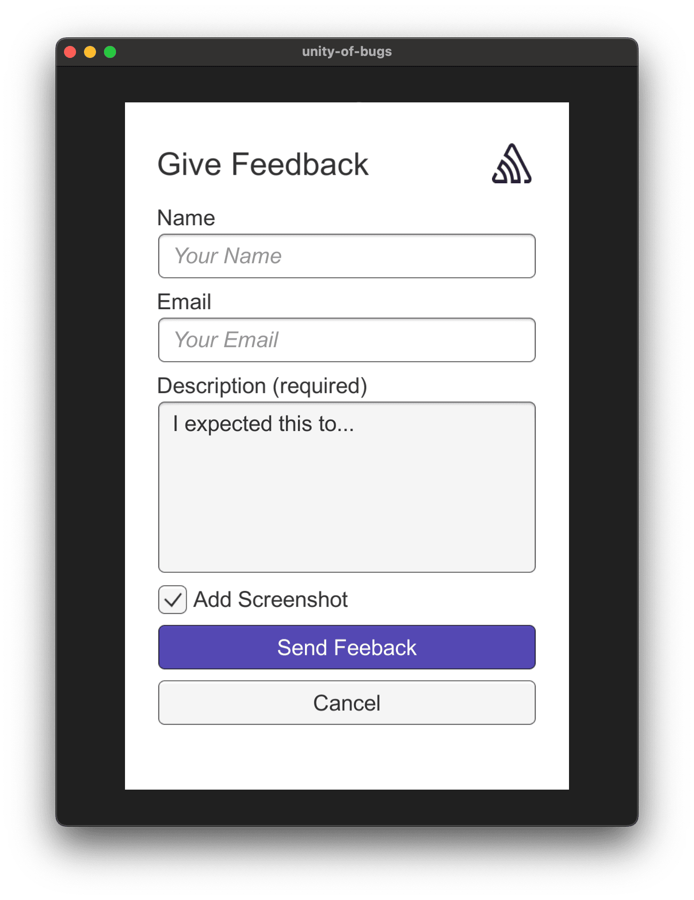

When a user experiences an error, Sentry provides the ability to collect additional feedback. The Unity SDK provides both a simple prefab-based solution and a programmatic API for collecting user feedback.

## Use the User Feedback Prefab

The Unity SDK includes a ready-to-use prefab that provides a complete user feedback solution. This prefab contains:

- A feedback button (megaphone icon) that opens the feedback form
- A feedback form with fields for:
  - Name (optional)
  - Email (optional)
  - Message/feedback (required)
  - Screenshot (optional, included by default and the user can uncheck it; the form hides itself before the screenshot gets taken)

### Adding the Prefab to Your Scene

The prefab needs the uGUI package (`com.unity.ugui`).

To add the prefab, drag and drop the User Feedback prefab from the Unity SDK package into any scene. The prefab is ready to use immediately without any additional configuration, and includes a scaling canvas that works across different screen sizes and resolutions.

### Default Appearance

The User Feedback prefab includes a megaphone button that triggers the feedback form:



When clicked, the feedback form appears with fields for user input:



### Customization

You can customize the feedback form by:

- Creating a prefab variant to inherit from the original while allowing updates
- Removing optional fields (name, email) by deleting them from the VerticalLayoutGroup
- Modifying the appearance and styling of the form elements
- The prefab comes with a custom inspector that highlights missing or broken references:
  - Missing optional fields are highlighted in yellow
  - Missing required fields are highlighted in red

## Use the API

If you prefer to create your own feedback form or need programmatic control, you can use the SDK's API to send feedback to Sentry:

```csharp {tabTitle:C#}
SentrySdk.CaptureFeedback("It broke.", "user@example.com", "The User", addScreenshot: true);
```

The SDK attaches a screenshot only when `addScreenshot` is `true`.

To link the feedback to an event, pass the event's ID:

```csharp {tabTitle:C#}
var eventId = SentrySdk.CaptureMessage("An event that will receive user feedback.");

SentrySdk.CaptureFeedback("It broke.", "user@example.com", "The User", associatedEventId: eventId);
```

To link the feedback to the last event the SDK captured, including errors it captures automatically, such as from `Debug.LogError`, use `SentrySdk.LastEventId`. It's `SentryId.Empty` when no event was captured or the last one was dropped, and native crashes don't set it:

```csharp {tabTitle:C#}
var lastEventId = SentrySdk.LastEventId;

SentrySdk.CaptureFeedback("It broke.", "user@example.com", "The User", associatedEventId: lastEventId != SentryId.Empty ? lastEventId : null);
```
