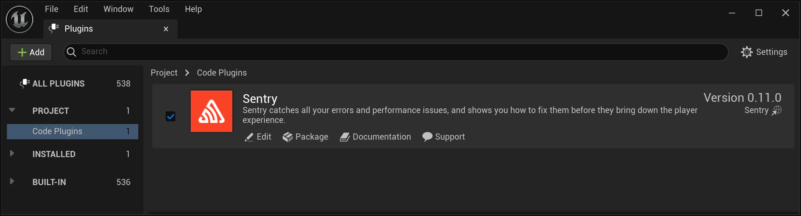
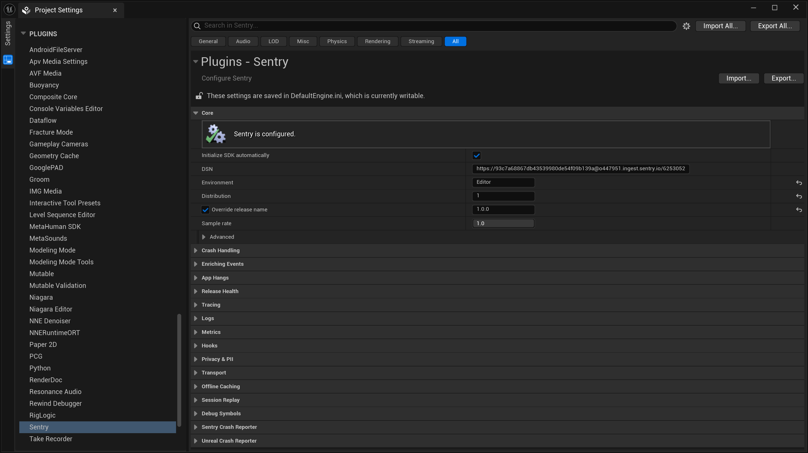
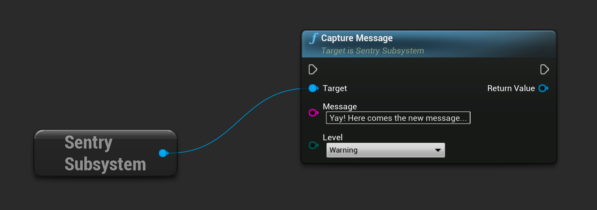

The Unreal Engine SDK builds on top of other Sentry SDKs and extends them with Unreal Engine-specific features. It gives developers helpful hints for where and why an error or performance issue might have occurred.

On this page, we get you up and running with Sentry's SDK.

Don't already have an account and Sentry project established? Head over to [sentry.io](https://sentry.io/signup/), then return to this page.

## Install

Sentry captures data by using an SDK within your application’s runtime.

The Unreal Engine (UE) SDK is officially supported for the three latest UE versions. However, it is likely to be compatible with older engine versions as well depending on the specific features and functionality that you need.

We recommend downloading the latest plugin sources from the [GitHub Releases page](https://github.com/getsentry/sentry-unreal/releases), but we also support [alternate installation methods](/platforms/unreal/install/).

To integrate Sentry into your Unreal Engine project using the GitHub package, select the artifact that matches your Unreal Engine version. Place the extracted files in your project's `Plugins` directory. On the next project launch, UE will prompt you to build the Sentry and SentryEditor modules.

<Alert>

Currently, this method is available only for C++ UE projects. Blueprint projects can be converted to a C++ one by adding an empty class using the editor.

</Alert>

To make sure the Sentry plugin has been enabled after installation has been completed, go to the editor and navigate to the **Settings > Plugins > Code Plugins** menu and check for the installation.



To access the plugin API from within C++,
add `Sentry` support to the build script (`MyProject.build.cs`):

```csharp
PublicDependencyModuleNames.AddRange(new string[] { ..., "Sentry" });
```

<Alert>

On arm64 architecture, Linux is supported with UE 5.0+ and Windows with UE 5.2+.

</Alert>

## Configure

**Error Monitoring**, including automatic crash capture, starts working as soon as the SDK initializes with your [DSN](/concepts/key-terms/dsn-explainer/). **Release Health** session tracking is on by default. **Logs** and **Application Metrics** need no extra configuration, and you'll learn how to send them in [Send Logs](#send-logs) and [Send Application Metrics](#send-application-metrics-).

This guide also enables **Tracing**. The Unreal Engine SDK also supports **Session Replay** (experimental) to capture gameplay video of the moments before a crash, and **User Feedback**; see <PlatformLink to="/session-replay/">Set Up Session Replay</PlatformLink> and <PlatformLink to="/user-feedback/">Set Up User Feedback</PlatformLink>.

Configure the SDK in the editor under **Project Settings > Plugins > Sentry**. The editor saves these settings to your project's `Config/DefaultEngine.ini` file, so you can also add them there directly.



The snippet also turns on:

- Tracing: via **Enable tracing** (`EnableTracing`) and <PlatformLink to="/configuration/options/#TracesSampleRate">`TracesSampleRate`</PlatformLink>. Tracing captures the transactions you create with <PlatformLink to="/tracing/instrumentation/custom-instrumentation/">custom instrumentation</PlatformLink>.
- User IP address and device name collection: via <PlatformLink to="/configuration/options/#SendDefaultPii">`SendDefaultPii`</PlatformLink>. Review the data your game sends before enabling this in production.
- Screenshots on crash and ensure events (not supported on Android): via <PlatformLink to="/configuration/options/#AttachScreenshot">`AttachScreenshot`</PlatformLink>. Only enable this if your game doesn't render sensitive data on screen.

Don't need a feature? Remove its options from the snippet.

```ini {filename:Config/DefaultEngine.ini}
[/Script/Sentry.SentrySettings]
; Required: set your Sentry project identifier (DSN)
Dsn="___PUBLIC_DSN___"

; Enables Tracing.
; Set to 1.0 to capture 100% of transactions for tracing.
; We recommend reducing this value in production.
EnableTracing=True
TracesSampleRate=1.0

; Adds data like the user's IP address and device name.
SendDefaultPii=True

; Attaches a screenshot to crash and ensure events.
AttachScreenshot=True
```

<Alert>

If you are logged in, you can also go to your [project settings](https://sentry.io/orgredirect/organizations/:orgslug/settings/projects/:projectId/keys/) and copy its DSN directly from there.

</Alert>

### Initialize the SDK

By default, the SDK is automatically initialized on application startup. Alternatively, the **Initialize SDK automatically** option can be disabled and in this case, explicit SDK initialization is required.

To override SDK settings at runtime, use the `InitializeWithSettings` method of the `SentrySubsystem` class. See <PlatformLink to="/configuration/options/">Options</PlatformLink> for all available settings.

```cpp
#include "SentrySubsystem.h"

USentrySubsystem* SentrySubsystem = GEngine->GetEngineSubsystem<USentrySubsystem>();

SentrySubsystem->InitializeWithSettings(FConfigureSettingsNativeDelegate::CreateLambda([=](USentrySettings* Settings)
{
    Settings->Dsn = TEXT("___PUBLIC_DSN___");
    Settings->EnableTracing = true;
    Settings->TracesSampleRate = 1.0f;
    Settings->SendDefaultPii = true;
    Settings->AttachScreenshot = true;
}));
```

### Set Up Crash Reporting

The SDK automatically captures crashes on:

- Windows (UE 5.2+) and Linux by using the [Native SDK](/platforms/native/) to support C and C++ with minidumps
- macOS by using the [macOS SDK](/platforms/apple/guides/macos/) to support Objective-C, Swift, C and C++
- iOS by using the [iOS SDK](/platforms/apple/guides/ios/) to support Objective-C, Swift, C and C++
- Android by using the [Android SDK](/platforms/android/) to support Java, Kotlin, C and C++

To automatically capture crashes on Windows with UE 5.1 or older, you have to configure the [Crash Reporter Client](/platforms/unreal/configuration/crash-reporter/crash-reporter-client/). Starting from UE 5.2, the provided API allows you to switch between default (CRC) and third-party (Sentry) crash-handling solutions, so the CRC configuration step isn't required. The two are mutually exclusive and can't be used simultaneously.

To collect feedback from players after a crash, use the [Sentry Crash Reporter](/platforms/unreal/configuration/crash-reporter/sentry-crash-reporter/), a standalone app supported on Windows and Linux. For PlayStation, Xbox, and Nintendo Switch, see [Game Consoles](/platforms/unreal/game-consoles/).

### Upload Debug Symbols

Sentry requires [debug information files](/platforms/unreal/data-management/debug-files/) to symbolicate crashes. The automated debug symbols upload is disabled by default. To turn it on, go to **Project Settings > Plugins > Sentry**, enable **Upload debug symbols automatically**, and enter your [Auth Token](https://sentry.io/orgredirect/organizations/:orgslug/settings/auth-tokens/), Organization Slug, and Project Name.

See [Debug Symbols Uploading](/platforms/unreal/configuration/debug-symbols/) for environment variable configuration, manual upload with `sentry-cli`, and macOS and iOS setup.

### Store Minidumps as Attachments

By default, Sentry only uses minidump files to create events and immediately drops them, because [minidumps](/platforms/native/guides/minidumps/#what-is-a-minidump) may contain sensitive information about the target system. To keep them, enable _Store Minidumps As Attachments_ in your [organization](https://sentry.io/orgredirect/organizations/:orgslug/settings/security-and-privacy/) or [project settings](https://sentry.io/orgredirect/organizations/:orgslug/settings/projects/:projectId/security-and-privacy/) under **Security & Privacy**. This feature is supported on Windows, Linux, and Android.

See [Store Minidumps as Attachments](/platforms/unreal/data-management/store-minidumps-as-attachments/) for retention and per-issue limits.

## Send Logs

Use the logging methods on the Sentry subsystem to send logs at different levels, such as `LogInfo`, `LogWarning`, or `LogError`. You can pass an optional category to organize your logs. Logs require Unreal Engine SDK version `1.2.0` or later and are enabled by default starting with version `1.11.0`.

To also forward Unreal Engine's native `UE_LOG` calls, enable the severity levels you want to send in the <PlatformLink to="/logs/#setup">Logs setup</PlatformLink>.

See <PlatformLink to="/logs/">Set Up Logs</PlatformLink> for all available logging methods, attributes, and configuration options.

```cpp
#include "SentrySubsystem.h"

USentrySubsystem* SentrySubsystem = GEngine->GetEngineSubsystem<USentrySubsystem>();

SentrySubsystem->LogInfo(TEXT("User completed tutorial"));
SentrySubsystem->LogWarning(TEXT("Failed to load texture asset"), TEXT("AssetLoading"));
SentrySubsystem->LogError(TEXT("Database connection failed"), TEXT("Database"));
```

## Send Application Metrics <FeatureBadge type="new" />

Use the Sentry subsystem to send counters, gauges, and distributions from your game to Sentry. Metrics require Unreal Engine SDK version `1.7.0` or later and are enabled by default starting with version `1.11.0`.

The SDK can also collect frame time, GC pause, game stats, and network metrics automatically. Enable them under **Project Settings > Plugins > Sentry > Metrics > Performance**, as described in <PlatformLink to="/metrics/#automatic-metrics">Automatic Metrics</PlatformLink>.

See <PlatformLink to="/metrics/">Set Up Metrics</PlatformLink> for all available metric types and configuration options.

```cpp
#include "SentrySubsystem.h"

USentrySubsystem* SentrySubsystem = GEngine->GetEngineSubsystem<USentrySubsystem>();

SentrySubsystem->AddCount(TEXT("api.requests"), 1);
SentrySubsystem->AddGauge(TEXT("active_connections"), 42, USentryUnitHelper::MakeSentryUnit(ESentryUnit::None));
SentrySubsystem->AddDistribution(TEXT("response.time"), 150.5f, USentryUnitHelper::MakeSentryUnit(ESentryUnit::Millisecond));
```

## Verify Your Setup

Capture a test message to confirm that Sentry is receiving data from your project:

```cpp
#include "SentrySubsystem.h"

void Verify()
{
    // Capture message
    USentrySubsystem* SentrySubsystem = GEngine->GetEngineSubsystem<USentrySubsystem>();
    SentrySubsystem->CaptureMessage(TEXT("Capture message"));
}
```

The same result can be achieved by calling the corresponding function in Blueprint:



### View Captured Data in Sentry

To view and resolve the recorded message, log into [sentry.io](https://sentry.io) and select your project. Select **Issues** in the sidebar to find the new issue, then click its title to see detailed information and mark it as resolved.

## Next Steps

At this point, you should have integrated Sentry into your Unreal Engine project. Here's what to explore next:

- Explore [practical guides](/get-started/guides/) on what to monitor, log, track, and investigate after setup
- Learn how to <PlatformLink to="/usage/">manually capture errors and messages</PlatformLink>
- Instrument more operations with <PlatformLink to="/tracing/instrumentation/custom-instrumentation/">custom instrumentation</PlatformLink>
- <PlatformLink to="/session-replay/">Set up Session Replay</PlatformLink>
  (experimental) to capture gameplay video of the moments before a crash
- <PlatformLink to="/user-feedback/">Collect User Feedback</PlatformLink> from
  your players
