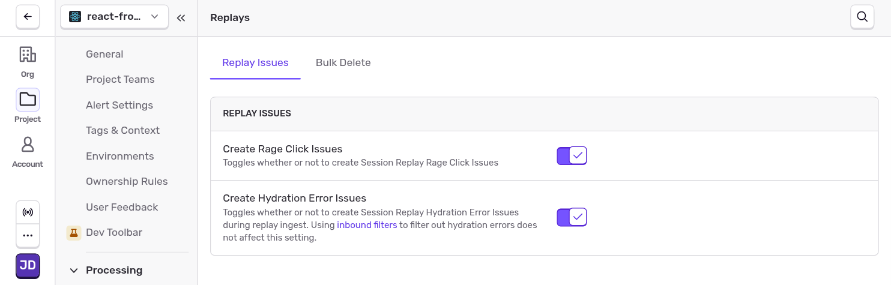

If you've enabled [Session Replay](/product/session-replay/), you'll be able to see rage click issues on the [**Issues**](https://sentry.io/orgredirect/organizations/:orgslug/issues/) page in Sentry. Rage clicks are a series of consecutive clicks on the same unresponsive page element. They are a strong signal of user frustration and most likely deserve your attention.

## Prerequisites for Seeing Rage Clicks

In order to see rage clicks in your issue stream on the **Issues** page, your organization needs to:

- Be sending [Session Replay events](/product/session-replay/)
- Enable the JavaScript SDK (or framework-specific bundle), version 7.60.1 or higher

<Alert>
  While you can enable **Session Replay** with JavaScript SDK version 7.27.0, or
  higher, you'll need to have version 7.60.1 or higher in order to be able to
  see **rage click issues**.
</Alert>

## Detection Criteria

"Dead clicks" (also called "slow clicks") are only detected on `<button>`, `<input>`, and `<a>` elements that don't lead to updates to the DOM or a page scroll within 7 seconds. When the user clicks on one of these elements 3 or more times within that 7-second timeframe, it indicates frustration, and the SDK registers a "rage click".

You can configure Replay to ignore specific selectors if you are seeing [too many rage clicks](/platforms/javascript/session-replay/troubleshooting/#why-am-i-seeing-too-many-or-too-few-rage-clicks) reported. For example, you might want to ignore clicks on "Print" or "Download" buttons.

## Get Rage Click Alerts

To set up alerts and get notified when a rage click occurs, follow these steps:

1. Go to **Monitors > [Alerts](https://sentry.io/monitors/alerts)** and click **Create Alert**.
2. Select the projects you want to alert on.
3. Under **If**, add the **Issue type** filter and set it to "Issue type is equal to Rage Click Detected".
4. Under **Then**, choose the action to perform.
5. Name your alert and click **Create Alert**.

See [Create Alerts](/product/monitors-and-alerts/alerts/create-alerts/) for all options.

## Turn Off Rage Click Issues

If you don't want to see rage click issues, you can disable them, follow these steps:

1. Open [**Project Settings > Replays**](https://sentry.io/orgredirect/organizations/:orgslug/settings/projects/:projectId/replays/).
2. Toggle off "Create Rage Click Issues".

