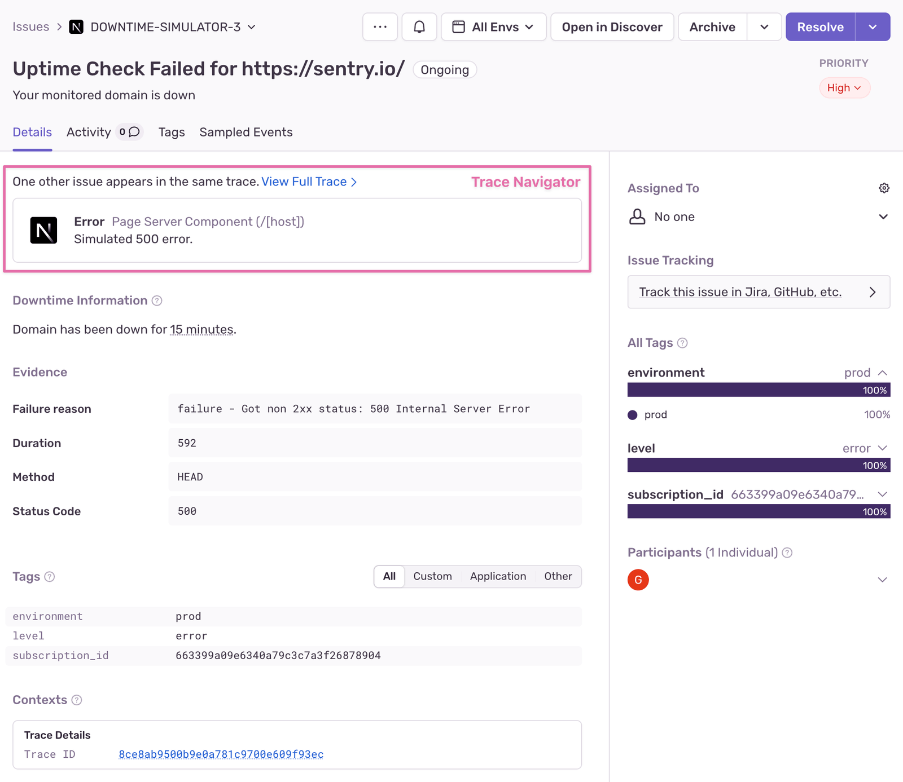

An uptime issue is a grouping of detected downtime events for a specific uptime monitor. A downtime event is generated by
active uptime monitors when HTTP requests fail to meet our
[uptime check criteria](/product/monitors-and-alerts/monitors/uptime-monitoring/#uptime-check-criteria).

## Traced Errors

Uptime checks made against web services configured with one of Sentry's supported SDKs contain a
[trace](/concepts/key-terms/tracing/) that can be used to track detected errors resulting from failed HTTP uptime checks. The trace navigator allows you to browse through potential root causes of your downtime and is a powerful tool for quickly identifying and resolving issues.

## Issue Lifecycle

Each uptime monitor has one uptime issue. Sentry creates it once the number of consecutive failed checks reaches the monitor's failure tolerance (3 by default), and resolves it once the number of consecutive successful checks reaches the recovery tolerance (1 by default). See [Thresholds](/product/monitors-and-alerts/monitors/uptime-monitoring/#thresholds). If the monitor detects downtime again, the issue's status changes to regressed.
