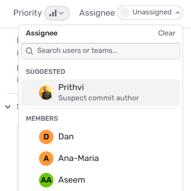
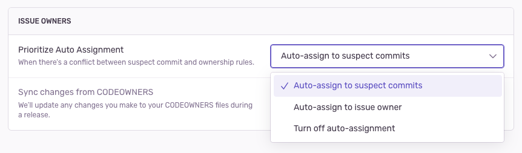

<Include name="only-error-issues-note.mdx" />

Suspect commits show you the most recent commit to the code in your [stack trace](https://sentry.io/features/stacktrace/). In the suspect commit information, we include the author of the commit and the pull request in which the commit was made.

When you've enabled suspect commits, we can tie together issues with the commits made in your code repository, including the following information:

- Files observed in the stack trace
- Files touched by those commits
- Authors of those files

Suspect commits and suggested assignees are then displayed on the **Issue Details** page in [sentry.io](https://sentry.io), as shown below.

<Arcade src="https://demo.arcade.software/XIrI8grPiEtHHSfCpCOt?embed" />

## Enable Suspect Commits

In order to see suspect commits, you have to first upload source maps, (or your platform-specific files for mapping transformed source code to the original source). Check out the docs for your [specific platform](/platforms/)) to learn more. Be aware that Sentry will not display suspect commits for issues that were created before your integration was set up.

### Connect a Repository Using Integrations

Suspect commits can be enabled using the following integrations:

- [GitHub](/integrations/source-code-mgmt/github/)
- [GitLab](/integrations/source-code-mgmt/gitlab/)

In [sentry.io](https://sentry.io):

1. Go to [**Settings > Integrations**](https://sentry.io/orgredirect/organizations/:orgslug/settings/integrations/).
1. Click the integration you’d like to use.
1. Configure the integration if you haven’t already.
1. Add the repository you'd like to use.

### Set Up Code Mappings

Suspect commits need a code mapping for each project, so Sentry can match the files in your stack traces to files in your repository. To set one up, see [Code Mappings](/integrations/source-code-mgmt/code-mappings/).

When looking at the stack trace from the top down, Sentry considers the first frame suspect. If the first frame isn't in-app, Sentry considers the next frame suspect.

## How It Works

When you have a GitHub/GitLab integration and valid [code mappings](https://blog.sentry.io/code-mappings-and-why-they-matter/), Sentry will look at the stack trace of an issue and collect all in-app frames. For each in-app frame, Sentry checks the blame info for the exact file and line number. If the most recent commit is less than 1 year old, we consider it a suspect commit.

## Suspect Commits Without Integrations

You can send us your commit data [manually](/product/releases/associate-commits/) if:

- You don’t want Sentry to connect to your repository.
- Your organization doesn't have a GitHub or Gitlab integration.
- Your integration has gotten disconnected.

Sentry will attempt to find suspect commits via your GitHub or GitLab integration by default. If this fails and you've set up the manual process, Sentry will fall back to using the release commit data to find suspect commits.

## Missing Suspect Commits

There are a few reasons why an issue might not have suspect commits:

- The issue doesn't have a stack trace or doesn't have any in-app frames.
- The stack trace doesn't have any in-app frames that match the code mappings.
- The stack trace doesn't have any in-app frames with recent commits (less than 1 year old).
- The code mappings for the project are incorrect.
- The issue was created before the integration was set up.

## Where It's Applied

Once suspect commit authors are identified, they're applied in the following ways:

### Suggested Assignees

On the **Issue Details** page, you'll see suggested assignees based on [ownership rules](/product/issues/ownership-rules/) matching the event, and suspect commits. You can manually assign the issue to a suggested assignee by selecting one from the dropdown.

### Auto-Assignment

You can automatically assign issues to their suspect commit authors by enabling the "Auto-assign to suspect commits" setting in [**\[Project\] > Settings > Ownership Rules**](https://sentry.io/orgredirect/organizations/:orgslug/settings/projects/:projectId/ownership/).

If an issue has already been assigned manually, new events will not change the current assignee. If an issue has not been assigned and a suspect commit is found, Sentry assigns it to the commit author.

## Limitations

- If auto-assignment is enabled but the suspect commit author is not in your Sentry organization, we will not be able to auto-assign the issue to them.

- Auto-assignment may be skipped if a project is creating too many new issues at a given time due to rate limits. We'll try to auto-assign it the next time an event comes in for those skipped issues. If you are encountering this limit with non-recurring issues, you may want to take a look at [issue grouping](/concepts/data-management/event-grouping/) strategies.
