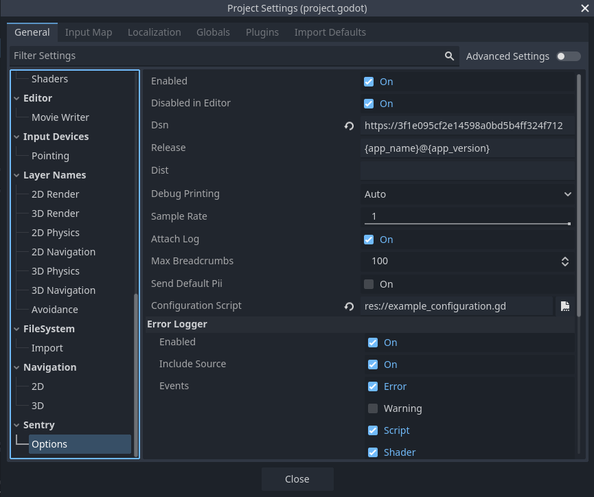

The minimum configuration required is the [DSN](/concepts/key-terms/dsn-explainer/) to your project.

To access the project settings in Godot Engine, navigate to **Project > Project Settings...**, then scroll down the sections list on the left until you find the **Sentry** section. Enter your DSN in **Sentry > Options > DSN**.

Your configuration is saved in the `project.godot` file along with other project settings. With **Auto Init** turned on (the default), the SDK initializes automatically when your game starts, before any scenes load or scripts run.
